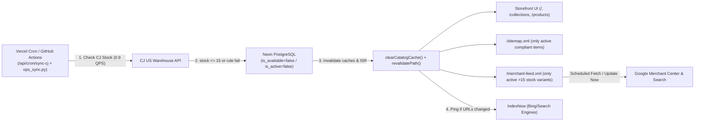

# Vastire Product Ingestion, Compliance, Pricing & Sync Pipeline Specification

> **Status:** Authoritative Production Standard  
> **Applies To:** All CJ Dropshipping product discovery (`ops_sync.py`), database curation, automated inventory/compliance synchronization (`/api/cron/sync-cj` & `.github/workflows/catalog-sync.yml`), storefront rendering (`storefront/src/lib/catalogServer.ts`), XML product feed (`/merchant-feed.xml`), and `/sitemap.xml`.  
> **Rule:** Every **new** product added from CJ Dropshipping AND every **existing** active product in Neon PostgreSQL (`products` / `product_variants`) must pass **all gates** defined in Sections 1–9. Any product or variant failing any gate is automatically deactivated (`is_active = FALSE` / `is_available = FALSE`), omitted from customer UI and checkout, and removed from `/merchant-feed.xml` and `/sitemap.xml`.

---

## 1. Fulfillment & Warehouse Boundaries (CJ Dropshipping API v2.0)

| Rule ID | Rule | Enforced Condition | Source |
|---|---|---|---|
| **WH-01** | **US Domestic Warehouse Only** | `countryCode = "US"` (`areaId = 2`). Cross-border China (`CN`) and India (`IN`) routes are permanently blocked due to ghost inventory (`cjInventoryNum == 0`), 1,789–2,404 ms auth TTFB, and 10–50 day shipping. | [`src/services/cj_client.py`](file:///c:/Users/bodha/OneDrive/Desktop/DropShipping/src/services/cj_client.py), [`docs/00_VIABILITY_AUDIT.md`](file:///c:/Users/bodha/OneDrive/Desktop/DropShipping/docs/00_VIABILITY_AUDIT.md), [`docs/04_ADR_LOG.md`](file:///c:/Users/bodha/OneDrive/Desktop/DropShipping/docs/04_ADR_LOG.md) |
| **WH-02** | **Ghost Inventory Guard (Physical Stock Only)** | Inspect `/product/stock/queryByVid` (`storageNum` / `cjInventoryNum` where `countryCode == "US"`, `areaId == 2`, or `"US"` in `warehouseName`). **Never** trust `factoryInventoryNum` or unverified synthetic/placeholder stock. | [`src/services/cj_client.py`](file:///c:/Users/bodha/OneDrive/Desktop/DropShipping/src/services/cj_client.py), [`docs/00_VIABILITY_AUDIT.md`](file:///c:/Users/bodha/OneDrive/Desktop/DropShipping/docs/00_VIABILITY_AUDIT.md) |
| **WH-03** | **Minimum Initial Ingestion Stock** | Newly discovered products must have **`>= 50` physical US warehouse units** (`startWarehouseInventory = 50`) to buffer against sell-outs between sync cycles. | [`docs/01_PRD.md`](file:///c:/Users/bodha/OneDrive/Desktop/DropShipping/docs/01_PRD.md), [`docs/04_ADR_LOG.md`](file:///c:/Users/bodha/OneDrive/Desktop/DropShipping/docs/04_ADR_LOG.md), [`src/services/cj_client.py`](file:///c:/Users/bodha/OneDrive/Desktop/DropShipping/src/services/cj_client.py) |
| **WH-04** | **Active Storefront Stock Floor (`> 15` Units)** | Every live variant exposed to customers must maintain **`us_warehouse_stock > 15`** (i.e., **minimum 16 physical US units**). Variants dropping to `<= 15` units are marked `is_available = FALSE`. If a product has **0** variants with `us_warehouse_stock > 15`, set `products.is_active = FALSE` immediately. *(Never render "Out of Stock" products in catalog grids, search, `/api/catalog`, `/merchant-feed.xml`, or `/sitemap.xml`.)* | Operational Requirement + [`storefront/src/lib/catalogServer.ts`](file:///c:/Users/bodha/OneDrive/Desktop/DropShipping/storefront/src/lib/catalogServer.ts), [`storefront/src/app/api/cron/sync-cj/route.ts`](file:///c:/Users/bodha/OneDrive/Desktop/DropShipping/storefront/src/app/api/cron/sync-cj/route.ts) |
| **WH-05** | **Static Fake-Stock Anomaly Check** | Flag any SKU reporting an unchanged round stock figure (e.g., exactly `20` or placeholder integers) across multiple consecutive syncs for manual verification against CJ. | [`docs/05_OPS_RUNBOOK.md`](file:///c:/Users/bodha/OneDrive/Desktop/DropShipping/docs/05_OPS_RUNBOOK.md) |
| **WH-06** | **Domestic 48 Contiguous US States Only** | Checkout and CJ freight validation enforce `shippingCountryCode = "US"` within the **48 Contiguous US States + DC** (AK, HI, PR/GU/VI/AS/MP territories, and APO/FPO/DPO military ZIPs are blocked). | [`storefront/src/lib/usAddressValidation.ts`](file:///c:/Users/bodha/OneDrive/Desktop/DropShipping/storefront/src/lib/usAddressValidation.ts), [`storefront/src/app/api/orders/paypal/capture/route.ts`](file:///c:/Users/bodha/OneDrive/Desktop/DropShipping/storefront/src/app/api/orders/paypal/capture/route.ts) |

---

## 2. Domestic Shipping, Carriers & Delivery SLA

| Rule ID | Rule | Enforced Condition | Source |
|---|---|---|---|
| **DL-01** | **US-to-US Freight Calculation** | Query CJ `POST /logistic/freightCalculate` with `startCountryCode = "US"`, `endCountryCode = "US"`, `zip = "90001"` (or customer ZIP), `products = [{ vid, quantity: 1 }]`. | [`src/services/cj_client.py`](file:///c:/Users/bodha/OneDrive/Desktop/DropShipping/src/services/cj_client.py), [`docs/00_VIABILITY_AUDIT.md`](file:///c:/Users/bodha/OneDrive/Desktop/DropShipping/docs/00_VIABILITY_AUDIT.md) |
| **DL-02** | **Exact Carrier String (`logisticName`)** | Store and pass the **exact** `logisticName` returned by `/logistic/freightCalculate` (or fallback `"USPS US to US"` only for validated USPS domestic routes). **Never** hardcode generic carrier names blindly when dispatching orders. | [`docs/00_VIABILITY_AUDIT.md`](file:///c:/Users/bodha/OneDrive/Desktop/DropShipping/docs/00_VIABILITY_AUDIT.md) (Trap 3), [`storefront/src/lib/cjClient.ts`](file:///c:/Users/bodha/OneDrive/Desktop/DropShipping/storefront/src/lib/cjClient.ts) |
| **DL-03** | **Delivery Transit Cap (`<= 7` Days Max)** | Parse max transit days from `logisticAging`. **Hard cap:** `max_delivery_days <= 7` business days (`3-5 Days` preferred for USPS Ground Advantage storefront promise). Reject any SKU whose fastest US domestic tracked option exceeds 7 days. | [`src/services/cj_client.py`](file:///c:/Users/bodha/OneDrive/Desktop/DropShipping/src/services/cj_client.py), [`docs/00_VIABILITY_AUDIT.md`](file:///c:/Users/bodha/OneDrive/Desktop/DropShipping/docs/00_VIABILITY_AUDIT.md), [`docs/01_PRD.md`](file:///c:/Users/bodha/OneDrive/Desktop/DropShipping/docs/01_PRD.md) |
| **DL-04** | **True Freight Cost Inclusion** | Record actual `logisticPrice` as `shipping_cost` per variant. Because Vastire promises `$0.00` Free Shipping at checkout, `actual_us_shipping_cost` **must** be added into `COGS = wholesale_cost + shipping_cost` before margin calculation. Never silently assume `$0.00` freight unless CJ freight calculation confirms `$0.00` bundled domestic shipping. | [`src/models/database.py`](file:///c:/Users/bodha/OneDrive/Desktop/DropShipping/src/models/database.py), [`ops_sync.py`](file:///c:/Users/bodha/OneDrive/Desktop/DropShipping/ops_sync.py) |

---

## 3. CJ Dropshipping API Safety & Order Fulfillment Contracts

| Rule ID | Rule | Enforced Condition | Source |
|---|---|---|---|
| **API-01** | **0.9 QPS Token-Bucket Rate Limit** | Space all CJ API calls via a thread-safe token bucket (`<= 0.75–0.9 QPS`, `>= 1.11s` spacing). If HTTP `429` or CJ code `1600200` (silent empty return rate limit) occurs, sleep `3.0s` and retry; **never** treat silent empty `1600200` responses as zero stock. | [`src/services/cj_client.py`](file:///c:/Users/bodha/OneDrive/Desktop/DropShipping/src/services/cj_client.py), [`docs/00_VIABILITY_AUDIT.md`](file:///c:/Users/bodha/OneDrive/Desktop/DropShipping/docs/00_VIABILITY_AUDIT.md) (Trap 2) |
| **API-02** | **Fail-Safe Auth / Outage Guard on Sync** | If `getAccessToken` fails (e.g., error `1600005` or network timeout), abort stock mutation immediately with telemetry error. **Never** mark active products out of stock due to an auth/network failure. | [`storefront/src/app/api/cron/sync-cj/route.ts`](file:///c:/Users/bodha/OneDrive/Desktop/DropShipping/storefront/src/app/api/cron/sync-cj/route.ts) |
| **API-03** | **Order Routing `fromCountryCode` + `payType=3`** | `createOrderV2` must explicitly inject `"fromCountryCode": "US"` and `"payType": "3"`. | [`docs/00_VIABILITY_AUDIT.md`](file:///c:/Users/bodha/OneDrive/Desktop/DropShipping/docs/00_VIABILITY_AUDIT.md) (Trap 3), [`storefront/src/lib/cjClient.ts`](file:///c:/Users/bodha/OneDrive/Desktop/DropShipping/storefront/src/lib/cjClient.ts) |
| **API-04** | **`logisticsMiss` Defensive Gate** | On every `createOrderV2` response, assert `code == 200 AND data.logisticsMiss == False AND data.postageAmount > 0`. If violated, quarantine to `MANUAL_REVIEW_DLQ` / `FULFILLMENT_FAILED` and trigger PayPal refund. | [`docs/00_VIABILITY_AUDIT.md`](file:///c:/Users/bodha/OneDrive/Desktop/DropShipping/docs/00_VIABILITY_AUDIT.md) (Trap 1), [`src/services/order_router.py`](file:///c:/Users/bodha/OneDrive/Desktop/DropShipping/src/services/order_router.py), [`storefront/src/lib/cjClient.ts`](file:///c:/Users/bodha/OneDrive/Desktop/DropShipping/storefront/src/lib/cjClient.ts) |
| **API-05** | **Order Idempotency (`1603003`)** | Always pass deterministic `orderNumber`. Treat CJ code `1603003` ("Order exist, please do not duplicate create") as an **idempotent success** and look up via `getOrderDetail` / `order/list`. | [`docs/00_VIABILITY_AUDIT.md`](file:///c:/Users/bodha/OneDrive/Desktop/DropShipping/docs/00_VIABILITY_AUDIT.md) (Trap 4), [`storefront/src/lib/cjClient.ts`](file:///c:/Users/bodha/OneDrive/Desktop/DropShipping/storefront/src/lib/cjClient.ts) |

---

## 4. Category Governance, Prohibited Products & Third-Party Brand Rules

Every candidate product must pass a **Strict Double-Gate** (Zero Blocklist Hits **AND** Positive Whitelist Match) evaluated against raw CJ title, cleaned title, category string, variant labels, and description.

### 4.1 Approved Verticals (Positive Whitelist)

Only products in these 5 Vastire categories and matching `APPROVED_THEMES` are eligible:
1. **`Home & Kitchen`** (storage, pantry/bath organizers, kitchen prep utensils, drinkware, household hardware — excluding wearables/cosmetics)
2. **`Workspace & Tech`** (desk stands, cable management, chargers, hubs, cooling fans, tablet cases, desk clocks)
3. **`Smart Lighting`** (LED desk lamps, night lights, backlit clocks, solar step/lantern lights — **no** third-party trademarked bulbs)
4. **`Outdoor & Patio`** (camping lanterns/tents, hiking packs, portable grills, garden fabric/aerators, patio lighting)
5. **`Everyday Carry & Auto`** (car phone mounts, backseat organizers, car vacuums, key holders, pocket tools — **no** chemical sprays/aerosols)

### 4.2 Hard Blocklist — Prohibited Categories & Keywords (`PROHIBITED_WORDS`)

Zero human override. Evaluated using word-boundary regex `\b<term>(s|es|ies)?\b`:

1. **Facial, Skincare, Beauty Devices, Cosmetics & Topicals** *(FDA 21 CFR Part 700 & PayPal/Stripe underwriting freeze risk)*:
   - `facial`, `blackhead`, `pore`, `cleansing strip`, `cleanser`, `skincare`, `cosmetic`, `beauty device`, `microcurrent`, `cream`, `serum`, `collagen`, `lotion`, `gel`, `moisturizer`, `patch`, `oil`, `mask`, `whitening`, `anti-aging`, `anti aging`, `slimming`, `butt`, `breast`, `eyelash`, `acne`, `hair removal`, `teeth`, `tooth`, `shampoo`, `soap`, `deodorant`, `nail`, `nails`, `eyeshadow`, `lipstick`, `perfume`, `parfum`, `fragrance oil`, `body spray`, `pet wipes`, `wet wipes`, `grooming wipes`.
2. **Ingestibles, Supplements & Medical Devices**:
   - `capsule`, `pill`, `supplement`, `vitamin`, `tea`, `gummy`, `gummies`, `diet`, `keto`, `drop`, `drops`, `snore`, `snoring`, `booster`, `testosterone`, `formula`.
3. **Multi-Size Apparel, Footwear & Worn Jewelry** *(25–35% sizing return rate wipes out dropship unit economics)*:
   - `shirt`, `t-shirt`, `tshirt`, `hoodie`, `shoes`, `shoe`, `sneaker`, `dress`, `pants`, `trousers`, `cargo pants`, `romper`, `jumpsuit`, `bra`, `underwear`, `clothing`, `jacket`, `coat`, `shorts`, `sweater`, `skirt`, `socks`, `sock`, `leggings`, `swimsuit`, `swimwear`, `boots`, `boot`, `sandals`, `sandal`, `heels`, `blouse`, `jeans`, `jean`, `denim`, `fleece`, `vest`, `robe`, `lingerie`, `scarf`, `tights`, `pantyhose`, `suit`, `jewelry making`, `earring`, `necklace`, `bracelet`, `ring`. *(Note: ultrasonic appliance cleaners for glasses/jewelry are allowed when explicitly appliance/cleaner hardware.)*
4. **Chemicals, Aerosols & Hazardous Sprays**:
   - `rust remover spray`, `brake cleaner`, `cleaner spray`, `aerosol`, `chemical spray`, `iron powder`.
5. **Tiles, Wall Stickers, Bulky Furniture & High-Liability Electronics**:
   - `tile`, `tiles`, `wallpaper`, `flooring`, `wall sticker`, `seashell`, `pyramid`, `chair`, `folding desk`, `computer desk`, `standing desk`, `sofa`, `couch`, `mattress`, `bed`, `wardrobe`, `furniture`, `luggage cart`, `luggage`, `suitcase`, `wagon`, `trolley`, `smartphone`, `drone`, `television`.

### 4.3 Third-Party Brand & Trademark Exclusion (`THIRD_PARTY_BRANDS`)

- Storefront & Google Merchant Feed advertise `brand = "Vastire"`. **Never** ingest or keep products carrying recognizable third-party brand trademarks printed on packaging or titles (Google Merchant Center `Counterfeit / Brand Mismatch` risk).
- **Blocked Brand Tokens (Case-Insensitive Word Boundary):**
  `SANSI`, `OUHOE`, `Rayhong`, `Yegbong`, `Kegani`, `EELHOE`, `West&Month`, `Hoker`, `VEVOR`, `Dowmoo`, `Cifbuy`, `Anker`, `Xiaomi`, `Baseus`, `Ugreen`, `Philips`, `Sony`, `Apple`, `Samsung`.

---

## 5. Pricing, Amazon Benchmark & Minimum Profit Formulas

All retail prices must simultaneously satisfy **Competitive Amazon Positioning**, **PayPal Fee + RTO Coverage**, and **Minimum Profit Floors**.

### 5.1 Cost & Deduction Equations

$$\text{COGS} = C_{\text{wholesale}} + C_{\text{shipping}}$$
$$\text{PayPal\_Fee} = \operatorname{ROUND}((0.0349 \times P_{\text{retail}}) + 0.49,\ 2)$$
$$\text{RTO\_Buffer} = \operatorname{ROUND}(0.08 \times P_{\text{retail}},\ 2)$$
$$\text{Net\_Profit} = \operatorname{ROUND}\big(P_{\text{retail}} - (\text{COGS} + \text{PayPal\_Fee} + \text{RTO\_Buffer}),\ 2\big)$$
$$\text{Net\_Margin\_\%} = \operatorname{ROUND}\left(\frac{\text{Net\_Profit}}{P_{\text{retail}}} \times 100,\ 2\right)$$
$$\text{Gross\_Margin\_\%} = \operatorname{ROUND}\left(\frac{P_{\text{retail}} - \text{COGS}}{P_{\text{retail}}} \times 100,\ 2\right)$$

### 5.2 Wholesale Bounds & Baseline Markup Engine

1. **Candidate Wholesale Bounds (Single-Unit Discovery):**
   - Core automated discovery target: `$3.00 <= C_wholesale <= $22.00` (with `$25.00` typical soft ceiling; higher-priced multi-piece sets allowed only if proportional Amazon comparison and strict net margin pass).
2. **Dynamic Tiered Markup Formula (`calculate_pricing` in [`src/models/database.py`](file:///c:/Users/bodha/OneDrive/Desktop/DropShipping/src/models/database.py)):**
   - If $\text{COGS} \le \$8.00$: $P_{\text{raw}} = \operatorname{ROUND}(\text{COGS} \times 3.5,\ 2) - 0.01$
   - If $\$8.00 < \text{COGS} \le \$18.00$: $P_{\text{raw}} = \operatorname{ROUND}(\text{COGS} \times 2.2,\ 2) - 0.01$
   - If $\text{COGS} > \$18.00$: $P_{\text{raw}} = \operatorname{ROUND}(\min(\text{COGS} \times 1.6,\ 49.99),\ 2) - 0.01$

### 5.3 Amazon US Price Comparison Engine (Option 3 Adaptive Match + `+$5` Hard Ceiling)

Every single-unit SKU is evaluated against a verified US Amazon benchmark ($P_{\text{amazon}}$) for an equivalent single unit:

1. **Case 1 — Verified Winner ($P_{\text{raw}} \le P_{\text{amazon}}$):**
   - Keep $P_{\text{retail}} = P_{\text{raw}}$ (already cheaper than Amazon). Verify profit & margin gates pass.
2. **Case 2 — Small Gap ($0 < P_{\text{raw}} - P_{\text{amazon}} \le \$5.00$):**
   - **Adaptive Match Preferred:** Set $P_{\text{match}} = \operatorname{ROUND}(P_{\text{amazon}} - 0.04,\ 2)$ (if $P_{\text{amazon}} > 10$ else $P_{\text{amazon}}$) whenever $P_{\text{match}}$ satisfies **Minimum Profit & Margin Gates** (`Net_Margin >= 20%`, `Gross_Margin >= 35%`, `Net_Profit >= $4.00`).
   - **Tolerance Fallback ($+\$5.00$ Cap):** Only if $P_{\text{match}}$ dips below target profit/margin, retain within **`P_retail <= P_amazon + $5.00`** (max gap `<= 20%` preferred, hard ceiling `<= $5.00`), provided **Minimum Profit & Margin Gates** pass.
3. **Case 3 — Overpriced ($P_{\text{raw}} > P_{\text{amazon}} + \$5.00$):**
   - Attempt adaptive reprice to $P_{\text{match}} = P_{\text{amazon}} - 0.04$ (or up to $P_{\text{amazon}} + 4.96$ only if gap `<= 20%` and gross margin `>= 35%`).
   - If $P_{\text{amazon}} - 0.04$ **passes** Minimum Profit & Margin Gates -> set $P_{\text{retail}} = P_{\text{match}}$.
   - If even $P_{\text{amazon}} + \$5.00$ **fails** Minimum Profit & Margin Gates (e.g., CJ COGS exceeds viable Amazon retail) -> **REJECT / DEACTIVATE SKU (`COMMODITY_TRAP`)**.

### 5.4 Hard Minimum Profit & Price Floor Gates

Every active variant must satisfy **all** of the following:
- **Minimum Net Profit Dollar Floor:** `Net_Profit >= $4.00` per unit (`>= $5.00` required for new `$14.99+` single-unit additions so checkout fees + domestic postage risk cannot erase profit).
- **Minimum Strict Net Margin:** **`Net_Margin_% >= 20.0%`** (after PayPal `3.49% + $0.49` and `8.0%` RTO buffer). Target catalog blended average: `>= 35%–48%` net.
- **Minimum Gross Margin vs Amazon Match:** **`Gross_Margin_% >= 35.0%`** when matching or capping near Amazon pricing.
- **Multi-Variant Parity Rule:** Multi-piece / multi-pack variants on a product must also pass `Net_Margin_% >= 20.0%` (`is_available = FALSE` for any bloated block/set variant falling under 20% net margin, such as high-ticket knife sets where wholesale absorbs > 70% of price) and **never** have mismatched supplier 10-pack wholesale priced as a single-unit variant.

### 5.5 Volume Bundle Tier Equations

- **1x Standard Unit:** `retail_price_1x`
- **2x Value Bundle ("Save 12%"):** `bundle_2_price = ROUND(retail_price_1x * 2.0 * 0.88, 2) - 0.01`
- **3x Pro Bundle ("Save 18%"):** `bundle_3_price = ROUND(retail_price_1x * 3.0 * 0.82, 2) - 0.01`
- Bundles exploit `$0` incremental US domestic freight and must keep positive order net margin `>= 20%`.

---

## 6. Titles, Media, Variants, Specifications & Copy Quality Gates

| Rule ID | Rule | Enforced Condition |
|---|---|---|
| **QA-01** | **Clean Consumer Title (4–8 Words)** | Strip HTML, Chinese characters (`\u4e00-\u9fff`), SKU/model codes (`[A-Z0-9]{8,}`, `01az`), and spam tokens (`Wholesale`, `Factory Direct`, `Amazon Hot`, `Hot Sale`, `New Arrival`, `Ready to Ship`, `VEVOR`, `US Plug/Spec/Standard`). Deduplicate repeated adjacent words; title-case cleanly while uppercasing `LED`, `LCD`, `USB`, `US`, `RGB`, `EDC`, `HUD`, `UV`. Zero third-party brand tokens. |
| **QA-02** | **Clean Canonical SEO Slug & 301 Map** | Generated via [`toSeoProductSlug`](file:///c:/Users/bodha/OneDrive/Desktop/DropShipping/storefront/src/lib/slugUtils.js) from the clean consumer title (`a-z0-9-`), deduplicated on collision, while preserving `legacy_slug` for CDN `301` redirects in [`next.config.js`](file:///c:/Users/bodha/OneDrive/Desktop/DropShipping/storefront/next.config.js). |
| **QA-03** | **Multi-Image Gallery (`>= 2` Images)** | Require **at least 2 valid HTTPS images** (`http://` normalized to `https://`, target 3–6 images). Reject products relying on `/placeholder.jpg` or missing hero/variant photos. |
| **QA-04** | **Human-Readable Variant Labels** | Raw supplier keys (`1PC`, `Beige-Us-1PCS`, `White-1PC`) must map to clean `display_name` values while retaining raw `variant_name` / `vid` / `sku` for CJ API fulfillment. Never misparse substrings like `USB` / `US` as apparel size `S`. |
| **QA-05** | **Required Specifications (`specs_json`)** | Non-empty `specs_json` object containing truthful, garble-free keys (`Material`, `Power Source` / `Build`, `Package Weight`, `In the Box`) with **zero** CJ dot/character encoding artifacts (`·` garble) and **zero** medical/false warranty claims. |
| **QA-06** | **Benefits, PAS Copy & FAQs** | Minimum **4** benefit objects in `features_json`, clean sanitized `pas_description_html` (Problem–Agitation–Solution, replacing `"money-back guarantee"` with `"30-day defect replacement & return support"` in feeds/schemas), and **4+** product-specific entries in `faq_schema_json`. |

---

## 7. Zero-Out-of-Stock Storefront & Automated Google Sync Architecture

1. **No Out-of-Stock Products Rendered Anywhere to Shoppers:**
   - [`catalogServer.ts`](file:///c:/Users/bodha/OneDrive/Desktop/DropShipping/storefront/src/lib/catalogServer.ts) filters every query (`is_active = TRUE` AND `is_available = TRUE` AND `us_warehouse_stock > 15`). If 0 compliant variants remain on a product, the entire product is omitted from UI, `/api/catalog`, `/sitemap.xml`, and `/merchant-feed.xml`.
   - [`products/[slug]/page.tsx`](file:///c:/Users/bodha/OneDrive/Desktop/DropShipping/storefront/src/app/products/%5Bslug%5D/page.tsx) resolves directly via [`getAuthoritativeProductBySlug`](file:///c:/Users/bodha/OneDrive/Desktop/DropShipping/storefront/src/lib/catalogServer.ts) on SSR (eliminating stale `seedCatalog.json` mismatches and 2-second loopback timeouts that showed `"This item is currently out of stock."` for DB-only items). Any deactivated product returns HTTP `404` (`notFound()`).
   - [`pricing.ts`](file:///c:/Users/bodha/OneDrive/Desktop/DropShipping/storefront/src/lib/pricing.ts) blocks checkout (`400 UNAVAILABLE_VARIANT`) if `is_active = FALSE`, `is_available = FALSE`, or `us_warehouse_stock <= 15`.
2. **Automated End-to-End Sync & Feed Refresh:**
   - **Vercel Scheduled Cron (`/api/cron/sync-cj`)**: Syncs CJ order tracking, runs time-budgeted live CJ US stock checks (`stock > 15`), disables low-stock/non-compliant variants & products in Neon PostgreSQL, flushes `clearCatalogCache()` + `clearPricingCache()`, revalidates `/`, `/collections/[slug]`, `/products/[slug]`, `/sitemap.xml`, and `/merchant-feed.xml`, and optionally submits changed URLs to IndexNow.
   - **GitHub Actions Cron (`.github/workflows/catalog-sync.yml`)**: Runs every 6 hours without Vercel's 60-second execution limit to audit full CJ inventory (`ops_sync.py --sync-stock`), enforce compliance rules in Neon PostgreSQL, and trigger `POST https://vastire.com/api/cron/sync-cj?mode=revalidate`.
   - **Google Merchant Center & Search Console**: Because GMC consumes `https://vastire.com/merchant-feed.xml` as a scheduled primary XML feed and Search Console indexes `https://vastire.com/sitemap.xml`, revalidating both routes immediately upon DB deactivation guarantees automatic removal/delisting on Google's next scheduled fetch without manual edits.
