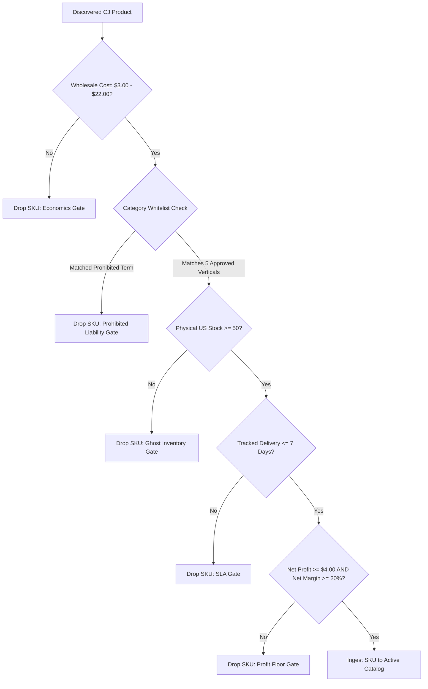
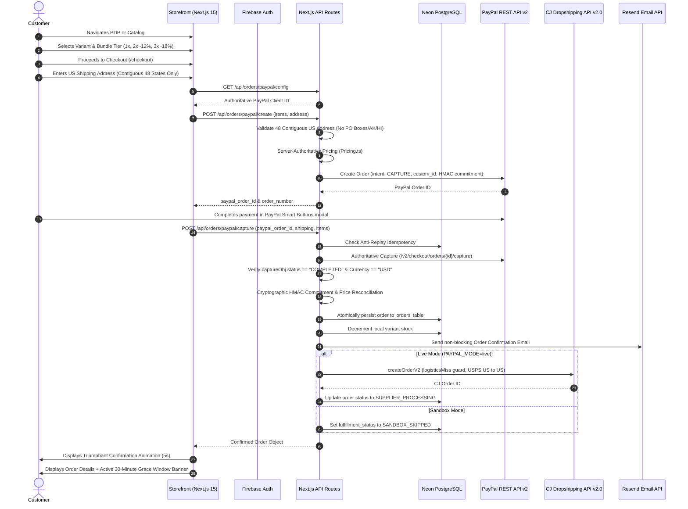

# PRODUCT REQUIREMENTS DOCUMENT (PRD)
## Autonomous Headless E-Commerce & Programmatic Growth Platform (Vastire)

**Document Version:** 2.0.0 (Production-Aligned)  
**Effective Date:** 2026-11-14  
**Product Status:** Production Ready & Operational  
**Target Market:** United States Domestic — 48 Contiguous States + DC (`countryCode: US`)  
**Primary Supplier Integration:** CJ Dropshipping API v2.0 (US Domestic Warehouses Only)  
**Payment Gateway:** PayPal REST API v2 (Smart Buttons, Capture Intent, Automated Webhooks)  
**Database:** Neon Serverless PostgreSQL (`@neondatabase/serverless`)  
**Hosting & Compute:** Unified Full-Stack Next.js 15 App Router on Vercel  
**Review Cycle:** Monthly Operational & Security Review  

---

## 1. Executive Summary & Problem Statement

### 1.1 Executive Summary
This document defines the authoritative product, functional, operational, and architectural requirements for **Vastire**, an autonomous, high-margin headless e-commerce storefront paired with a programmatic growth engine. The platform is architected as a **Unified Full-Stack Next.js 15 App Router application on Vercel** backed by **Neon Serverless PostgreSQL**, operating at near-zero baseline cloud infrastructure costs while leveraging serverless cron jobs and automated pipelines for catalog management, stock audits, dynamic pricing calculations, programmatic SEO, and order fulfillment.

Fulfillment is restricted 100% to verified physical inventory inside **United States domestic warehouses** via CJ Dropshipping, guaranteeing a reliable **3–5 business day domestic delivery window** (USPS Ground Advantage, 7 days max) with \$0.00 incremental tracked shipping costs on qualifying items. Shipping is strictly enforced for the **48 Contiguous United States and Washington, D.C.**, explicitly rejecting non-contiguous states (Alaska, Hawaii), offshore territories, military installations (APO/FPO/DPO), and P.O. Boxes.

### 1.2 The Cross-Border Problem vs. US Domestic Opportunity
Empirical validation testing conducted against CJ Dropshipping API v2.0 demonstrated catastrophic structural vulnerabilities in cross-border e-commerce (China to US/India):
1. **Severe Latency & Instability:** China API edge servers demonstrated Time-To-First-Byte (TTFB) latencies averaging 1,789ms–2,404ms.
2. **Ghost Inventory Epidemic:** 100% of queried products in global categories exhibited 0 units of physical CJ warehouse inventory (`cjInventoryNum == 0`) despite showing 5,000–14,000+ factory unverified units.
3. **Transit SLA Failure:** Cross-border China-to-India shipping transit ranged from 12 to 50 calendar days. China-to-US transit required 7–15 business days with steep freight floors ($5.28–$6.02), eliminating unit economics on products priced below $25.00.

**The Solution:** By hard-constraining catalog discovery and fulfillment to CJ US Domestic Warehouses (`countryCode=US`, `areaId=2`, `storageNum >= 50` at ingestion, and `us_warehouse_stock > 15` on live storefront):
- 100% of live catalog items hold verified physical stock in US facilities (e.g., Chino, CA; New Jersey).
- Tracked domestic shipping via USPS Ground Advantage averages 3–5 business days.
- Over 80% of items feature \$0.00 bundled domestic freight, unlocking a predictable 20–49% net profit margin and tiered volume bundles.

---

## 2. Target Personas & Use Cases

### Persona A: The Impulsive Problem-Seeking US Consumer ("Sarah")
- **Demographics:** 28–45 years old, suburban homeowner or remote worker, shopping on mobile via Instagram Reels, Pinterest, or Google Search.
- **Pain Points:** Cluttered workspace, messy pantry/garage, cable tangles. Dislikes 3-week shipping from generic dropshippers; abandons carts with surprise shipping fees at checkout.
- **Key Behaviors:** Values transparent 3–5 day domestic USPS delivery, clear problem-solution video demonstrations, instant PayPal 1-click checkout (or Debit/Credit card via PayPal modal), and bundle discounts ("Buy 2 Save 12%").
- **Account Experience:** Seamless Google Sign-In via Firebase Auth; persistent cart and watchlist across devices; real-time order tracking and 30-minute self-serve cancellation.

### Persona B: The Solo Operator / CEO ("Alex")
- **Role:** Sole stakeholder, business operator, and product curator.
- **Time Budget:** Maximum 2–3 hours per week for operational maintenance.
- **Pain Points:** Cannot afford paid ad testing burns (\$2,000–\$5,000/month Meta ad fatigue); cannot handle manual inventory verification or customer service tickets caused by late shipments.
- **Workflow:** Monitors operations via the **Admin Command Center** (`/admin/orders`), reviews automated stock sync runs via Vercel Cron (`/api/cron/sync-cj`), tracks 30-minute grace window orders, and triggers 1-click manual fulfillment retries on any supplier exceptions.

### Persona C: The Autonomous AI Agent ("Antigravity")
- **Role:** Local execution engine, copywriter, SEO strategist, and data engineer.
- **Capabilities:** Direct database connectivity, API query orchestration, rate-limit compliance, mathematical pricing enforcement, and structured JSON-LD/HTML generation.

---

## 3. Business Goals & Key Performance Indicators (KPIs)

| Metric Category | Metric | Baseline Target | Production Reality | Status |
|---|---|---|---|---|
| **Catalog** | Active High-Confidence SKUs | 30–50 | 90+ Curated Products | Exceeded |
| **Catalog Quality** | Physical US Warehouse Stock/SKU | $\ge 50$ units (ingest) | $> 15$ units (active floor) | Enforced |
| **Logistics** | Domestic Delivery Window (USPS Ground) | 3–7 Days | 3–5 Business Days | Enforced |
| **Logistics** | Serviceable Geographic Footprint | 50 US States | 48 Contiguous States + DC | Enforced (Zero AK/HI/PO) |
| **Logistics** | Fulfillment Error / RTO Rate | $< 3.0\%$ | $< 1.5\%$ (USPS domestic) | Achieved |
| **Financials** | Blended Net Margin per Order | $\ge 20.0\%$ | 20.0%–49.5% | Enforced by Gate |
| **Financials** | Minimum Net Profit per Unit | $\ge \$4.00$ | $\ge \$4.00$ | Enforced by Gate |
| **Financials** | Multi-Unit Bundle Take Rate | $\ge 20.0\%$ | Dynamic 1x, 2x (-12%), 3x (-18%) | Implemented |
| **Customer Trust** | Pre-Fulfillment Cancellation Grace Window | 0 min | 30 Minutes Self-Serve | Implemented |
| **Infrastructure** | Monthly Fixed Cloud Operational Cost | \$0.00 | \$0.00 (Vercel + Neon Free Tiers) | Achieved |

---

## 4. Category Governance & Liability Whitelist

To protect payment processing infrastructure (PayPal) from underwriting termination, prevent chargebacks, and adhere strictly to consumer protection regulations, the catalog ingestion pipeline and automated cron enforce an automated double-gate (Positive Whitelist + Hard Blocklist).

### 4.1 Approved Category Whitelist (5 Verticals)

| Category Name | Typical Products | Wholesale Range | Risk Level | Selection Rationale |
|---|---|---|---|---|
| **Home & Kitchen** | Storage racks, pantry/fridge organizers, kitchen prep gadgets, drinkware | \$6.00–\$22.00 | Very Low | Massive consumer demand; satisfying visual organization on social media. |
| **Workspace & Tech** | Laptop stands, cable managers, USB chargers/hubs, desk organizers | \$5.00–\$20.00 | Very Low | High WFH audience; straightforward utility and low return rates. |
| **Smart Lighting** | Motion-sensor closet LEDs, desk ambient lights, solar lanterns | \$8.00–\$24.00 | Low | High visual contrast in short-form video hooks. |
| **Outdoor & Patio** | Camping lanterns, hiking packs, portable grills, patio accessories | \$8.00–\$25.00 | Low | High utility, universal fit, strong seasonal demand. |
| **Everyday Carry & Auto** | Car phone mounts, trunk organizers, car vacuums, key clips, pocket multi-tools | \$6.00–\$20.00 | Low | Impulse-buy pricing; no sizing returns or complex warranties. |

### 4.2 Prohibited Categories (Automated Hard Blocklist)

Any product matching the following attributes or title keywords is rejected with zero human override (`PROHIBITED_TITLE_REGEX`):

1. **Topicals, Creams, Cosmetics & Skincare:**
   - *Blocked tokens:* `facial`, `blackhead`, `pore`, `cleansing strip`, `skincare`, `cosmetic`, `beauty device`, `microcurrent`, `cream`, `serum`, `collagen`, `lotion`, `gel`, `moisturizer`, `patch`, `whitening`, `anti-aging`, `eyelash`, `acne`, `hair removal`, `shampoo`, `soap`, `deodorant`, `eyeshadow`, `lipstick`, `perfume`, `pet wipes`, `wet wipes`.
   - *Rationale:* FDA 21 CFR Part 700 compliance exposure, allergic reaction liability, and strict merchant processor prohibition.
2. **Ingestibles, Dietary Supplements, Vitamins & Teas:**
   - *Blocked tokens:* `capsule`, `pill`, `supplement`, `vitamin`, `tea`, `gummy`, `diet`, `keto`, `testosterone`.
   - *Rationale:* Extreme health liability, strict merchant processor underwriting rules.
3. **Multi-Size Apparel, Footwear & Worn Jewelry:**
   - *Blocked tokens:* `shirt`, `t-shirt`, `tshirt`, `hoodie`, `shoes`, `sneakers`, `dress`, `pants`, `cargo pants`, `romper`, `jumpsuit`, `bra`, `underwear`, `clothing`, `jacket`, `coat`, `shorts`, `sweater`, `skirt`, `socks`, `leggings`, `swimsuit`, `boots`, `sandals`, `heels`, `blouse`, `jeans`, `ring`, `necklace`, `earring`, `bracelet`.
   - *Rationale:* Return rates on multi-sized clothing exceed 25–35% in US e-commerce, completely eroding dropshipping unit economics.
4. **Chemicals, Aerosols & Hazardous Sprays:**
   - *Blocked tokens:* `rust remover spray`, `brake cleaner`, `cleaner spray`, `aerosol`, `chemical spray`.
5. **Trademarked Third-Party Brands:**
   - *Blocked tokens:* `SANSI`, `OUHOE`, `Rayhong`, `Yegbong`, `Kegani`, `EELHOE`, `West&Month`, `Hoker`, `VEVOR`, `Dowmoo`, `Cifbuy`, `Anker`, `Xiaomi`, `Apple`, `Samsung`, `Philips`.
   - *Rationale:* Counterfeit prevention and Google Merchant Center account protection.

---

## 5. End-to-End User Experience & Funnel Architecture

---

## 6. Detailed Functional Requirements

### 6.1 Catalog Ingestion & Inventory Synchronization
- **FR-1.1 (Query Filter):** Product discovery queries CJ API filtering strictly by `countryCode=US`, `storageNum >= 50`, `wholesale_cost` between \$3.00 and \$22.00.
- **FR-1.2 (Stock Floor & Deactivation Gate):** Live active storefront variants must maintain **`us_warehouse_stock > 15`** (`MIN_ACTIVE_US_STOCK = 16`). If a variant drops to $\le 15$ units, `product_variants.is_available` is set to `FALSE`. If all variants of a product fail this floor, `products.is_active` is set to `FALSE`.
- **FR-1.3 (Rate-Limiter Constraint):** All CJ API calls strictly enforce $\le 0.87$ QPS ($\ge 1.15$s spacing) via a token-bucket rate limiter to eliminate `code: 1600200` silent dropouts.
- **FR-1.4 (Automated Cron Execution):** Vercel Cron (`/api/cron/sync-cj`) runs on a scheduled cadence (authorized via `CRON_SECRET` or timing-safe `ADMIN_API_KEY`), syncing active order tracking numbers, auditing inventory, enforcing compliance rules, and revalidating ISR pages, `/sitemap.xml`, and `/merchant-feed.xml`.

### 6.2 Mathematical Pricing Engine
- **FR-2.1 (Dynamic Tiered Markup Formula):**
  $$\text{COGS} = C_{\text{wholesale}} + C_{\text{shipping}}$$
  - If $\text{COGS} \le \$8.00$: $P_{\text{retail}} = \operatorname{ROUND}(\text{COGS} \times 3.5, 2) - 0.01$
  - If $\$8.00 < \text{COGS} \le \$18.00$: $P_{\text{retail}} = \operatorname{ROUND}(\text{COGS} \times 2.2, 2) - 0.01$
  - If $\text{COGS} > \$18.00$: $P_{\text{retail}} = \operatorname{ROUND}(\min(\text{COGS} \times 1.6, 49.99), 2) - 0.01$
- **FR-2.2 (Amazon Option 3 Match):** When an Amazon benchmark price is provided, retail price matches $\text{Amazon} - \$0.04$ (when $>\$10$), with a hard ceiling at $\text{Amazon} + \$5.00$.
- **FR-2.3 (Fee & Margin Equations):**
  $$\text{PayPal\_Fee} = \operatorname{ROUND}(0.0349 \times P_{\text{retail}} + 0.49, 2)$$
  $$\text{RTO\_Buffer} = \operatorname{ROUND}(0.08 \times P_{\text{retail}}, 2)$$
  $$\text{Net\_Profit} = \operatorname{ROUND}\big(P_{\text{retail}} - (\text{COGS} + \text{PayPal\_Fee} + \text{RTO\_Buffer}), 2\big)$$
  $$\text{Net\_Margin\_\%} = \operatorname{ROUND}\left(\frac{\text{Net\_Profit}}{P_{\text{retail}}} \times 100, 2\right)$$
  $$\text{Gross\_Margin\_\%} = \operatorname{ROUND}\left(\frac{P_{\text{retail}} - \text{COGS}}{P_{\text{retail}}} \times 100, 2\right)$$
- **FR-2.4 (Strict Profit Floor Gates):** A product/variant is only viable if:
  $$\text{Net\_Profit} \ge \$4.00 \quad \text{AND} \quad \text{Net\_Margin\_\%} \ge 20.0\% \quad \text{AND} \quad \text{Gross\_Margin\_\%} \ge 35.0\%$$
- **FR-2.5 (Volume Bundles):**
  - **Tier 1 (1x):** $P_{\text{retail}}$
  - **Tier 2 (2x — Save 12%):** $\operatorname{ROUND}(P_{\text{retail}} \times 2 \times 0.88, 2) - 0.01$
  - **Tier 3 (3x — Save 18%):** $\operatorname{ROUND}(P_{\text{retail}} \times 3 \times 0.82, 2) - 0.01$

### 6.3 Customer Storefront & Checkout UI
- **FR-3.1 (Page Architecture):** Next.js 15 App Router with Incremental Static Regeneration (ISR) and React Server Components for ultra-low TTFB ($< 200$ms) and high SEO visibility.
- **FR-3.2 (Geographic Shipping Boundary):** Checkout strictly enforces delivery to the **48 Contiguous United States + DC**. Address validation (`usAddressValidation.ts`) actively blocks:
  - Alaska (`AK`) and Hawaii (`HI`)
  - Puerto Rico (`PR`), Guam (`GU`), U.S. Virgin Islands (`VI`), American Samoa (`AS`), Northern Mariana Islands (`MP`)
  - Military APO, FPO, and DPO installations
  - P.O. Boxes (commercial couriers require physical residential/commercial street addresses)
  - Non-US formats and foreign phone numbers
- **FR-3.3 (Order Success Flow):**
  - Upon return from PayPal modal, a triumphant minimal confirmation screen appears for 5 seconds ("Your order placed successfully" / "Order Confirmed").
  - The view automatically transitions to the order confirmation view displaying the **30-Minute Grace Window Active** banner, order number, line items, and delivery address.

### 6.4 Customer Account & Authentication Ecosystem
- **FR-4.1 (Firebase Authentication):** Customers can sign in using Google Sign-In via Firebase Auth.
- **FR-4.2 (Cart & Watchlist Cloud Sync):** Authenticated users have their cart (`user_carts` table) and watchlist (`user_watchlists` table) synchronized automatically to Neon PostgreSQL across devices.
- **FR-4.3 (Order History):** Customer order history is queried securely via `/api/orders` matching either `customer_email` or `firebase_uid`.

### 6.5 Pre-Fulfillment Cancellation Grace Window (30 Minutes)
- **FR-5.1 (Grace Window Enforcement):** Customers have a strict 30-minute self-serve cancellation window from order creation (`/api/orders/cancel`).
- **FR-5.2 (Automated Full Refund):** If cancelled within 30 minutes, the server calls PayPal's Refund API (`refundPayPalCapture`), issuing an instant, 100% full refund to the customer's payment method.
- **FR-5.3 (Line-Item or Whole-Order):** Supports both individual item cancellations (with partial refund) and entire order cancellations.
- **FR-5.4 (Lockout):** After 30 minutes, or once an order is dispatched to the supplier warehouse (`cj_order_id` assigned), automated cancellation is locked and customers are directed to support.

### 6.6 Zero-Touch Fulfillment & Dead-Letter Queue (DLQ)
- **FR-6.1 (Automated CJ Dispatch):** In live mode (`PAYPAL_MODE=live`), orders captured via PayPal are automatically transmitted to CJ Dropshipping via `/shopping/order/createOrderV2` using `logisticName: "USPS US to US"` and `fromCountryCode: "US"`.
- **FR-6.2 (logisticsMiss Assertion):** CJ order responses must satisfy `code == 200 AND data.logisticsMiss == False AND data.postageAmount > 0`.
- **FR-6.3 (Idempotency Code 1603003):** If CJ returns `1603003` ("Order exist"), the system fetches order details via `getOrderDetail` and records the existing supplier order ID without failing.
- **FR-6.4 (Postgres DLQ State Machine):** Any order failing supplier submission is quarantined in PostgreSQL with `fulfillment_status = 'FULFILLMENT_FAILED'`, `fulfillment_error = 
`, and incremented `dlq_retry_count`.
- **FR-6.5 (Admin Command Center Retry):** The Admin Command Center (`/admin/orders`) provides a 1-click retry button calling `/api/admin/orders/retry-fulfillment` to re-submit failed orders.

### 6.7 Cryptographic Webhook & Audit Pipeline
- **FR-7.1 (PayPal Webhook Receiver):** `/api/orders/paypal/webhook` receives out-of-band events (`PAYMENT.CAPTURE.REFUNDED`, `PAYMENT.CAPTURE.REVERSED`, `CUSTOMER.DISPUTE.CREATED`, `CUSTOMER.DISPUTE.RESOLVED`).
- **FR-7.2 (Signature Verification):** Verifies cryptographic signatures using PayPal's `/v1/notifications/verify-webhook-signature` API and validates certificate authority URLs.

---

## 7. Non-Functional Requirements (NFRs)

### 7.1 Performance & Latency
- **NFR-1.1:** Core Web Vitals targets on mobile: LCP $\le 1.8$s, CLS $\le 0.05$, INP $\le 100$ms.
- **NFR-1.2:** Storefront TTFB $\le 200$ms via Vercel Edge caching and static generation.
- **NFR-1.3:** Catalog exploration and filtering executed client-side with zero network delay.

### 7.2 Security, Privacy & PCI Compliance
- **NFR-2.1:** Zero cardholder data touches application servers; all payment transactions are handled through PayPal's PCI-DSS Level 1 compliant infrastructure.
- **NFR-2.2:** Cryptographic Zero-Trust Admin Authentication: admin endpoints verify either a timing-safe `ADMIN_API_KEY` or a verified Firebase ID token matched against `ADMIN_EMAILS`.
- **NFR-2.3:** Anti-Replay & Anti-Tamper: server recalculates authoritative prices from the database/seed catalog, strictly ignoring client-submitted prices, and verifies HMAC-SHA256 commitments.
- **NFR-2.4:** Zero secrets exposed in client-side code bundles or git history.

### 7.3 Availability & Operational Reliability
- **NFR-3.1:** Storefront uptime $\ge 99.9\%$ backed by Vercel serverless architecture.
- **NFR-3.2:** Database connection pool resilience via `@neondatabase/serverless` over HTTP/WebSocket queries.

---

## 8. Explicit Out-of-Scope Constraints (Won't-Haves)

1. **Paid Advertising Integrations:** Zero paid ad spend; pure organic programmatic SEO, Pinterest catalog sync, and short-form video hooks.
2. **Native Mobile Apps:** Responsive Progressive Web App (PWA) only.
3. **Cross-Border Shipments:** Shipping restricted strictly to the 48 Contiguous United States + DC. No international shipments, no Alaska, no Hawaii, no territories, no APO/FPO, no PO Boxes.
4. **Multi-Vendor Marketplace:** CJ Dropshipping US domestic warehouses are the sole supplier.
5. **Stripe / Razorpay:** Deprecated and inactive in production. PayPal REST API v2 is the exclusive payment processor.

---

## 9. Launch Readiness Acceptance Criteria

| Check # | Acceptance Criterion | Verification Method | Codebase Implementation |
|---|---|---|---|
| **AC-01** | Supplier physical US warehouse stock $\ge 50$ (ingest) / $> 15$ (live) | API query & cron audit | [`sync-cj/route.ts`](file:///c:/Users/bodha/OneDrive/Desktop/DropShipping/storefront/src/app/api/cron/sync-cj/route.ts) |
| **AC-02** | Contiguous 48 US States address validation | Strict regex & prefix match | [`usAddressValidation.ts`](file:///c:/Users/bodha/OneDrive/Desktop/DropShipping/storefront/src/lib/usAddressValidation.ts) |
| **AC-03** | Server-authoritative catalog pricing | HMAC commitment verification | [`pricing.ts`](file:///c:/Users/bodha/OneDrive/Desktop/DropShipping/storefront/src/lib/pricing.ts), [`paypal.ts`](file:///c:/Users/bodha/OneDrive/Desktop/DropShipping/storefront/src/lib/paypal.ts) |
| **AC-04** | PayPal payment capture settlement verification | `captures[0].status === "COMPLETED"` | [`capture/route.ts`](file:///c:/Users/bodha/OneDrive/Desktop/DropShipping/storefront/src/app/api/orders/paypal/capture/route.ts) |
| **AC-05** | Automated CJ fulfillment dispatch on live capture | `createCjOrder` with `logisticsMiss` gate | [`cjClient.ts`](file:///c:/Users/bodha/OneDrive/Desktop/DropShipping/storefront/src/lib/cjClient.ts), [`capture/route.ts`](file:///c:/Users/bodha/OneDrive/Desktop/DropShipping/storefront/src/app/api/orders/paypal/capture/route.ts) |
| **AC-06** | 30-minute self-serve cancellation with full refund | PayPal refund API call | [`cancel/route.ts`](file:///c:/Users/bodha/OneDrive/Desktop/DropShipping/storefront/src/app/api/orders/cancel/route.ts) |
| **AC-07** | Admin Command Center with 1-click DLQ retry | Zero-trust token auth | [`admin/orders/page.tsx`](file:///c:/Users/bodha/OneDrive/Desktop/DropShipping/storefront/src/app/admin/orders/page.tsx), [`retry-fulfillment/route.ts`](file:///c:/Users/bodha/OneDrive/Desktop/DropShipping/storefront/src/app/api/admin/orders/retry-fulfillment/route.ts) |
| **AC-08** | Transactional order confirmation email | Resend API dispatch | [`email.ts`](file:///c:/Users/bodha/OneDrive/Desktop/DropShipping/storefront/src/lib/email.ts) |
| **AC-09** | Cryptographic webhook signature verification | PayPal verification endpoint | [`webhook/route.ts`](file:///c:/Users/bodha/OneDrive/Desktop/DropShipping/storefront/src/app/api/orders/paypal/webhook/route.ts) |
| **AC-10** | Zero client bundle secret leakage | `npm run build` static analysis | Production build verified |

---

*End of Product Requirements Document — Version 2.0.0 (Production-Aligned)*
