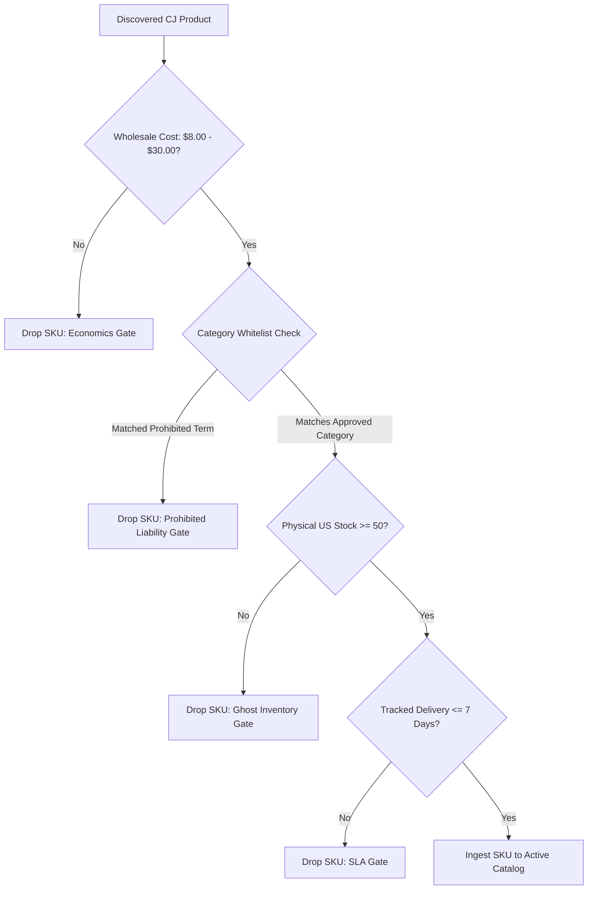
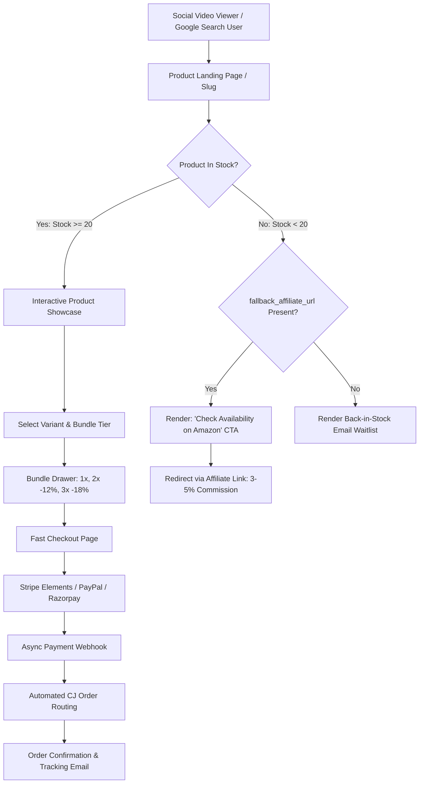

# PRODUCT REQUIREMENTS DOCUMENT (PRD)
## Autonomous Headless E-Commerce & Programmatic Growth Platform

**Document Version:** 1.0.0  
**Effective Date:** 2026-10-25  
**Product Status:** Approved for Implementation (Sprint 1 Ready)  
**Target Market:** United States Domestic (`countryCode: US`)  
**Primary Integration:** CJ Dropshipping API v2.0 (US Warehouses Only)  
**Authors:** Principal Systems Architect & Lead Technical Product Manager  
**Review Cycle:** Bi-weekly during MVP; Monthly post-launch  

---

## 1. Executive Summary & Problem Statement

### 1.1 Executive Summary
This document defines the product, functional, operational, and non-functional requirements for an autonomous, high-margin headless e-commerce storefront paired with a programmatic growth engine. The platform is architected to operate on a \$0/month baseline cloud infrastructure (Vercel free tier + Supabase PostgreSQL free tier) while leveraging localized agentic computing (Antigravity running every 72–96 hours) for catalog management, stock audits, dynamic pricing calculations, programmatic SEO generation, and short-form video scripting.

Fulfillment is restricted 100% to verified physical inventory inside United States domestic warehouses via CJ Dropshipping, guaranteeing a reliable **3–7 business day domestic delivery window** at \$0.00 incremental tracked shipping costs on qualifying items.

### 1.2 The Cross-Border Problem vs. US Domestic Opportunity
Empirical validation testing conducted against CJ Dropshipping API v2.0 demonstrated catastrophic structural vulnerabilities in cross-border e-commerce (China to US/India):
1. **Severe Latency & Instability:** China API edge servers demonstrated Time-To-First-Byte (TTFB) latencies averaging 1,789ms–2,404ms.
2. **Ghost Inventory Epidemic:** 100% of queried products in global categories exhibited 0 units of physical CJ warehouse inventory (`cjInventoryNum == 0`) despite showing 5,000–14,000+ factory unverified units.
3. **Transit SLA Failure:** Cross-border China-to-India shipping transit ranged from 12 to 50 calendar days. China-to-US transit required 7–15 business days with steep freight floors ($5.28–$6.02), eliminating unit economics on products priced below $25.00.

**The Solution:** By hard-constraining catalog discovery to CJ US Domestic Warehouses (`countryCode=US`, `areaId=2`, `startWarehouseInventory >= 50`):
- 90% (9/10) of tested products held verified on-shelf stock in US facilities (e.g., Chino, CA; New Jersey).
- Tracked shipping via USPS, FedEx, and UPS ground averages 3–7 business days.
- Over 80% of items feature \$0.00 bundled domestic freight, unlocking a predictable 49.5% net profit margin and tiered volume bundles.

---

## 2. Target Personas & Use Cases

### Persona A: The Impulsive Problem-Seeking US Consumer ("Sarah")
- **Demographics:** 28–45 years old, suburban homeowner or remote worker, shopping on mobile via Instagram Reels or TikTok.
- **Pain Points:** Cluttered workspace, messy pantry/garage, pet shedding, cable mess. Dislikes 3-week shipping from generic dropshippers; abandons carts with surprise shipping fees at checkout.
- **Key Behaviors:** Values transparent 3–7 day domestic USPS delivery, clear video demonstrations, Apple Pay / Stripe 1-click checkout, and bundle discounts ("Buy 2 Save 12%").

### Persona B: The Solo Operator / CEO ("Alex")
- **Role:** Sole stakeholder, business operator, and video creator.
- **Time Budget:** Maximum 2–3 hours per week for operational maintenance.
- **Pain Points:** Cannot afford paid ad testing burns (\$2,000–\$5,000/month Meta ad fatigue); cannot handle manual inventory verification or customer service tickets caused by late shipments.
- **Workflow:** Triggers local agentic synchronization script (`ops_sync.py`) once every 3–4 days, reviews automated audit logs, renders AI-generated video scripts via ElevenLabs + CapCut, and pastes video links.

### Persona C: The Autonomous AI Agent ("Antigravity")
- **Role:** Local execution engine, copywriter, SEO strategist, and data engineer.
- **Capabilities:** Direct database connectivity, API query orchestration, rate-limit compliance, mathematical pricing enforcement, and structured JSON-LD/HTML generation.

---

## 3. Business Goals & Key Performance Indicators (KPIs)

| Metric Category | Metric | Month 1 Target | Month 3 Target | Month 6 Target |
|---|---|---|---|---|
| **Catalog** | Active High-Confidence SKUs | 10–15 | 30–50 | 100+ |
| **Catalog Quality** | Physical US Warehouse Stock/SKU | $\ge 50$ units | $\ge 50$ units | $\ge 50$ units |
| **Logistics** | Domestic Delivery Window (USPS/UPS) | 3–7 Days | 3–7 Days | 3–7 Days |
| **Logistics** | Fulfillment Error / RTO Rate | $< 3.0\%$ | $< 2.0\%$ | $< 1.5\%$ |
| **Financials** | Blended Net Margin per Order | $\ge 45.0\%$ | $\ge 48.0\%$ | $\ge 49.5\%$ |
| **Financials** | Multi-Unit Bundle Take Rate | $\ge 15.0\%$ | $\ge 25.0\%$ | $\ge 35.0\%$ |
| **Financials** | Average Order Value (AOV) | \$26.50 | \$34.00 | \$42.50 |
| **Organic Growth** | Short-Form Faceless Videos Produced | 30 videos | 100 videos | 250 videos |
| **Organic Growth** | Organic Search Impressions / Mo | 1,000 | 15,000 | 75,000 |
| **Infrastructure** | Monthly Fixed Cloud Operational Cost | \$0.00 | \$0.00 | $< \$25.00$ |

---

## 4. Category Governance & Liability Whitelist

To protect payment processing infrastructure (Stripe, PayPal) from underwriting termination, prevent chargebacks, and adhere strictly to consumer protection regulations, the catalog ingestion pipeline enforces an automated whitelist filter.

### 4.1 Approved Category Whitelist

| Category Name | Typical Products | Wholesale Range | Risk Level | Selection Rationale |
|---|---|---|---|---|
| **Workspace Ergonomics** | Laptop risers, desk cable organizers, wrist rests, phone stands | \$8.00–\$22.00 | Very Low | Massive work-from-home audience; high visual problem-solving value on video. |
| **Home Organization** | Pantry containers, modular drawer dividers, closet organizers | \$9.00–\$25.00 | Very Low | High aesthetic appeal for "satisfying organization" social reels. |
| **Smart Ambient Lighting** | Motion-sensor cabinet LED strips, sunset lamps, monitor light bars | \$10.00–\$26.00 | Low | Striking visual contrast in short-form video hooks. |
| **Everyday Gadgets** | Multi-tool card clips, electric bottle openers, portable lint vacuums | \$8.00–\$18.00 | Low | Impulse-buy pricing; straightforward single-purpose utility. |
| **Pet Problem-Solvers** | De-shedding gloves, car seat pet protectors, interactive laser balls | \$8.50–\$24.00 | Low | High emotional engagement from pet owners; low sizing return friction. |
| **Auto Care & Organization** | Gap filler organizers, trunk storage boxes, USB air purifiers | \$9.00–\$25.00 | Low | Universal fit, high utility, minimal warranty claims. |

### 4.2 Prohibited Categories (Automated Hard Blocklist)

Any product matching the following attributes or title keywords is rejected with zero human override:

1. **Topicals, Creams, Cosmetics & Skincare:**
   - *Examples:* Anti-aging creams, blemish removers, butt/breast enhancement creams, serums.
   - *Rationale:* Spike testing proved that while products like West&Month Hair Cream or EELHOE Face Cream achieve 3–5 day shipping, they present immediate FDA regulatory exposure, severe liability for allergic reactions, and automated Stripe/PayPal account freezes under Restricted Business guidelines.
2. **Ingestibles, Dietary Supplements, Vitamins & Teas:**
   - *Rationale:* Extreme health liability, strict merchant processor prohibition, requires pharmaceutical compliance documentation.
3. **Multi-Size Apparel & Footwear:**
   - *Rationale:* Return rates on multi-sized clothing exceed 25–35% in US e-commerce, completely eroding dropshipping unit economics.
4. **Trademarked, Licensed, or Branded Knock-offs:**
   - *Rationale:* Zero tolerance for copyright infringement; protects domain and payment gateways.
5. **High-Voltage or Lithium-Heavy Power Banks:**
   - *Rationale:* Air/ground freight hazardous material surcharges and transit restrictions.

---

## 5. End-to-End User Experience & Funnel Architecture

---

## 6. Detailed Functional Requirements

### 6.1 Catalog Ingestion & Inventory Synchronization (`ops_sync.py`)
- **FR-1.1 (Query Filter):** The system shall query CJ API `POST /product/list` filtering strictly by `countryCode=US`, `startWarehouseInventory=50`, `startSellPrice=8.00`, and `endSellPrice=30.00`.
- **FR-1.2 (Stock Verification):** The system shall verify physical warehouse inventory by calling `POST /product/stock/queryByVid` for each candidate variant. If the verified US warehouse count (`cjInventoryNum`) is `< 50`, the variant shall be rejected.
- **FR-1.3 (Rate-Limiter Constraint):** The catalog sync shall enforce a client-side token bucket limiting requests to $\le 0.9$ Queries Per Second (QPS) with a deterministic sleep buffer to eliminate `code: 1600200` silent data dropouts.
- **FR-1.4 (Automated SKU Deactivation):** When a previously active product's physical US warehouse stock drops below 20 units, the system shall set `is_active = FALSE` in PostgreSQL.
- **FR-1.5 (Prohibited Filter):** The synchronization module shall execute regex matching against titles, categories, and tags, discarding any item containing prohibited strings (e.g., `cream`, `serum`, `collagen`, `patch`, `capsule`, `oil`, `t-shirt`, `shoes`).

### 6.2 Mathematical Pricing & AOV Multiplier Engine
- **FR-2.1 (Base Retail Price):** For any product with wholesale cost $C_{wholesale}$ and freight $C_{shipping}$, the 1-unit retail price shall be calculated deterministically as:
  $$\text{Retail\_Price}_{1x} = \operatorname{ROUND}((C_{wholesale} + C_{shipping}) \times 2.5, 2) - 0.01$$
- **FR-2.2 (Net Margin Enforcement):** The system shall calculate estimated Net Profit:
  $$\text{Fee}_{gateway} = (\text{Retail\_Price}_{1x} \times 0.025) + 0.30$$
  $$\text{Buffer}_{RTO} = \text{Retail\_Price}_{1x} \times 0.08$$
  $$\text{Net\_Profit} = \text{Retail\_Price}_{1x} - (C_{wholesale} + C_{shipping} + \text{Fee}_{gateway} + \text{Buffer}_{RTO})$$
  $$\text{Net\_Margin\_\%} = \frac{\text{Net\_Profit}}{\text{Retail\_Price}_{1x}} \times 100$$
  If $\text{Net\_Margin\_\%} < 45.0\%$, the product shall be rejected.
- **FR-2.3 (Automated Tiered Volume Bundling):** Because US domestic shipping is \$0.00 incremental on multi-unit packages, the database shall store three distinct price tiers:
  - **Tier 1 (1 Unit):** $\text{Retail\_Price}_{1x}$
  - **Tier 2 (2 Units - 'Save 12%'):** $\operatorname{ROUND}(\text{Retail\_Price}_{1x} \times 2 \times 0.88, 2) - 0.01$ (Multiplier: 1.88)
  - **Tier 3 (3 Units - 'Save 18%'):** $\operatorname{ROUND}(\text{Retail\_Price}_{1x} \times 3 \times 0.82, 2) - 0.01$ (Multiplier: 2.46)
- **FR-2.4 (Storefront Bundle Selector):** The product page shall feature a default-expanded bundle drawer defaulting to Tier 2 ("Most Popular - Save 12%"), displaying total dollar savings dynamically.

### 6.3 Storefront UI & Technical Presentation (Next.js 15)
- **FR-3.1 (Page Architecture):** Product detail pages (PDP) shall use Incremental Static Regeneration (`revalidate = 300`) to guarantee static asset caching on Vercel's Edge Network while polling updated availability every 5 minutes.
- **FR-3.2 (PAS Content Presentation):** The product page shall render:
  - High-resolution hero image carousel with responsive thumbnail strip.
  - Problem-Agitation-Solution (PAS) narrative copy structured in clean HTML.
  - 5 key benefit-driven bullet points featuring checkmark iconography.
  - Technical specifications comparison matrix.
  - Domestic shipping badge: "Ships from US Warehouse via USPS Ground • Arrives in 3–7 Business Days".
- **FR-3.3 (Cart & Checkout Integration):** Single-page headless checkout embedding Stripe Elements (Credit/Debit, Apple Pay, Google Pay) and PayPal button SDK.

### 6.4 Hybrid Monetization & Out-of-Stock Fallback
- **FR-4.1 (Zero-Bounce OOS Policy):** When a product's status is `is_active = FALSE` or stock is `< 20`, the PDP shall NOT return an HTTP 404.
- **FR-4.2 (Affiliate Redirection CTA):** If the product row contains a valid `fallback_affiliate_url`, the buy box shall replace the checkout button with an orange "Check Availability on Amazon" outbound button passing standard `rel="noopener noreferrer nofollow"`.
- **FR-4.3 (Waitlist Fallback):** If `fallback_affiliate_url` is NULL, an inline email capture form ("Notify me when back in stock") shall display, storing the lead in Supabase.

### 6.5 Zero-Touch Order Fulfillment & Defensive Router
- **FR-5.1 (Webhook Ingestion):** The FastAPI backend shall expose `POST /api/v1/webhooks/stripe` with mandatory cryptographic signature verification using the Stripe signing secret.
- **FR-5.2 (Idempotency Engine):** The system shall generate an `internal_order_number` formatted as `ORD-{TIMESTAMP}-{RANDOM_HEX}`. In the event of webhook replay, duplicate requests shall return HTTP 200 without submitting secondary CJ orders.
- **FR-5.3 (Defensive logisticsMiss Guard):** When calling CJ `POST /shopping/order/createOrderV2`, the response payload shall be evaluated against:
  $$\text{Assertion:} \quad \text{code} == 200 \quad \text{AND} \quad \text{data.logisticsMiss} == \text{False} \quad \text{AND} \quad \text{data.postageAmount} > 0$$
  If `logisticsMiss == True`, the order status shall be immediately transitioned to `FULFILLMENT_FAILED`, an administrative alert shall fire via Sentry, and an automated Stripe refund shall initiate.
- **FR-5.4 (Mandatory Header Injection):** Every order payload shall explicitly include `fromCountryCode: "US"` and the verified carrier string `logisticName: "USPS"` / `logisticName: "DHL Official"`.
- **FR-5.5 (CJ Code 1603003 Handling):** If CJ returns error code `1603003` ("Order exist, please do not duplicate create"), the system shall recognize this as an idempotent success, query `GET /shopping/order/getOrderDetail`, and sync the existing order ID.

### 6.6 Programmatic SEO & Structured Data Requirements
- **FR-6.1 (Automated Schema Markup):** The Next.js layout shall inject valid Schema.org `Product`, `Offer`, `AggregateRating`, and `FAQPage` JSON-LD blocks into `<head>`:
  - `shippingDetails` configured to `USPS Ground (3 to 7 business days)` with `shippingRate: 0.00 USD`.
  - `hasMerchantReturnPolicy` configured to 30-day return policy.
- **FR-6.2 (Slug & Keyword Generation):** Every product slug shall follow the programmatic pattern: `/products/{category-slug}-{primary-benefit-slug}-{sku}`.
- **FR-6.3 (FAQ Schema):** Every product page shall feature a minimum of 4 product-specific FAQs covering: US shipping speed, bundle contents, warranty/returns, and setup instructions.

### 6.7 Viral Video Production Pack Specifications
- **FR-7.1 (Automated Asset Output):** For every active product, the agentic pipeline shall generate three ready-to-produce short-form video scripts stored in `product_video_scripts`:
  - **Script Type 1: Visual Problem Hook (0–3s problem agitation, 3–12s solution demo, 12–15s CTA).**
  - **Script Type 2: Before & After Transformation.**
  - **Script Type 3: Simulated UGC / Honest Review.**
- **FR-7.2 (Voiceover Metadata):** Scripts shall include word-for-word copy formatted for direct ingestion into ElevenLabs text-to-speech API or manual copy-paste.
- **FR-7.3 (Hashtag Generation):** Scripts shall output a curated block of 8 hashtags (3 niche-specific, 3 problem-solving, 2 platform-trending).

---

## 7. Non-Functional Requirements (NFRs)

### 7.1 Performance & Latency
- **NFR-1.1:** Core Web Vitals targets on mobile:
  - Largest Contentful Paint (LCP) $\le 1.8$ seconds.
  - Cumulative Layout Shift (CLS) $\le 0.05$.
  - First Input Delay (FID) / Interaction to Next Paint (INP) $\le 100$ milliseconds.
- **NFR-1.2:** Storefront TTFB $\le 200$ milliseconds globally via Vercel Edge caching.

### 7.2 Security, Privacy & PCI Compliance
- **NFR-2.1:** Zero cardholder data shall touch the application server; all payments must use Stripe Elements / Payment Intents or hosted PayPal modal.
- **NFR-2.2:** Customer Personally Identifiable Information (PII) like phone numbers and shipping addresses shall be stored in Supabase with Row Level Security (RLS) enabled and encrypted at rest.
- **NFR-2.3:** API tokens (`CJ_API_KEY`, `STRIPE_SECRET_KEY`) shall never be exposed in client bundles or logged to observability tools.

### 7.3 Availability & Operational Reliability
- **NFR-3.1:** Storefront uptime $\ge 99.9\%$ backed by Vercel serverless architecture.
- **NFR-3.2:** Database connection pool resilience using Supabase Transaction Pooler (PgBouncer) over port 6543 to avoid connection exhaustion.

---

## 8. Out of Scope for MVP (Explicit Won't-Haves)

1. **Paid Advertising Integrations:** No Meta Pixel, Google Tag Manager server-side containers, or TikTok Ads API integrations during MVP.
2. **Native iOS/Android Mobile Apps:** Responsive PWA only.
3. **Multi-Vendor Marketplace:** Sole supplier is CJ Dropshipping US domestic warehouses.
4. **Custom Loyalty Programs & Points:** Volume bundle discounts replace point systems.
5. **Real-time Live Chat Agents:** Replaced with comprehensive FAQ schema and contact email.
6. **Cross-Border Shipments:** Shipping restricted exclusively to the 50 United States and DC (excluding military APO/FPO and external territories for MVP).

---

## 9. Launch Readiness Acceptance Criteria

A product and its storefront are cleared for live commercial traffic only when all 10 validation gates evaluate to TRUE:

| Check # | Acceptance Criterion | Verification Method |
|---|---|---|
| **AC-01** | Supplier physical US warehouse inventory $\ge 50$ units | API query `POST /product/stock/queryByVid` |
| **AC-02** | Tracked carrier SLA is $\le 7$ business days via USPS/FedEx | API query `POST /logistic/freightCalculate` |
| **AC-03** | Calculated Net Profit Margin is $\ge 45.0\%$ | Pricing formula verification script |
| **AC-04** | Title & Category free of all prohibited keywords | Automated regex filter inspection |
| **AC-05** | Tier 1, Tier 2, and Tier 3 bundle prices present in DB | SQL audit against `products` table |
| **AC-06** | PAS copy, 5 bullets, and specs table populated | HTML render validation |
| **AC-07** | Product and FAQPage JSON-LD schemas valid | Google Rich Results Test API |
| **AC-08** | 3 video production scripts stored in database | Query against `product_video_scripts` |
| **AC-09** | Stripe dry-run payment triggers order creation | End-to-end sandbox webhook test |
| **AC-10** | CJ order payload contains valid `fromCountryCode: "US"` | Request payload inspection in test mode |

---

*End of Product Requirements Document — Version 1.0.0*
