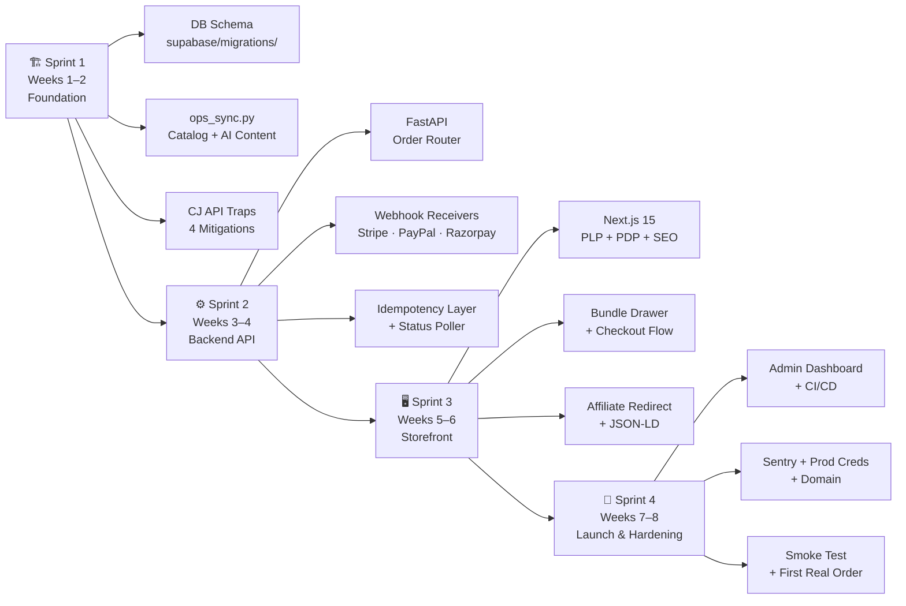
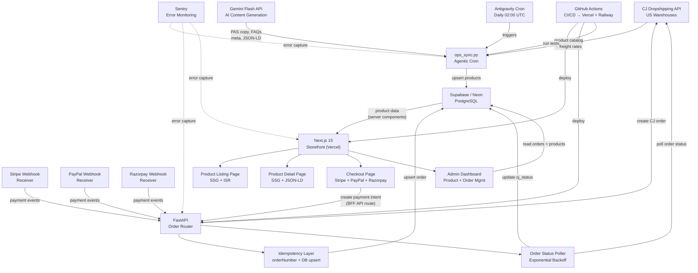

# 02 — MVP Scope: Headless US Dropshipping Platform

> **Document Version:** 1.0  
> **Status:** Approved for Execution  
> **Owner:** CEO / Solo Operator  
> **Last Updated:** 2026-10-25

---

## 1. Executive Summary

### What This MVP Is

This MVP delivers a **fully automated, zero-touch US dropshipping platform** built on a headless architecture. The system sources products exclusively from **CJ Dropshipping US Warehouses**, ensuring 3–7 business day domestic delivery without cross-border logistics complexity. It is designed to run autonomously: an agentic Python cron (`ops_sync.py`) handles catalog synchronization, unit economics validation, and AI-generated SEO content; a FastAPI backend router handles order creation and lifecycle management; and a Next.js 15 storefront (deployed on Vercel) serves customers.

The MVP is intentionally narrow. It targets **five category verticals** — Home Organization, Workspace Ergonomics, Smart Lighting, Everyday Gadgets, and Pet/Auto Problem-Solvers — and enforces a hard prohibition on cosmetics, topicals, supplements, and multi-size apparel. Every product in the catalog must survive a unit economics gate: margin ≥ 35%, landed cost ≤ \$40, freight confirmed from a US warehouse.

The primary business goal is to demonstrate **end-to-end autonomous order processing** — from customer checkout through CJ order creation to fulfillment tracking — with the CEO spending fewer than 5 hours/week on operations after launch.

### What This MVP Is NOT

- It is **not** a multi-vendor marketplace. CJ Dropshipping is the sole supplier.
- It is **not** a mobile app. The storefront is a responsive web application only.
- It is **not** a loyalty or rewards platform. No points, tiers, or referral programs.
- It is **not** a paid advertising platform. No ad campaign management in scope.
- It is **not** a customer support system. No live chat, ticketing, or CRM integration.
- It is **not** an analytics platform. Basic Supabase query access suffices for launch.
- It is **not** a multi-currency storefront. USD is the sole transaction currency.

### Launch Timeline

| Phase | Duration | Target Completion |
|---|---|---|
| Sprint 1 — Foundation | Weeks 1–2 | End of Week 2 |
| Sprint 2 — Backend API | Weeks 3–4 | End of Week 4 |
| Sprint 3 — Storefront | Weeks 5–6 | End of Week 6 |
| Sprint 4 — Launch & Hardening | Weeks 7–8 | End of Week 8 |
| **Total MVP Duration** | **8 Weeks** | **4 Sprints × 2 Weeks** |

---

## 2. MoSCoW Prioritization Matrix

| **Must Have** | **Should Have** | **Could Have** | **Won't Have** |
|---|---|---|---|
| CJ US Warehouse catalog sync via `ops_sync.py` | Bundle pricing drawer (1x / 2x / 3x) | Product comparison table | Native mobile app (iOS/Android) |
| Ghost inventory filter (logisticsMiss guard) | Animated product image gallery | Customer wishlist / saved items | Multi-vendor supplier switching |
| Unit economics gate (≥35% margin, ≤\$40 landed cost) | Related products carousel on PDP | Coupon / discount code engine | Loyalty points and rewards system |
| AI-generated PAS copy + benefit bullets per product | Order confirmation email via Resend/SendGrid | Customer account portal (order history) | Paid ad campaign management (Meta/Google) |
| AI-generated FAQs and JSON-LD structured data | Sentry error monitoring and alerting | Product video auto-embed from CJ assets | Real-time inventory reservation on cart add |
| Stripe checkout (Elements) with webhook receiver | Admin dashboard for product enable/disable | Abandoned cart recovery email sequence | Multi-currency support (GBP, EUR, INR) |
| PayPal checkout button integration | GitHub Actions CI/CD pipeline | Back-in-stock email notification | Physical warehouse / 3PL integration |
| Razorpay International checkout fallback | Vercel preview deployments per PR | Post-purchase upsell modal | Live chat / customer support ticketing |
| CJ order creation (payType 3 → payType 1 flow) | Lighthouse score ≥ 90 on all Core Web Vitals | Affiliate redirect for related OOS products | B2B wholesale pricing tier |
| Idempotency via `orderNumber` + Postgres upsert | ISR-enabled product pages (Next.js 15 App Router) | Revenue analytics dashboard (Recharts) | Multi-language / i18n support |
| Webhook signature verification (Stripe + Razorpay) | Canonical URL and sitemap.xml generation | Product import via CSV upload in admin | Subscription / recurring order billing |
| Affiliate redirect for permanently OOS products | robots.txt and Open Graph meta tags | Heatmap / session recording (Hotjar free) | Custom returns management portal |
| 0.9 QPS throttle on all CJ API calls | fromCountryCode injection on all CJ order calls | A/B testing framework for PDP copy | Marketplace listing sync (Amazon, eBay) |
| Supabase/Neon PostgreSQL schema (products, orders, sync_log) | Order status poller with exponential backoff | Automated reorder trigger at stock threshold | Influencer / affiliate partner portal |
| Category whitelist enforcement (hard coded + DB flag) | Rate limit retry middleware (429 handling) | Bulk product publish / unpublish in admin | AI chatbot for customer support |

---

## 3. Sprint Roadmap

### Sprint 1 — Foundation: DB Schema + `ops_sync.py`
**Weeks 1–2 | Goal: Seeded catalog in DB with complete SEO content, all CJ API traps mitigated**

#### Sprint 1 Deliverables

| # | Deliverable | Artifact / File |
|---|---|---|
| 1.1 | Supabase/Neon PostgreSQL schema | `supabase/migrations/001_initial_schema.sql` |
| 1.2 | `products` table | Columns: id, cj_pid, title, slug, category, status, landed_cost, msrp, margin_pct, freight_usd, warehouse_country, images, video_url, pas_copy, benefit_bullets, faqs, json_ld, meta_title, meta_desc, created_at, updated_at |
| 1.3 | `orders` table | Columns: id, order_number, payment_provider, payment_intent_id, status, cj_order_id, cj_status, customer_email, shipping_address (jsonb), line_items (jsonb), total_usd, created_at, updated_at |
| 1.4 | `sync_log` table | Columns: id, run_at, products_fetched, products_upserted, products_rejected, errors (jsonb), duration_ms |
| 1.5 | `ops_sync.py` — CJ auth module | `ops/ops_sync.py` → `_get_cj_token()` with token cache + refresh |
| 1.6 | `ops_sync.py` — US warehouse product fetch | `_fetch_us_products()`: pages through CJ `/v1/product/query` with `countryCode=US` and `warehouseCountryCode=US` |
| 1.7 | `ops_sync.py` — Ghost inventory filter | `_filter_ghost_inventory()`: rejects any product where logistics list is empty or `logisticsMiss=true` |
| 1.8 | `ops_sync.py` — Freight calculator | `_calculate_freight()`: queries CJ `/v1/logistic/freightCalculate` with `fromCountryCode=US`, `toCountryCode=US`, parses first available rate |
| 1.9 | `ops_sync.py` — Unit economics gate | `_passes_unit_economics()`: landed_cost = product_cost + freight; margin = (msrp − landed_cost) / msrp; rejects if margin < 0.35 or landed_cost > 40 |
| 1.10 | `ops_sync.py` — Category whitelist | `WHITELIST_CATEGORIES` constant; filters out any product whose CJ category does not map to the 5 approved verticals |
| 1.11 | `ops_sync.py` — AI content pipeline | `_generate_content()`: calls Gemini Flash API with structured prompt → returns `{pas_copy, benefit_bullets, faqs, meta_title, meta_desc, json_ld}` |
| 1.12 | `ops_sync.py` — DB upsert | `_upsert_products()`: uses `ON CONFLICT (cj_pid) DO UPDATE` for idempotent writes |
| 1.13 | `ops_sync.py` — 0.9 QPS throttle | `_throttled_request()`: token-bucket rate limiter, max 0.9 requests/second to all CJ API endpoints |
| 1.14 | `ops_sync.py` — orderNumber idempotency seed | Generates deterministic `orderNumber` = `DS-{store_id}-{payment_intent_id[-8:]}` stored pre-creation |
| 1.15 | `ops_sync.py` — fromCountryCode injection | All CJ order/freight calls inject `fromCountryCode: "US"` explicitly; asserted in unit tests |
| 1.16 | Unit test suite | `tests/test_ops_sync.py`: covers ghost filter, unit economics gate, category whitelist, QPS throttle, idempotency key generation, fromCountryCode injection |
| 1.17 | Environment variable template | `.env.example`: `CJ_API_KEY`, `CJ_EMAIL`, `SUPABASE_URL`, `SUPABASE_SERVICE_KEY`, `GEMINI_API_KEY`, `STORE_ID` |

#### Sprint 1 — Definition of Done

- [ ] Database schema migrations run cleanly on a fresh Supabase project
- [ ] `ops_sync.py` runs end-to-end without manual intervention from a cold start
- [ ] At least 10 whitelisted products appear in the `products` table with non-null `pas_copy`, `benefit_bullets`, `faqs`, `meta_title`, `meta_desc`, and `json_ld`
- [ ] All four CJ API trap mitigations are present and covered by unit tests: logisticsMiss guard, 0.9 QPS throttle, orderNumber idempotency seeding, fromCountryCode injection
- [ ] All unit tests pass: `pytest tests/test_ops_sync.py -v` exits 0
- [ ] `sync_log` table records at least one successful run with `errors` = `[]`
- [ ] `.env.example` is committed; no secrets in source code

#### Sprint 1 — Dependencies

- CJ Dropshipping API account with US warehouse access enabled
- Supabase project created (free tier)
- Gemini API key provisioned
- Python 3.11+ environment with `uv` package manager

---

### Sprint 2 — Backend API: FastAPI Order Router
**Weeks 3–4 | Goal: End-to-end order placed via test webhook, tracked in DB, zero duplicates**

#### Sprint 2 Deliverables

| # | Deliverable | Artifact / File |
|---|---|---|
| 2.1 | FastAPI application scaffold | `api/main.py`, `api/routers/`, `api/models/`, `api/services/` |
| 2.2 | Pydantic order model | `api/models/order.py`: `OrderCreate`, `OrderLine`, `ShippingAddress`, `PaymentWebhookPayload` |
| 2.3 | Stripe webhook receiver | `api/routers/stripe_webhook.py`: validates `Stripe-Signature` header using `stripe.Webhook.construct_event()`, handles `payment_intent.succeeded` |
| 2.4 | Razorpay webhook receiver | `api/routers/razorpay_webhook.py`: validates HMAC-SHA256 signature using `razorpay_key_secret`, handles `payment.captured` |
| 2.5 | PayPal IPN / webhook receiver | `api/routers/paypal_webhook.py`: verifies event with PayPal cert URL, handles `PAYMENT.CAPTURE.COMPLETED` |
| 2.6 | Idempotency middleware | `api/middleware/idempotency.py`: extracts `orderNumber` from payload, checks `orders` table for existing record before proceeding |
| 2.7 | CJ order creation service | `api/services/cj_order.py`: `create_cj_order()` — first attempts `payType=3` (credit balance), falls back to `payType=1` (balance) on 4xx, injects `fromCountryCode=US` |
| 2.8 | Order status poller | `api/services/order_poller.py`: queries CJ `/v1/order/detail` every 4 hours (exponential backoff on failure), updates `cj_status` in `orders` table |
| 2.9 | Order status webhook handler | Handles CJ push webhook for order status changes (shipped, cancelled, refunded) if CJ webhook is configured |
| 2.10 | DB order upsert | `api/services/db.py`: `upsert_order()` uses `ON CONFLICT (order_number) DO UPDATE` for idempotency |
| 2.11 | Health check endpoint | `GET /health` — returns `{status: "ok", db: "connected", cj_auth: "valid"}` |
| 2.12 | Error handling middleware | `api/middleware/error_handler.py`: catches unhandled exceptions, logs to Sentry, returns RFC 7807 Problem JSON |
| 2.13 | Local dev Stripe CLI tunnel | `Makefile` target: `make stripe-listen` runs `stripe listen --forward-to localhost:8000/webhooks/stripe` |
| 2.14 | Integration test suite | `tests/test_order_router.py`: covers duplicate prevention, payType fallback, fromCountryCode injection, Stripe sig verification, Razorpay sig verification |
| 2.15 | Docker Compose for local stack | `docker-compose.yml`: FastAPI + Postgres (local) for integration testing without Supabase dependency |
| 2.16 | API documentation | FastAPI auto-generates `/docs` (Swagger) and `/redoc`; ensure all endpoints documented |

#### Sprint 2 — Definition of Done

- [ ] `POST /webhooks/stripe` receives a `payment_intent.succeeded` test event from Stripe CLI and creates a CJ order
- [ ] Order record appears in `orders` table with `cj_order_id` populated and `status=processing`
- [ ] Sending the same webhook event a second time does **not** create a duplicate order (idempotency test passes)
- [ ] `POST /webhooks/razorpay` with an invalid signature returns HTTP 400 (signature verification works)
- [ ] Order status poller updates `cj_status` from `pending` to `shipped` when CJ order advances
- [ ] All integration tests pass: `pytest tests/test_order_router.py -v` exits 0
- [ ] `/health` endpoint returns HTTP 200 in both local and staging environments

#### Sprint 2 — Dependencies

- Sprint 1 complete: `orders` table schema available in Supabase
- Stripe account with test API keys
- Razorpay account with test credentials
- PayPal Sandbox account
- CJ API sandbox or live account with order creation permission

---

### Sprint 3 — Storefront: Next.js 15 Front End
**Weeks 5–6 | Goal: Lighthouse ≥ 90, end-to-end checkout in test mode, affiliate OOS redirect live**

#### Sprint 3 Deliverables

| # | Deliverable | Artifact / File |
|---|---|---|
| 3.1 | Next.js 15 App Router scaffold | `storefront/app/`, `storefront/components/`, `storefront/lib/` |
| 3.2 | Supabase client (server-side) | `storefront/lib/supabase.ts`: server component client using `SUPABASE_URL` + `SUPABASE_ANON_KEY` |
| 3.3 | Product listing page (PLP) | `storefront/app/products/page.tsx`: SSG with ISR revalidation every 3600s; grid of product cards with image, title, price |
| 3.4 | Product detail page (PDP) | `storefront/app/products/[slug]/page.tsx`: SSG; renders images, PAS copy, benefit bullets, bundle pricing drawer |
| 3.5 | Bundle pricing drawer component | `storefront/components/BundleDrawer.tsx`: 1x / 2x / 3x quantity selector with per-unit price and total; "Add to Cart" triggers cart state update |
| 3.6 | Image gallery component | `storefront/components/ImageGallery.tsx`: main image + thumbnail strip; lazy-loaded with `next/image` |
| 3.7 | FAQ accordion component | `storefront/components/FaqAccordion.tsx`: renders AI-generated FAQs from DB; accessible `
/
` pattern |
| 3.8 | JSON-LD + meta injection | `storefront/app/products/[slug]/head.tsx` or `generateMetadata()`: injects `<script type="application/ld+json">` for Product + FAQPage schema, sets `title` and `description` from DB `meta_title` / `meta_desc` |
| 3.9 | Cart state management | `storefront/lib/cart.ts`: Zustand store; persists to `localStorage`; exposes `addItem`, `removeItem`, `clearCart`, `getTotal` |
| 3.10 | Checkout page | `storefront/app/checkout/page.tsx`: renders Stripe Elements payment form, PayPal Smart Buttons, Razorpay button (conditional on geo/fallback) |
| 3.11 | Stripe Elements integration | `storefront/components/StripeCheckout.tsx`: `@stripe/react-stripe-js`; creates `PaymentIntent` via `/api/create-payment-intent`, handles confirmation |
| 3.12 | PayPal button integration | `storefront/components/PayPalButton.tsx`: `@paypal/react-paypal-js`; creates order server-side, captures on approval |
| 3.13 | Razorpay integration | `storefront/components/RazorpayCheckout.tsx`: loads Razorpay SDK client-side, creates order via Next.js API route, verifies payment signature |
| 3.14 | Next.js API routes (BFF layer) | `storefront/app/api/create-payment-intent/route.ts`, `storefront/app/api/paypal-create-order/route.ts`, `storefront/app/api/razorpay-create-order/route.ts` |
| 3.15 | Affiliate redirect for OOS | `storefront/app/products/[slug]/page.tsx`: if `product.status = 'oos'`, renders affiliate redirect CTA with `rel="sponsored noopener"` link instead of "Add to Cart" |
| 3.16 | Order confirmation page | `storefront/app/checkout/success/page.tsx`: reads `payment_intent` from query param, displays order summary and estimated delivery (3–7 business days) |
| 3.17 | Global layout + navigation | `storefront/app/layout.tsx`: header with logo + cart icon (badge), footer with policy links |
| 3.18 | sitemap.xml generation | `storefront/app/sitemap.ts`: generates sitemap from all `status='active'` product slugs |
| 3.19 | robots.txt | `storefront/public/robots.txt`: allows all crawlers; points to sitemap |
| 3.20 | Open Graph meta tags | `generateMetadata()` per PDP: `og:title`, `og:description`, `og:image` (first product image) |
| 3.21 | Lighthouse CI config | `.github/workflows/lighthouse.yml`: runs Lighthouse CI on every PR, fails below 90 on Performance, Accessibility, Best Practices, SEO |

#### Sprint 3 — Definition of Done

- [ ] Lighthouse CI passes with scores ≥ 90 across Performance, Accessibility, Best Practices, SEO on the PDP
- [ ] PDP renders JSON-LD structured data verifiable via Google Rich Results Test
- [ ] Full checkout flow (Stripe test mode): add to cart → checkout → payment → order confirmation page renders
- [ ] Stripe test webhook fires, order created in `orders` table, success page confirms
- [ ] OOS product shows affiliate redirect CTA, not "Add to Cart"
- [ ] `next build` completes with no type errors (`tsc --noEmit` exits 0)
- [ ] sitemap.xml accessible at `/sitemap.xml` with all active product URLs
- [ ] `next/image` is used for all product images (no raw `` tags)

#### Sprint 3 — Dependencies

- Sprint 1 complete: `products` table populated with ≥10 active products including `slug`, `json_ld`, `meta_title`, `meta_desc`, `images`
- Sprint 2 complete: payment intent API routes functional
- Stripe publishable key (test)
- PayPal client ID (sandbox)
- Razorpay key ID (test)
- Vercel project linked to GitHub repo

---

### Sprint 4 — Admin, Launch & Hardening
**Weeks 7–8 | Goal: Zero P0 bugs, production cron running, first real order successfully processed**

#### Sprint 4 Deliverables

| # | Deliverable | Artifact / File |
|---|---|---|
| 4.1 | Admin dashboard — product management | `storefront/app/admin/products/page.tsx`: protected by middleware; table of all products with enable/disable toggle, stock count, margin display |
| 4.2 | Admin dashboard — order management | `storefront/app/admin/orders/page.tsx`: list all orders with status, CJ order ID, payment provider, total; link to CJ tracking URL |
| 4.3 | Admin route protection | `storefront/middleware.ts`: checks `ADMIN_SECRET` cookie or Basic Auth header; redirects unauthenticated requests to `/admin/login` |
| 4.4 | Sentry integration (free tier) | `storefront/instrumentation.ts` + `api/main.py`: Sentry DSN configured; captures unhandled exceptions in both Next.js and FastAPI; alert on first occurrence of new issue |
| 4.5 | GitHub Actions — CI pipeline | `.github/workflows/ci.yml`: on PR → runs `pytest`, `tsc --noEmit`, `next build`, Lighthouse CI |
| 4.6 | GitHub Actions — CD pipeline | `.github/workflows/deploy.yml`: on push to `main` → deploys storefront to Vercel via Vercel CLI; deploys FastAPI to Railway/Fly.io or Vercel serverless |
| 4.7 | Production environment variables | All secrets added to Vercel Environment Variables and GitHub Actions secrets; `.env.production.example` documented |
| 4.8 | Custom domain + DNS | Domain configured in Vercel; A/CNAME records set; SSL auto-provisioned by Vercel |
| 4.9 | Production Supabase setup | Row-level security (RLS) policies: anon role can SELECT active products; service role used only by `ops_sync.py` and FastAPI |
| 4.10 | `ops_sync.py` production cron | Antigravity local cron scheduler (`agy schedule`) triggers `ops_sync.py` daily at 02:00 UTC; logs to `sync_log` table |
| 4.11 | CJ API production credentials | Live CJ API key substituted; warehouse filter confirmed against live US inventory |
| 4.12 | Stripe live mode activation | Stripe account verified; live publishable + secret keys substituted; webhook endpoint registered for production URL |
| 4.13 | PayPal live credentials | PayPal app switched from Sandbox to Live; client ID updated |
| 4.14 | Razorpay international live | Razorpay account KYC complete; live keys substituted |
| 4.15 | Smoke test checklist | `docs/SMOKE_TEST.md`: 15-step manual checklist covering: product visible on PLP, PDP renders, cart add, checkout with each provider (Stripe/PayPal/Razorpay test), OOS affiliate redirect, admin login, product toggle, order appears in admin, `ops_sync.py` manual run |
| 4.16 | Runbook | `docs/RUNBOOK.md`: emergency procedures for: CJ API outage, Stripe freeze, DB connection loss, `ops_sync.py` failure, reverting a bad deploy |
| 4.17 | First real order validation | Place a \$1 test transaction on production (Stripe minimum); verify order appears in CJ dashboard and `orders` table; confirm tracking number returned by poller |

#### Sprint 4 — Definition of Done

- [ ] Zero open P0 bugs (P0 = system down, checkout broken, data loss risk)
- [ ] `ops_sync.py` runs end-to-end in production cron without manual intervention; `sync_log` shows successful run
- [ ] First real order placed, CJ order created, tracking number polled and stored in `orders` table
- [ ] Sentry dashboard shows zero unresolved errors from smoke test run
- [ ] GitHub Actions CI passes on `main` branch; Vercel deploy succeeds automatically
- [ ] Custom domain serves the storefront over HTTPS with no certificate warnings
- [ ] Admin dashboard accessible only to authenticated operator; product enable/disable works
- [ ] All 15 items in `SMOKE_TEST.md` checked off

#### Sprint 4 — Dependencies

- Sprints 1–3 complete and all DoDs met
- Domain name purchased
- Stripe, PayPal, Razorpay live account verification complete
- CJ Dropshipping live API access confirmed
- Sentry account created (free tier)

---

## 4. Risk Register

| # | Risk | Likelihood | Impact | Mitigation |
|---|---|---|---|---|
| R-01 | **CJ API rate limit breach** — exceeding 1 QPS causes 429 errors, disrupting catalog sync and order creation | Medium | High | 0.9 QPS token-bucket throttle in `_throttled_request()`; exponential backoff on 429; `sync_log` records throttle events; alert on >5 consecutive 429s |
| R-02 | **CJ US warehouse stock depletion** — product shows in-stock in API but warehouse has zero physical units, resulting in ghost orders | High | High | logisticsMiss guard in `_filter_ghost_inventory()`; mark product `status='oos'` in DB; trigger affiliate redirect on PDP; daily sync catches depletions within 24h |
| R-03 | **Stripe account freeze** — a prohibited product (supplement, topical, cosmetic) slips through category filter and triggers Stripe high-risk merchant review | Low | Critical | Hard-coded `WHITELIST_CATEGORIES` constant enforced at sync time; secondary manual audit of first 20 products before launch; prohibited terms blocklist in AI content prompt; Stripe dispute rate monitored weekly |
| R-04 | **Vercel cold starts on API routes** — serverless function cold start adds 800–2000ms latency to checkout flow | Medium | Medium | FastAPI deployed on Railway/Fly.io (always-on free tier) separate from Vercel; Next.js BFF routes kept thin; Edge Runtime used where possible for low-latency routes |
| R-05 | **Supabase free tier row limits** — Supabase free tier caps at 500MB DB size; heavy sync logs could exhaust storage | Low | Medium | `sync_log` rows older than 30 days auto-deleted by scheduled Postgres function (`DELETE WHERE run_at < NOW() - INTERVAL '30 days'`); product images stored as CJ CDN URLs, not blobs; monitor DB size weekly |
| R-06 | **Category filter bypass** — CJ reclassifies a product's category tag, causing a prohibited product to pass the whitelist filter | Low | High | Dual-gate: category whitelist AND prohibited keyword blocklist (`['supplement', 'serum', 'vitamin', 'cream', 'pill', 'capsule', 'lotion']`) scanned in product title + description at sync time |
| R-07 | **CJ API breaking change** — CJ updates API schema (field rename, endpoint deprecation) silently, breaking sync or order creation | Medium | High | All CJ API responses parsed with strict Pydantic models; any unexpected field causes logged warning; `ops_sync.py` has field fallback with explicit None checks; pin CJ API version header where supported |
| R-08 | **FX / currency risk** — CJ invoices in USD but supplier cost fluctuations erode margin between sync and order | Low | Medium | Unit economics gate re-evaluated on every daily sync; margin threshold set conservatively at 35% (not 20–25%); MSRP is fixed at DB-time; operator alerted if any product's live margin drops below 30% |
| R-09 | **PayPal dispute / chargeback spike** — customers dispute charges, raising chargeback rate above PayPal's 1% threshold | Low | High | Clear delivery SLA (3–7 business days) stated on PDP, confirmation email, and checkout; tracking number surfaced in order confirmation within 48h of shipping; refund policy page live before launch |
| R-10 | **`ops_sync.py` silent failure** — cron runs but AI content generation fails, resulting in products with empty `pas_copy` being published | Medium | Medium | Products with `pas_copy IS NULL` are set to `status='draft'` (not visible to storefront) until content is confirmed; `sync_log.errors` captures AI failures; Sentry alert on any `sync_log` run with `errors != []` |

---

## 5. Resource Requirements

### CEO / Operator Time Investment

| Phase | Weekly Hours | Activities |
|---|---|---|
| Sprints 1–2 (Weeks 1–4) | 10–15 hrs/week | Schema design decisions, CJ account setup, API credential provisioning, reviewing `ops_sync.py` output, test order placement |
| Sprints 3–4 (Weeks 5–8) | 8–12 hrs/week | Storefront copy review, smoke testing, domain setup, live payment account verification, runbook authoring |
| Post-Launch (Ongoing) | < 5 hrs/week | Reviewing `sync_log`, approving new products from draft queue, monitoring Sentry, reviewing order list in admin |

### Accounts and Tools Required

| Tool / Service | Plan | Monthly Cost | Purpose |
|---|---|---|---|
| Vercel | Hobby (Free) | \$0 | Next.js 15 storefront hosting, preview deploys |
| Supabase | Free Tier | \$0 | PostgreSQL database, row-level security |
| CJ Dropshipping | Free Account | \$0 | Product catalog, order fulfillment |
| Stripe | Pay-as-you-go | \$0 fixed (2.9% + 30¢/txn) | Primary checkout |
| PayPal | Business (Free) | \$0 fixed (3.49% + fixed fee/txn) | Secondary checkout |
| Razorpay | Free Account | \$0 fixed (2% international) | Tertiary / international checkout |
| Gemini API | Free Tier (1M tokens/day) | \$0 | AI content generation in `ops_sync.py` |
| GitHub | Free | \$0 | Version control, GitHub Actions CI/CD |
| Sentry | Developer (Free) | \$0 | Error monitoring (5K errors/month) |
| Railway or Fly.io | Hobby (Free) | \$0 | FastAPI backend hosting (always-on) |
| Domain Name | One-time purchase | ~\$12/year | `.com` domain via Namecheap or Cloudflare |
| Antigravity (agy) | Existing subscription | \$0 marginal | Local agentic cron for `ops_sync.py` |

**Total Fixed Infrastructure Cost: \$0/month**  
**Variable Cost: Payment processing fees only (passed to gross margin calculation)**

### Developer Environment Prerequisites

- Python 3.11+ with `uv` package manager
- Node.js 20 LTS + pnpm
- Docker Desktop (for local integration testing)
- Stripe CLI (for local webhook forwarding)
- Git + GitHub account
- Antigravity (`agy`) CLI installed and authenticated

---

## 6. Sprint Timeline (Flowchart LR)

---

## 7. Component Dependency Graph (Flowchart TD)

---

## Appendix A: Category Whitelist Mapping

| Approved Vertical | Example CJ Category Tags | Prohibited Examples |
|---|---|---|
| Home Organization | Storage Boxes, Drawer Organizers, Closet Accessories | Aromatherapy Diffusers with oils |
| Workspace Ergonomics | Monitor Stands, Cable Management, Keyboard Wrist Rests | Ergonomic supplements/pillows with health claims |
| Smart Lighting | LED Strip Lights, Smart Bulbs, Night Lights | UV sterilization devices (health claim risk) |
| Everyday Gadgets | Phone Stands, Portable Chargers, Pocket Tools | Smart devices requiring app with personal data |
| Pet & Auto Problem-Solvers | Pet Hair Removers, Seat Organizers, Car Phone Holders | Pet supplements, flea/tick topicals |

---

## Appendix B: Unit Economics Gate — Worked Example

Given a product:
- CJ Product Cost: \$8.50
- CJ US → US Freight: \$4.20
- Landed Cost: \$8.50 + \$4.20 = **\$12.70**
- MSRP (2.5× markup): \$31.75 → rounded to **\$29.99**
- Margin: (\$29.99 − \$12.70) / \$29.99 = **57.6%** ✅ passes 35% gate
- Landed cost \$12.70 ≤ \$40 ✅ passes cost gate

If MSRP were set to \$15.99:
- Margin: (\$15.99 − \$12.70) / \$15.99 = **20.6%** ❌ rejected by gate

---

## Appendix C: Definition of "Zero-Touch" Post-Launch

The MVP is considered zero-touch when the following loop runs without manual intervention:

1. `ops_sync.py` fetches new US warehouse products from CJ API
2. Ghost inventory filter removes unavailable products
3. Unit economics gate approves/rejects based on margin and cost
4. Gemini generates SEO content for approved products
5. Products upserted to Supabase; `status='active'` products appear on storefront within 1 ISR revalidation cycle (≤ 60 min)
6. Customer places order via Stripe/PayPal/Razorpay checkout
7. FastAPI receives webhook, creates CJ order, stores in `orders` table
8. Order status poller polls CJ every 4 hours, updates `cj_status` in DB
9. Admin dashboard reflects order status; operator reviews once/day

The CEO's only recurring manual action is a daily 5-minute review of the admin dashboard and any Sentry alerts.
