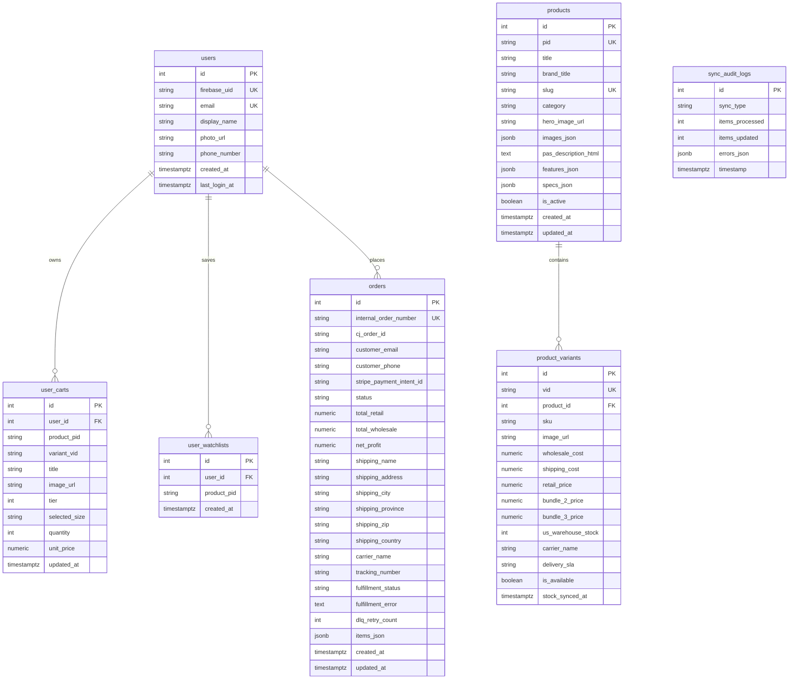
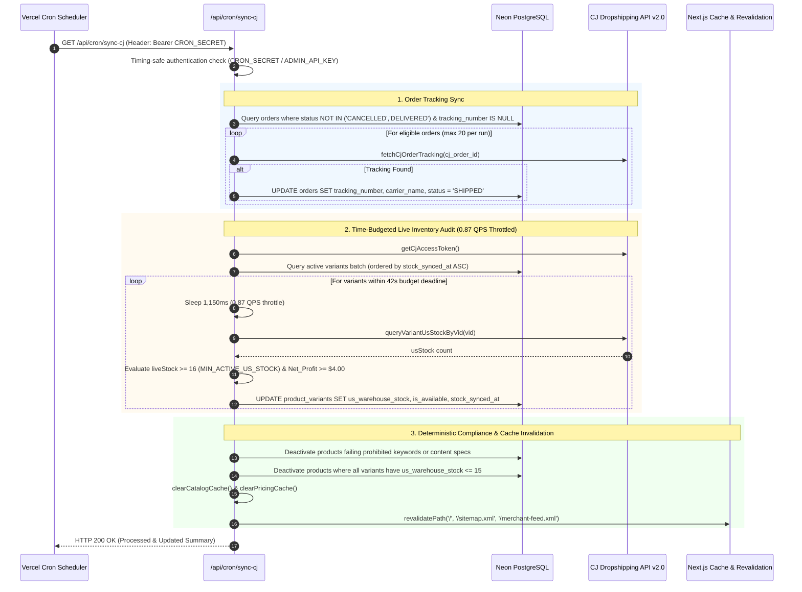
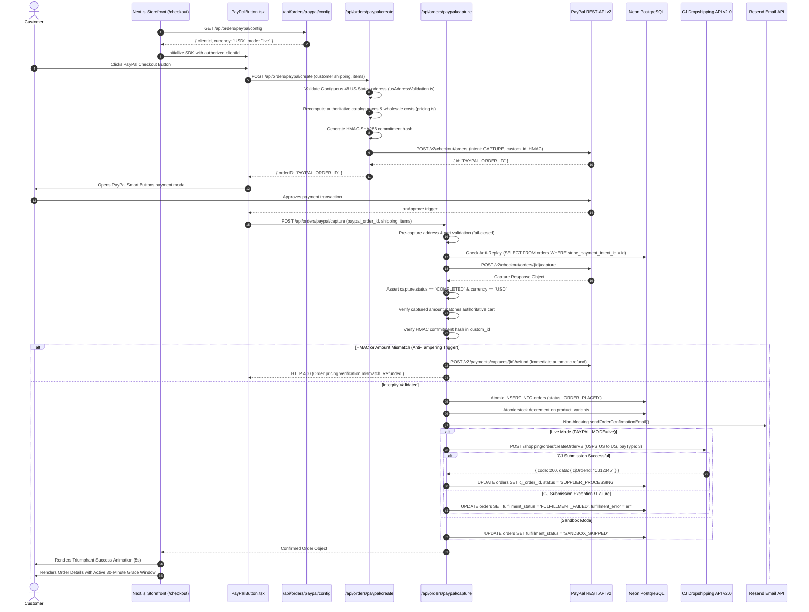
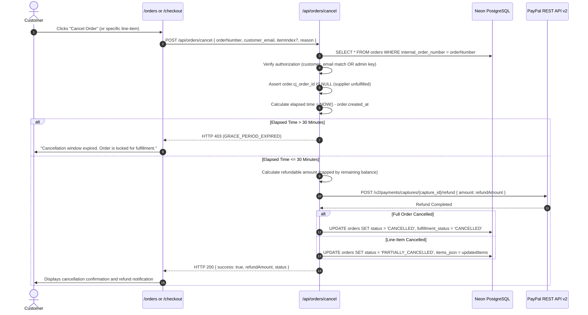
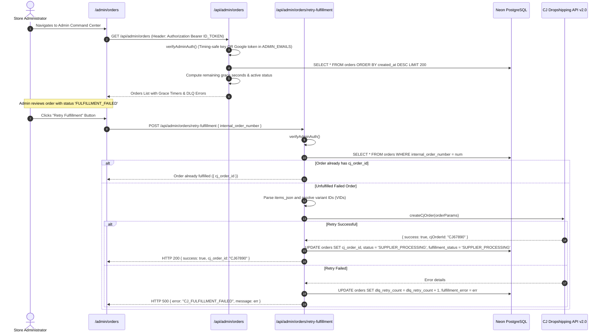
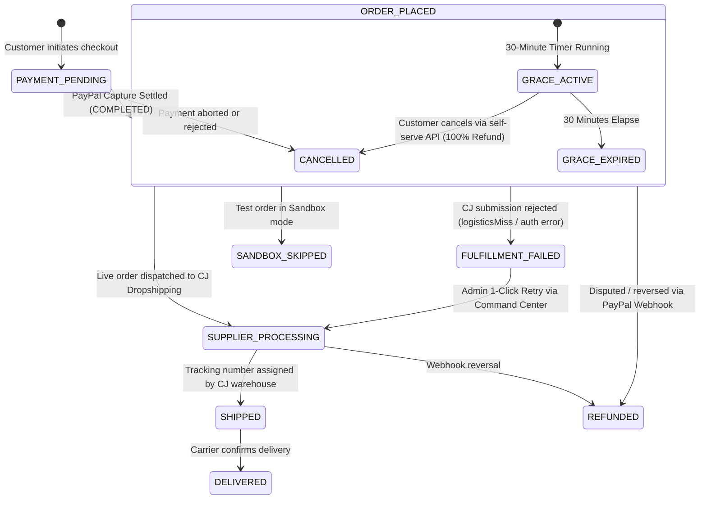

# 03 — System Design Document: Production Architecture

> **Document Version:** 2.0.0 (Production-Aligned)  
> **Status:** Production Standard  
> **Architecture Topology:** Option A — Unified Full-Stack Next.js 15 App Router on Vercel  
> **Database:** Neon Serverless PostgreSQL (`@neondatabase/serverless`)  
> **Payment Engine:** PayPal REST API v2 (Smart Buttons, Capture Intent, HMAC Commitments)  
> **Supplier Integration:** CJ Dropshipping API v2.0 (Native TypeScript Client)  
> **Last Updated:** 2026-11-14  

---

## Table of Contents

1. [Architecture Principles & Goals](#1-architecture-principles--goals)
2. [C4 Container Diagram](#2-c4-container-diagram)
3. [Component Breakdown](#3-component-breakdown)
4. [Database Schema & ERD (Neon PostgreSQL)](#4-database-schema--erd-neon-postgresql)
5. [Sequence Diagram 1 — Automated Catalog & Inventory Sync](#5-sequence-diagram-1--automated-catalog--inventory-sync)
6. [Sequence Diagram 2 — Zero-Touch Checkout & Order Fulfillment](#6-sequence-diagram-2--zero-touch-checkout--order-fulfillment)
7. [Sequence Diagram 3 — 30-Minute Grace Period & Self-Serve Cancellation](#7-sequence-diagram-3--30-minute-grace-period--self-serve-cancellation)
8. [Sequence Diagram 4 — Admin Command Center & DLQ Retry](#8-sequence-diagram-4--admin-command-center--dlq-retry)
9. [Order Lifecycle State Machine](#9-order-lifecycle-state-machine)
10. [Security & Anti-Fraud Architecture](#10-security--anti-fraud-architecture)
11. [Deployment & Infrastructure Topology](#11-deployment--infrastructure-topology)

---

## 1. Architecture Principles & Goals

Following the architectural consolidation detailed in [`docs/ARCHITECTURE_DECISION_RECORD.md`](file:///c:/Users/bodha/OneDrive/Desktop/DropShipping/docs/ARCHITECTURE_DECISION_RECORD.md), the system is deployed as a **Unified Full-Stack Next.js 15 App Router application on Vercel**. The legacy FastAPI backend on Render is retired.

### Core Architectural Goals:
1. **Single Source of Truth:** Next.js App Router serverless route handlers serve as the sole authoritative backend, eliminating split-brain routing and phantom orders.
2. **Zero-Trust Security:** Server-authoritative catalog pricing strictly ignores client prices; cryptographic HMAC commitments protect order integrity; timing-safe comparisons guard admin operations.
3. **Automated Supplier Fulfillment:** Seamless dispatch to CJ Dropshipping US domestic warehouses upon live payment capture, backed by defensive `logisticsMiss` assertion gates.
4. **Resilient Error Recovery:** An embedded Postgres Dead-Letter Queue (DLQ) state machine captures fulfillment exceptions and exposes a 1-click retry interface in the Admin Command Center (`/admin/orders`).
5. **Zero Baseline Operational Cost:** Optimized within the free tiers of Vercel and Neon Serverless PostgreSQL.
6. **Strict Domestic Fulfillment Boundary:** Delivery is limited to the **48 Contiguous United States and Washington, D.C.** via USPS Ground Advantage (3–5 business days), actively rejecting Alaska, Hawaii, US territories, APO/FPO military addresses, and P.O. Boxes.

---

## 2. C4 Container Diagram

```mermaid
flowchart TD
    subgraph CustomerDevice ["🛒 Customer / Admin Browser"]
        Client["React 19 Storefront Client\n(Tailwind CSS + Lucide Icons)"]
    end

    subgraph VercelCloud ["☁️ Vercel Global Edge & Serverless Platform"]
        EdgeRouter["Vercel Edge Network\n(CDN, Caching, SSL Termination)"]
        
        subgraph NextAppRouter ["Next.js 15 Full-Stack App Router"]
            UI["Server & Client Components\n(SSG / ISR Product Pages, Cart, Checkout)"]
            
            subgraph APIRoutes ["Authoritative API Route Handlers"]
                OrdersAPI["/api/orders/paypal/*\n(config, create, capture, webhook)"]
                CancelAPI["/api/orders/cancel\n(30-Min Grace Window, Refund)"]
                AddressAPI["/api/orders/address\n(Grace Period Address Update)"]
                AdminAPI["/api/admin/orders/*\n(Admin Command Center, DLQ Retry)"]
                CronAPI["/api/cron/sync-cj\n(Stock Audit >15, Tracking, ISR Purge)"]
                AuthAPI["/api/auth/*\n(Firebase User Sync, Cart & Watchlist)"]
            end
            
            subgraph CoreLibraries ["Shared Server Modules"]
                CJClient["cjClient.ts\n(CJ API v2.0, logisticsMiss Guard)"]
                PayPalLib["paypal.ts\n(HMAC Commitments, Tokens, Refunds)"]
                PricingLib["pricing.ts & bundlePricing.ts\n(Authoritative Catalog Pricing)"]
                AddressLib["usAddressValidation.ts\n(48 Contiguous US State Validation)"]
                AdminAuthLib["adminAuth.ts\n(Timing-Safe Key & Firebase Verification)"]
                EmailLib["email.ts\n(Transactional Resend Email)"]
                RedisLib["redis.ts\n(Upstash Redis Token Cache)"]
            end
        end
    end

    subgraph DataStorage ["🗄️ Managed Persistence Layer"]
        NeonDB[("Neon Serverless PostgreSQL\n(@neondatabase/serverless)\norders, users, carts, watchlists, products")]
        UpstashRedis[("Upstash Redis\n(Distributed CJ Token Cache)")]
    end

    subgraph ExternalServices ["🌐 External Cloud APIs"]
        PayPalAPI["PayPal REST API v2\n(OAuth2, Orders, Captures, Webhooks)"]
        CJAPI["CJ Dropshipping API v2.0\n(US Domestic Warehouses, 0.87 QPS)"]
        FirebaseAuth["Firebase Authentication\n(Google Sign-In, Identity Toolkit)"]
        ResendAPI["Resend Email API\n(Order Confirmation Delivery)"]
    end

    Client -->|HTTPS / Requests| EdgeRouter
    EdgeRouter --> UI
    EdgeRouter --> APIRoutes

    APIRoutes --> CoreLibraries
    CoreLibraries --> NeonDB
    CoreLibraries --> UpstashRedis

    OrdersAPI -->|OAuth & Payments| PayPalAPI
    CancelAPI -->|Refund Capture| PayPalAPI
    OrdersAPI -->|Cryptographic Webhook| PayPalAPI

    CJClient -->|createOrderV2 / Tracking| CJAPI
    AdminAuthLib -->|Token Verification| FirebaseAuth
    EmailLib -->|Transactional Email| ResendAPI
```

---

## 3. Component Breakdown

| Component | Technology | File Location | Responsibility |
|---|---|---|---|
| **Storefront UI** | Next.js 15, React 19, Tailwind CSS | [`storefront/src/app/`](file:///c:/Users/bodha/OneDrive/Desktop/DropShipping/storefront/src/app/) | Renders high-converting homepage, PDPs, cart, checkout, customer order tracker, and admin center |
| **Payment Controller** | Next.js Serverless Route Handlers | [`storefront/src/app/api/orders/paypal/`](file:///c:/Users/bodha/OneDrive/Desktop/DropShipping/storefront/src/app/api/orders/paypal/) | Generates config, creates orders with HMAC commitments, captures funds, verifies settlements, and processes webhooks |
| **Cancellation & Grace Manager** | Next.js Route Handler | [`storefront/src/app/api/orders/cancel/route.ts`](file:///c:/Users/bodha/OneDrive/Desktop/DropShipping/storefront/src/app/api/orders/cancel/route.ts) | Enforces 30-minute server-side grace window; triggers instant PayPal refunds on line-item or order cancellations |
| **Address & Shipping Gate** | Next.js Route Handler & Library | [`storefront/src/lib/usAddressValidation.ts`](file:///c:/Users/bodha/OneDrive/Desktop/DropShipping/storefront/src/lib/usAddressValidation.ts) | Validates domestic street addresses, cities, states, ZIP codes, and phones against the 48 Contiguous US States (rejects AK/HI/PO) |
| **Fulfillment Client** | Native TypeScript CJ Client | [`storefront/src/lib/cjClient.ts`](file:///c:/Users/bodha/OneDrive/Desktop/DropShipping/storefront/src/lib/cjClient.ts) | Manages CJ API v2.0 authentication, order submission via `/shopping/order/createOrderV2`, `logisticsMiss` assertions, and idempotency |
| **Authoritative Pricing Engine** | TypeScript Module | [`storefront/src/lib/pricing.ts`](file:///c:/Users/bodha/OneDrive/Desktop/DropShipping/storefront/src/lib/pricing.ts) | Recomputes line-item prices, wholesale costs, volume discounts (1x/2x/3x), and cart totals server-side |
| **Admin Command Center** | Next.js UI & Admin API | [`storefront/src/app/admin/orders/`](file:///c:/Users/bodha/OneDrive/Desktop/DropShipping/storefront/src/app/admin/orders/) | Real-time monitoring of orders, active grace countdowns, DLQ failure inspection, and 1-click manual retry |
| **Maintenance Cron** | Vercel Cron Route Handler | [`storefront/src/app/api/cron/sync-cj/route.ts`](file:///c:/Users/bodha/OneDrive/Desktop/DropShipping/storefront/src/app/api/cron/sync-cj/route.ts) | Scheduled stock audits (`> 15` units floor), tracking sync, compliance checks, and ISR cache revalidation |
| **Authentication Sync** | Next.js Route Handlers | [`storefront/src/app/api/auth/`](file:///c:/Users/bodha/OneDrive/Desktop/DropShipping/storefront/src/app/api/auth/) | Merges guest carts and watchlists into Neon PostgreSQL on Firebase Google Sign-In |

---

## 4. Database Schema & ERD (Neon PostgreSQL)

---

## 5. Sequence Diagram 1 — Automated Catalog & Inventory Sync

Executed on a scheduled cadence via Vercel Cron or manual admin trigger.

---

## 6. Sequence Diagram 2 — Zero-Touch Checkout & Order Fulfillment

---

## 7. Sequence Diagram 3 — 30-Minute Grace Period & Self-Serve Cancellation

---

## 8. Sequence Diagram 4 — Admin Command Center & DLQ Retry

---

## 9. Order Lifecycle State Machine

---

## 10. Security & Anti-Fraud Architecture

1. **Zero Client Trust Pricing:** All pricing calculations occur server-side inside [`storefront/src/lib/pricing.ts`](file:///c:/Users/bodha/OneDrive/Desktop/DropShipping/storefront/src/lib/pricing.ts). Client price fields are ignored.
2. **Cryptographic HMAC Commitment:** When an order is created on PayPal, the server embeds an HMAC-SHA256 signature of `{ total, currency, items: [{ vid, quantity }] }` keyed with `PAYPAL_CLIENT_SECRET` into `purchase_units[0].custom_id`. On capture, the server recomputes the HMAC and verifies that the captured payment matches the exact cart state.
3. **Automated Price Mismatch Refund:** If a price difference $> \$0.05$ or an invalid HMAC commitment is detected on capture, an immediate automated refund is issued via PayPal API to protect the store from manipulated requests.
4. **Anti-Replay Idempotency:** The database indexes `stripe_payment_intent_id` (storing the PayPal transaction ID). If a duplicate capture request arrives, it returns the existing order record without double-capturing or creating secondary orders.
5. **Cryptographic Webhook Signature Verification:** Incoming webhooks are validated using PayPal's `/v1/notifications/verify-webhook-signature` API, with certificate URLs pinned strictly to official PayPal domains (`api.paypal.com`, `api-m.paypal.com`).
6. **Timing-Safe Admin Authentication:** Administrative keys are verified using `crypto.timingSafeEqual` to eliminate side-channel timing attacks. Firebase tokens are validated against Google Identity Toolkit and checked against authorized `ADMIN_EMAILS`.
7. **Strict Geographic Address Gate:** Non-contiguous states (Alaska, Hawaii), US territories, military installations, and P.O. Boxes are blocked prior to payment authorization.

---

## 11. Deployment & Infrastructure Topology

- **Vercel Project:** Hosts the entire full-stack application (Next.js 15 App Router).
- **Database:** Neon Serverless PostgreSQL with auto-scaling compute and connection pooling over WebSocket/HTTP.
- **Cache:** Upstash Serverless Redis for distributed CJ access token sharing and rate-limit counters.
- **Environment Configuration:**
  - `DATABASE_URL`: Connection string to Neon PostgreSQL
  - `PAYPAL_CLIENT_ID`: Authoritative PayPal REST API Client ID
  - `PAYPAL_CLIENT_SECRET`: Authoritative PayPal Secret
  - `PAYPAL_MODE`: `live` (Production) or `sandbox` (Testing)
  - `PAYPAL_WEBHOOK_ID`: PayPal Webhook ID for signature verification
  - `CJ_API_KEY`: CJ Dropshipping API key
  - `ADMIN_API_KEY`: High-entropy timing-safe secret for admin endpoints
  - `ADMIN_EMAILS`: Comma-separated list of authorized administrator Google accounts
  - `RESEND_API_KEY`: API key for transactional emails
  - `UPSTASH_REDIS_REST_URL` & `UPSTASH_REDIS_REST_TOKEN`: Upstash Redis credentials
  - `CRON_SECRET`: High-entropy secret authorizing scheduled cron runs

---

*End of System Design Document — Version 2.0.0 (Production-Aligned)*
