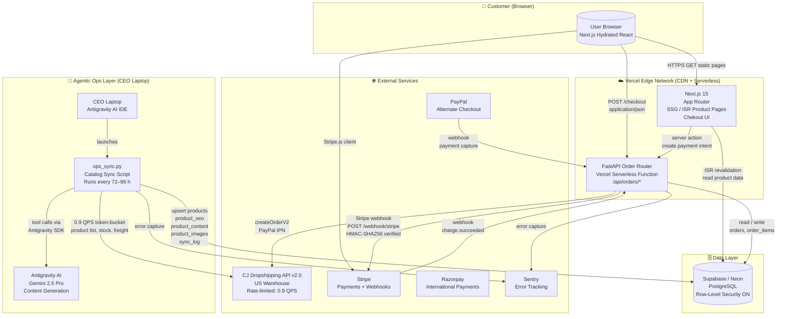
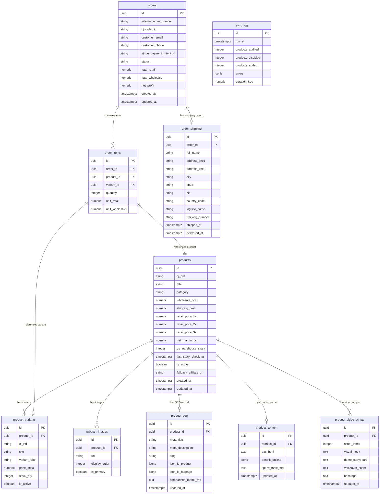
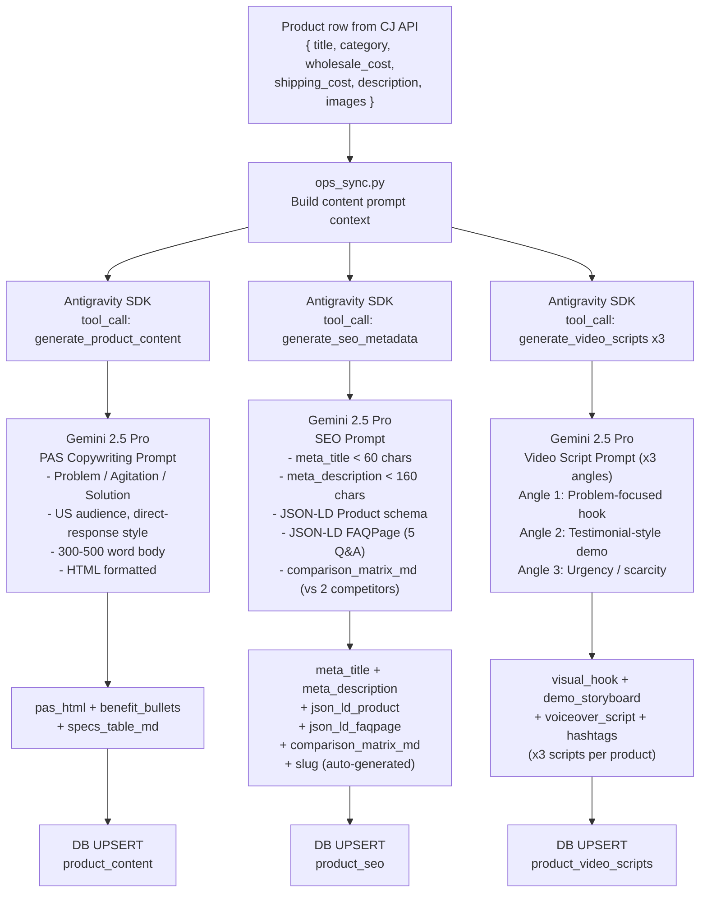

# 03 — System Design Document: Architecture
<!-- docs/03_SDD_ARCHITECTURE.md -->

| Field        | Value                                         |
|--------------|-----------------------------------------------|
| **Version**  | 1.0.0                                         |
| **Status**   | Approved — Active Implementation              |
| **Authors**  | Platform Architect, CEO / Solo Operator       |
| **Created**  | 2025-01-01                                    |
| **Updated**  | 2025-01-01                                    |
| **Scope**    | Full system architecture for US dropshipping platform |

---

## Table of Contents

1. [Architecture Goals](#1-architecture-goals)
2. [C4 Container Diagram](#2-c4-container-diagram)
3. [Component Breakdown](#3-component-breakdown)
4. [Full Database ERD](#4-full-database-erd)
5. [Sequence Diagram 1 — 72-Hour Catalog Sync](#5-sequence-diagram-1--72-hour-catalog-sync)
6. [Sequence Diagram 2 — Zero-Touch Checkout & Order Flow](#6-sequence-diagram-2--zero-touch-checkout--order-flow)
7. [Order Lifecycle State Machine](#7-order-lifecycle-state-machine)
8. [API Rate Limiting Architecture](#8-api-rate-limiting-architecture)
9. [Security Design](#9-security-design)
10. [Data Flow — AI Content Generation](#10-data-flow--ai-content-generation)
11. [Deployment Architecture](#11-deployment-architecture)
12. [Observability](#12-observability)
13. [Scalability Path](#13-scalability-path)

---

## 1. Architecture Goals

This document describes the end-to-end system architecture for a headless, zero-inventory US dropshipping storefront. The system is intentionally designed around **\$0 monthly infrastructure cost** at launch while maintaining production-grade reliability and data integrity.

### 1.1 Availability Targets

| Component               | Target Uptime | Strategy                                     |
|-------------------------|---------------|----------------------------------------------|
| Storefront (Next.js)    | 99.9 %        | Vercel Edge CDN; static pages survive API downtime |
| Order API (FastAPI)     | 99.5 %        | Vercel Serverless auto-restart; Railway fallback |
| Database (Supabase PG)  | 99.5 %        | Managed Postgres; point-in-time recovery     |
| Catalog Sync            | Best-effort   | Manual CEO-triggered; failure is non-fatal   |
| CJ Dropshipping API     | SLA: 99 %     | External dependency; guarded with fallbacks  |

### 1.2 Performance Targets

| Metric                           | Target                        |
|----------------------------------|-------------------------------|
| Core Web Vitals — LCP            | < 2.5 s (SSG pages)           |
| Core Web Vitals — CLS            | < 0.1                         |
| Core Web Vitals — INP            | < 200 ms                      |
| Checkout API p95 latency         | < 1.5 s                       |
| Stripe webhook processing        | < 5 s end-to-end              |
| CJ order submission              | < 10 s (includes dry-run + live) |
| Catalog sync throughput          | ≥ 500 products per run        |

### 1.3 Cost Constraint — \$0 Infrastructure

Every infrastructure choice must fit within free tiers at launch:

| Service        | Free Tier Limit                           | Our Usage Profile              |
|----------------|-------------------------------------------|--------------------------------|
| Vercel         | 100 GB bandwidth / mo; 100k fn invocations | < 10 GB; < 5k orders/mo       |
| Supabase       | 500 MB database; 2 GB bandwidth           | < 200 MB at launch             |
| Sentry         | 5k errors/mo                              | < 1k errors/mo expected        |
| Railway        | \$5 credit/mo (free trial)                | FastAPI fallback only          |
| Stripe         | 2.9 % + \$0.30 per transaction            | Revenue-proportional; no fixed cost |

### 1.4 Maintainability Principles

- **Solo operator model**: All operational tasks must be executable by one non-engineer CEO using Antigravity AI assistance.
- **No microservice sprawl**: Maximum 3 deployed services (Next.js, FastAPI, Supabase).
- **Schema migrations are version-controlled**: Every DDL change is a numbered Alembic migration committed to Git.
- **Agentic automation**: The `ops_sync.py` script is the single source of truth for catalog freshness. It must be idempotent — re-running it always produces a safe outcome.
- **Configuration over code**: All supplier, payment, and deployment parameters live in environment variables, never hardcoded.

### 1.5 Observability Targets

- Every unhandled exception captured in Sentry with full stack trace and request context.
- Every `ops_sync.py` run writes a structured row to `sync_log` within the database.
- Order state transitions emit structured log events consumable by Sentry breadcrumbs.
- No PII (email, phone, address) appears in any log line, Sentry event, or console output — only masked identifiers.

---

## 2. C4 Container Diagram

The following diagram presents a C4 Level 2 (Container) view of the system, showing all runtime processes, data stores, and external services, and the communication channels between them.



### 2.1 Key Architectural Decisions Reflected in the Diagram

1. **Vercel hosts both the storefront and the order API** — This eliminates a separate always-on server cost. The FastAPI router runs as a Vercel Python serverless function in the `/api` route namespace.
2. **The CEO laptop is a first-class runtime node** — `ops_sync.py` is not a cron job on a cloud server; it is intentionally run manually or via Antigravity automation to preserve zero-infra-cost.
3. **Antigravity AI is an in-process tool call** — The sync script invokes Gemini 2.5 Pro via the Antigravity SDK for content generation; results are synchronous within the script loop.
4. **Supabase is the single database** — No Redis, no Elasticsearch at launch. Rate limiting uses an in-process token bucket during sync.

---

## 3. Component Breakdown

| # | Component | Technology | Hosting | Purpose | SLO |
|---|-----------|-----------|---------|---------|-----|
| 1 | **Storefront** | Next.js 15, React 19, Tailwind CSS | Vercel (free) | Product catalog display, SEO-optimized static pages, cart UI, checkout initiation | 99.9 % uptime via static CDN |
| 2 | **Order Router API** | FastAPI 0.115, Python 3.12, Pydantic v2 | Vercel Serverless (Python runtime) | Receives checkout form, calls Stripe, processes webhooks, submits orders to CJ, writes to DB | p95 < 1.5 s |
| 3 | **Application Database** | PostgreSQL 15 (Supabase managed) | Supabase (free 500 MB) | Persistent store for all products, variants, orders, sync metadata | 99.5 % uptime; automated backups |
| 4 | **Catalog Sync Agent** | Python 3.12, `ops_sync.py`, Antigravity SDK | CEO Laptop (local) | Authenticates to CJ, audits stock, computes margins, triggers AI content generation, upserts DB | Best-effort; manual trigger |
| 5 | **AI Content Engine** | Antigravity / Gemini 2.5 Pro | Cloud (API call from laptop) | Generates PAS copy, SEO metadata, JSON-LD, FAQ, video scripts for each product | < 30 s per product |
| 6 | **CJ Dropshipping API** | REST API v2.0, JWT auth | CJ infrastructure (external) | Product catalog, real-time stock, freight calculation, order submission and tracking | External SLA 99 % |
| 7 | **Payment — Stripe** | Stripe API v2024, Stripe.js | Stripe cloud (external) | Primary payment processing, webhook delivery, refund handling | Stripe SLA 99.99 % |
| 8 | **Payment — PayPal** | PayPal REST API v2 | PayPal cloud (external) | Alternate checkout for PayPal-preferred customers | External SLA 99.9 % |
| 9 | **Payment — Razorpay** | Razorpay API v1 | Razorpay cloud (external) | International payment fallback, UPI, cards outside US | External SLA 99.9 % |
| 10 | **Error Tracking** | Sentry SDK (Python + JS) | Sentry cloud (free 5k/mo) | Real-time exception capture, sync failure alerts, order failure alerts | Best-effort alerting |
| 11 | **CDN / Edge** | Vercel Edge Network | Global PoPs | Static asset delivery, ISR cache, TLS termination | 99.99 % (Vercel SLA) |

---

## 4. Full Database ERD

The following entity-relationship diagram covers all 10 tables. Cardinality notation follows Mermaid `erDiagram` conventions: `||--o{` means "one to zero-or-many."



### 4.1 Table Notes

**`products`**
- `cj_pid` is the CJ Dropshipping product ID, must be unique and indexed.
- `retail_price_1x / 2x / 3x` store pre-computed markup tiers for display on PDPs.
- `net_margin_pct` is recomputed on every sync: `(retail - wholesale - shipping) / retail * 100`.
- `is_active = false` deactivates a product from Next.js ISR without deletion, preserving order history FK integrity.
- `fallback_affiliate_url` is used if a product is temporarily out of stock — the PDP shows an affiliate link instead.

**`product_variants`**
- `cj_vid` is the CJ variant ID used in `createOrderV2` and stock queries.
- `price_delta` is added to the parent product's base price for variant-specific pricing.

**`product_seo`**
- `json_ld_product` stores the complete JSON-LD `Product` schema as JSONB.
- `json_ld_faqpage` stores the FAQ schema for voice search optimization.
- `slug` must be unique and is used as the Next.js route segment (`/products/[slug]`).

**`orders`**
- `status` is a constrained enum: `PENDING_PAYMENT | PAYMENT_CAPTURED | ORDER_SUBMITTED_DRY_RUN | ORDER_CONFIRMED | FULFILLMENT_IN_PROGRESS | SHIPPED | DELIVERED | CLOSED | PAYMENT_FAILED | FULFILLMENT_FAILED | CANCELLED | REFUNDED`.
- `internal_order_number` is a human-readable ID (`DS-YYYYMMDD-XXXX`) used in CJ's `orderNumber` field — the field that drives idempotency via CJ error code `1603003`.

**`sync_log`**
- `errors` is a JSONB array of structured error objects: `[{ "cj_pid": "...", "step": "freight_calc", "message": "..." }]`.
- This table is the primary audit trail for the ops_sync.py agent.

---

## 5. Sequence Diagram 1 — 72-Hour Catalog Sync

This diagram shows the complete `ops_sync.py` execution flow, including CJ API orchestration, the 0.9 QPS throttle, ghost inventory guard, margin check, and Antigravity AI content generation.

```mermaid
sequenceDiagram
    autonumber
    actor CEO as CEO / Antigravity IDE
    participant SYNC as ops_sync.py
    participant TB as Token Bucket (0.9 QPS)
    participant CJ as CJ Dropshipping API
    participant AGY as Antigravity AI (Gemini 2.5 Pro)
    participant DB as Supabase PostgreSQL

    CEO->>SYNC: python ops_sync.py (manual trigger or Antigravity scheduled task)
    activate SYNC

    Note over SYNC: Phase 1 — Authentication
    SYNC->>TB: acquire()
    TB-->>SYNC: granted (1.11 s min interval)
    SYNC->>CJ: POST /authentication/getAccessToken
    CJ-->>SYNC: 200 OK { accessToken, expiredTime (180 days) }
    SYNC->>SYNC: Store token in memory; log expiry date

    Note over SYNC: Phase 2 — Fetch Product Catalog
    SYNC->>TB: acquire()
    TB-->>SYNC: granted
    SYNC->>CJ: GET /product/list?countryCode=US&startWarehouseInventory=50&pageNum=1
    CJ-->>SYNC: 200 OK { productList: [...], totalCount: N }
    SYNC->>SYNC: Paginate until all pages fetched (throttled per page)

    Note over SYNC: Phase 3 — Ghost Inventory Filter
    loop For each product in list
        SYNC->>TB: acquire()
        TB-->>SYNC: granted
        SYNC->>CJ: POST /product/stock/queryByVid (all vids for product)
        CJ-->>SYNC: 200 OK { stockList: [{ vid, quantity }] }
        SYNC->>SYNC: Assert ALL variants quantity >= 50 (US warehouse)\nIf any variant < 50 → mark product SKIP (ghost inventory)
    end

    Note over SYNC: Phase 4 — Freight Calculation + Margin Check
    loop For each non-SKIP product
        SYNC->>TB: acquire()
        TB-->>SYNC: granted
        SYNC->>CJ: POST /logistic/freightCalculate\n{ fromCountryCode: "US", toCountryCode: "US", vid: ..., quantity: 1 }
        CJ-->>SYNC: 200 OK { logisticsMiss: false/true, postageAmount: X, logisticName: "..." }
        SYNC->>SYNC: GUARD: Assert logisticsMiss == false AND postageAmount > 0\nIf guard fails → skip product, log error
        SYNC->>SYNC: Compute net_margin_pct = (retail_2x - wholesale - postageAmount) / retail_2x\nIf margin < 25% → skip product
    end

    Note over SYNC: Phase 5 — AI Content Generation (per qualifying product)
    loop For each margin-passing product
        SYNC->>AGY: Tool call: generate_product_content(product_data, category, competitor_context)
        AGY-->>SYNC: { pas_html, benefit_bullets[], specs_table_md }
        SYNC->>AGY: Tool call: generate_seo_metadata(product_data, slug)
        AGY-->>SYNC: { meta_title, meta_description, json_ld_product, json_ld_faqpage, comparison_matrix_md }
        SYNC->>AGY: Tool call: generate_video_scripts(product_data, hook_angle) x3
        AGY-->>SYNC: [{ visual_hook, demo_storyboard, voiceover_script, hashtags }] x3
    end

    Note over SYNC: Phase 6 — Database Upsert
    loop For each processed product
        SYNC->>DB: UPSERT products ON CONFLICT (cj_pid)\nSET wholesale_cost, shipping_cost, us_warehouse_stock,\nretail_price_1x/2x/3x, net_margin_pct, is_active, updated_at
        SYNC->>DB: UPSERT product_variants ON CONFLICT (cj_vid)
        SYNC->>DB: UPSERT product_images (replace set for product_id)
        SYNC->>DB: UPSERT product_seo ON CONFLICT (product_id)
        SYNC->>DB: UPSERT product_content ON CONFLICT (product_id)
        SYNC->>DB: UPSERT product_video_scripts (replace set for product_id)
        DB-->>SYNC: 200 OK rowsAffected
    end

    Note over SYNC: Phase 7 — Disable Ghost Products
    SYNC->>DB: UPDATE products SET is_active = false\nWHERE cj_pid NOT IN (this_run_active_pids)\nAND is_active = true
    DB-->>SYNC: Rows disabled

    Note over SYNC: Phase 8 — Write Sync Log
    SYNC->>DB: INSERT INTO sync_log\n{ run_at, products_audited, products_disabled, products_added, errors[], duration_sec }
    DB-->>SYNC: 200 OK
    SYNC-->>CEO: Print summary report + Sentry flush
    deactivate SYNC
```

### 5.1 0.9 QPS Token Bucket — Implementation Note

The `Token Bucket` shown above is an in-process Python object instantiated at sync startup:

```python
# ops_sync.py — TokenBucket implementation
import time
import threading

class TokenBucket:
    """Enforces 0.9 QPS (1.11 s minimum between calls) on CJ API."""
    def __init__(self, rate: float = 0.9):
        self._interval = 1.0 / rate        # 1.111 seconds
        self._last_call = 0.0
        self._lock = threading.Lock()

    def acquire(self):
        with self._lock:
            now = time.monotonic()
            wait = self._interval - (now - self._last_call)
            if wait > 0:
                time.sleep(wait)
            self._last_call = time.monotonic()
```

This approach requires no Redis and has zero infrastructure cost. All CJ API calls are serialized through `tb.acquire()` before dispatch.

---

## 6. Sequence Diagram 2 — Zero-Touch Checkout & Order Flow

This diagram covers the full customer checkout path from cart submission through CJ order confirmation.

```mermaid
sequenceDiagram
    autonumber
    actor Customer as Customer Browser
    participant NX as Next.js (Vercel)
    participant ST as Stripe API
    participant WH as FastAPI /webhook/stripe
    participant FA as FastAPI Order Router
    participant CJ as CJ Dropshipping API
    participant DB as Supabase PostgreSQL

    Customer->>NX: Submit checkout form\n{ items[], shipping_address, email }
    NX->>FA: POST /api/orders/create-payment-intent\n{ cart_items, customer_info }
    FA->>DB: SELECT product variants, prices, stock (READ)
    DB-->>FA: Product rows with unit_retail, cj_vid, logistic_name
    FA->>ST: POST /payment_intents\n{ amount, currency: "usd", metadata: { internal_order_number } }
    ST-->>FA: { client_secret, payment_intent_id }
    FA-->>NX: { client_secret }
    NX->>Customer: Render Stripe Elements with client_secret

    Customer->>ST: Confirm card payment via Stripe.js\n(card details never touch our servers)
    ST-->>Customer: Payment processing...

    Note over ST,WH: Stripe delivers signed webhook
    ST->>WH: POST /webhook/stripe\nEvent: payment_intent.succeeded\nHeader: Stripe-Signature: t=...,v1=...
    WH->>WH: VERIFY: stripe.construct_event(payload, sig, STRIPE_WEBHOOK_SECRET)\nIf signature invalid → 400 reject immediately
    WH->>DB: INSERT INTO orders\n{ internal_order_number, stripe_payment_intent_id,\nstatus: PAYMENT_CAPTURED, customer_email_hash, ... }
    DB-->>WH: order.id created
    WH->>DB: INSERT INTO order_items, INSERT INTO order_shipping
    DB-->>WH: OK

    Note over WH,CJ: Dry-run submission (payType=3)
    WH->>CJ: POST /shopping/order/createOrderV2\n{ orderNumber: internal_order_number,\npayType: 3,\nfromCountryCode: "US",\nlogisticName: from_freight_calc,\nproducts: [...] }
    CJ-->>WH: Response A or B (see below)

    alt CJ returns code 1603003 (duplicate orderNumber)
        Note over WH: IDEMPOTENCY: Order already exists on CJ side
        WH->>CJ: GET /shopping/order/getOrderDetail?orderNum=internal_order_number
        CJ-->>WH: Existing CJ order details
        WH->>DB: UPDATE orders SET cj_order_id = ..., status = ORDER_CONFIRMED
    else CJ dry-run success
        WH->>WH: GUARD: Assert logisticsMiss == false AND postageAmount > 0\nIf guard fails → SET status = FULFILLMENT_FAILED, alert Sentry
        Note over WH,CJ: Live submission (payType=1)
        WH->>CJ: POST /shopping/order/createOrderV2\n{ same payload, payType: 1 }
        CJ-->>WH: { code: 200, data: { cjOrderId, orderNum, ... } }
        WH->>DB: UPDATE orders\nSET cj_order_id = cjOrderId,\nstatus = ORDER_CONFIRMED,\ntotal_wholesale = amount,\nnet_profit = retail - wholesale - shipping
        DB-->>WH: OK
    else CJ returns error (non-1603003)
        WH->>DB: UPDATE orders SET status = FULFILLMENT_FAILED
        WH->>WH: Capture exception in Sentry with full CJ response
        WH-->>Customer: Email: "Order delay — manual review" (via Stripe metadata email hook)
    end

    WH->>DB: UPDATE orders SET status = FULFILLMENT_IN_PROGRESS
    WH-->>ST: 200 OK (acknowledge webhook; Stripe will retry if non-2xx)
    Customer->>NX: Poll GET /api/orders/status?payment_intent_id=...
    NX->>FA: Forward status query
    FA->>DB: SELECT orders WHERE stripe_payment_intent_id = ?
    DB-->>FA: { status: ORDER_CONFIRMED, internal_order_number }
    FA-->>NX: { status, order_number }
    NX-->>Customer: Display order confirmation page
```

### 6.1 Critical Field Injection

When calling `createOrderV2`, the following fields are **always** injected regardless of what the cart payload contains:

```python
order_payload = {
    "orderNumber": order.internal_order_number,
    "fromCountryCode": "US",                       # Required field — always US warehouse
    "logisticName": product.logistic_name,         # From freight calc at sync time
    "payType": 3,                                  # Dry-run first, then 1 for live
    "products": [
        {
            "vid": item.cj_vid,
            "quantity": item.quantity,
            "shippingName": order_shipping.full_name,
            "shippingCountryCode": "US",
            "shippingProvince": order_shipping.state,
            "shippingCity": order_shipping.city,
            "shippingAddress": order_shipping.address_line1,
            "shippingZip": order_shipping.zip,
            "shippingPhone": order_shipping.customer_phone,
        }
    ]
}
```

---

## 7. Order Lifecycle State Machine

```mermaid
stateDiagram-v2
    [*] --> PENDING_PAYMENT : Customer submits checkout

    PENDING_PAYMENT --> PAYMENT_CAPTURED : Stripe payment_intent.succeeded webhook received & verified
    PENDING_PAYMENT --> PAYMENT_FAILED : Stripe payment_intent.payment_failed webhook

    PAYMENT_FAILED --> [*] : No further action; customer notified by Stripe

    PAYMENT_CAPTURED --> ORDER_SUBMITTED_DRY_RUN : createOrderV2 payType=3 dispatched to CJ

    ORDER_SUBMITTED_DRY_RUN --> ORDER_CONFIRMED : Dry-run success AND logisticsMiss==false\nAND live payType=1 accepted by CJ\n(or idempotency code 1603003 resolved)
    ORDER_SUBMITTED_DRY_RUN --> FULFILLMENT_FAILED : logisticsMiss==true\nOR postageAmount==0\nOR CJ non-recoverable error

    ORDER_CONFIRMED --> FULFILLMENT_IN_PROGRESS : CJ begins warehouse pick-pack

    FULFILLMENT_IN_PROGRESS --> SHIPPED : CJ tracking number assigned\norder_shipping.tracking_number populated

    FULFILLMENT_IN_PROGRESS --> FULFILLMENT_FAILED : CJ cancels order\n(item unavailable after submission)

    SHIPPED --> DELIVERED : Carrier marks package delivered\norder_shipping.delivered_at set

    DELIVERED --> CLOSED : Auto-close after 7-day return window\nor manual CEO action

    CLOSED --> REFUNDED : Customer opens dispute; Stripe refund issued

    FULFILLMENT_FAILED --> CANCELLED : CEO reviews; decides not to retry
    FULFILLMENT_FAILED --> ORDER_SUBMITTED_DRY_RUN : CEO retries via ops panel

    CANCELLED --> REFUNDED : CEO issues Stripe refund

    REFUNDED --> [*] : Terminal state
    CLOSED --> [*] : Terminal state (if not refunded)
```



### 7.1 State Transition Rules

| Transition | Trigger | Actor | Side Effects |
|---|---|---|---|
| `PENDING_PAYMENT` → `PAYMENT_CAPTURED` | Stripe webhook `payment_intent.succeeded` | System | Create `orders`, `order_items`, `order_shipping` rows |
| `PAYMENT_CAPTURED` → `ORDER_SUBMITTED_DRY_RUN` | FastAPI webhook handler | System | Call CJ `createOrderV2` payType=3 |
| `ORDER_SUBMITTED_DRY_RUN` → `ORDER_CONFIRMED` | CJ dry-run + live success | System | Write `cj_order_id`; compute `net_profit` |
| `ORDER_SUBMITTED_DRY_RUN` → `FULFILLMENT_FAILED` | logisticsMiss guard or CJ error | System | Sentry alert; CEO notified |
| `FULFILLMENT_IN_PROGRESS` → `SHIPPED` | CJ webhook / polling | System | Populate `tracking_number`, `logistic_name`, `shipped_at` |
| `SHIPPED` → `DELIVERED` | Carrier event | System | Set `delivered_at` |
| `DELIVERED` → `CLOSED` | 7-day TTL or CEO action | CEO / Cron | Final; archive record |
| Any → `REFUNDED` | CEO via Stripe dashboard | CEO | Stripe refund issued; record updated |

---

## 8. API Rate Limiting Architecture

### 8.1 Problem Statement

CJ Dropshipping enforces an undocumented but empirically observed rate limit of approximately **1 request per second per access token**. Exceeding this results in HTTP 429 responses that temporarily invalidate the session and delay the entire sync run. We intentionally target **0.9 QPS** (10 % buffer) to stay comfortably within limits.

### 8.2 Token Bucket Design

A token bucket algorithm is used because it allows short bursts (a single token available immediately) while enforcing a long-run average rate. In our configuration, we set the bucket to hold exactly **1 token** with a refill rate of 0.9 tokens per second, making it functionally equivalent to a sliding window with a 1.11-second minimum gap between calls.

```
Token Bucket Parameters:
  capacity   = 1 token
  refill rate = 0.9 tokens/second (1 token every 1.111 seconds)
  initial    = 1 token (first call is instant)
```

**Behavior:**
- First CJ call: immediate dispatch (1 token consumed).
- Subsequent calls: thread sleeps until 1.111 s have elapsed since the last call.
- If sync script is interrupted and restarted: bucket resets (safe, idempotent sync design).

### 8.3 In-Process vs. Redis Comparison

| Attribute | In-Process TokenBucket (Current) | Redis INCR / Sliding Window (Future) |
|---|---|---|
| Infrastructure cost | \$0 | \$15–20/mo (Redis Cloud) |
| Multi-process safe | No (single process) | Yes |
| Persistence across restarts | No (resets cleanly) | Yes |
| Suitable for ops_sync.py | **Yes — single-threaded script** | Overkill |
| Suitable for FastAPI (if CJ calls added) | No | **Yes** |

**Decision:** The in-process token bucket is correct for `ops_sync.py` which is a single-process, single-threaded script. FastAPI order submission also calls CJ (`createOrderV2`) but these are low-frequency (one per customer order) and do not require rate limiting at launch.

### 8.4 Retry Strategy for CJ API Errors

All CJ API calls in `ops_sync.py` wrap the token bucket with an exponential backoff retry:

```
Retry Policy:
  Max retries     : 3
  Backoff base    : 2 s
  Backoff formula : base^attempt  (2s, 4s, 8s)
  Jitter          : ±0.5 s random
  Retry on        : HTTP 429, HTTP 5xx, socket timeout
  Do not retry    : HTTP 400 (bad request), HTTP 401 (auth — re-auth first)
```

### 8.5 CJ API Auth Token Management

The 180-day JWT returned by `/authentication/getAccessToken` is stored as follows:

| Layer | Storage | Rotation |
|---|---|---|
| ops_sync.py runtime | In-memory only (no disk write) | Re-fetched on each sync run |
| FastAPI serverless | Environment variable `CJ_ACCESS_TOKEN` | CEO manually refreshes every 150 days (Vercel dashboard) |
| Expiry detection | Check `expiredTime` field in response | Log warning if < 30 days remaining |

---

## 9. Security Design

### 9.1 Stripe Webhook Signature Verification

Every POST to `/webhook/stripe` is cryptographically verified before any business logic executes. The verification is non-negotiable and cannot be bypassed:

```python
import stripe
from fastapi import Request, HTTPException

async def stripe_webhook(request: Request):
    payload = await request.body()
    sig_header = request.headers.get("Stripe-Signature")
    
    try:
        event = stripe.Webhook.construct_event(
            payload, sig_header, settings.STRIPE_WEBHOOK_SECRET
        )
    except stripe.error.SignatureVerificationError:
        raise HTTPException(status_code=400, detail="Invalid webhook signature")
    
    # Only process events after signature is verified
    ...
```

- `STRIPE_WEBHOOK_SECRET` is a Vercel environment variable (`whsec_...`), never committed to Git.
- The webhook endpoint returns HTTP 200 immediately after verification and dispatches async processing. Stripe will retry delivery for up to 72 hours on non-2xx responses.
- Replay protection: Stripe includes a timestamp in the signature. Events older than 300 seconds are rejected by the SDK automatically.

### 9.2 CJ API Key Storage and Rotation

| Secret | Storage Location | Rotation Procedure |
|---|---|---|
| `CJ_API_KEY` (email + API key) | Vercel env var + local `.env` (gitignored) | Rotate via CJ dashboard; update Vercel env; redeploy |
| CJ Access Token (JWT) | In-memory (ops_sync.py) / Vercel env var | Re-fetched on each sync; manual update every 150 days |
| CJ App Key | Vercel env var | Rotated only on compromise |

**Never stored:**
- CJ credentials are never written to the database.
- CJ credentials are never logged (stdout, Sentry, or file).
- `.env` is in `.gitignore`; a pre-commit hook blocks accidental commit of secrets.

### 9.3 Supabase Row-Level Security

Supabase RLS is **enabled** on all tables. The application uses two database roles:

| Role | Permissions | Used By |
|---|---|---|
| `anon` | SELECT on `products`, `product_variants`, `product_images`, `product_seo`, `product_content` (active only) | Next.js ISR public reads |
| `service_role` | Full access (SELECT, INSERT, UPDATE, DELETE) on all tables | FastAPI Order Router, ops_sync.py |

RLS Policies:

```sql
-- Products: public read of active products only
CREATE POLICY "Public read active products"
ON products FOR SELECT
TO anon
USING (is_active = true);

-- Orders: only service role can read/write (customers cannot query their own orders via REST)
-- All order access goes through FastAPI which uses service_role key
CREATE POLICY "Service role only on orders"
ON orders FOR ALL
TO service_role
USING (true);

-- sync_log: service role only
CREATE POLICY "Service role only on sync_log"
ON sync_log FOR ALL
TO service_role
USING (true);
```

### 9.4 PII Handling

**Rule: No PII appears in any log line, Sentry event, or console output.**

| Data Type | In Database | In Logs | In Sentry |
|---|---|---|---|
| Customer email | Stored (encrypted at rest by Supabase) | ❌ Never | ❌ Never |
| Customer phone | Stored | ❌ Never | ❌ Never |
| Shipping address | Stored in `order_shipping` | ❌ Never | ❌ Never |
| Card data | ❌ Never touches our system (Stripe tokenized) | ❌ Never | ❌ Never |
| `internal_order_number` | Stored (non-PII) | ✅ Safe to log | ✅ Safe as tag |
| `stripe_payment_intent_id` | Stored | ✅ Safe to log | ✅ Safe as tag |

PII masking in FastAPI:

```python
import sentry_sdk

sentry_sdk.init(
    before_send=lambda event, hint: strip_pii(event),
    ...
)

def strip_pii(event: dict) -> dict:
    """Remove any request body fields containing PII before Sentry capture."""
    sensitive_keys = {"email", "phone", "address", "name", "zip"}
    if "request" in event and "data" in event["request"]:
        for key in sensitive_keys:
            event["request"]["data"].pop(key, None)
    return event
```

### 9.5 HTTPS / TLS

- All Vercel deployments enforce HTTPS with automatic TLS certificates (Let's Encrypt).
- Supabase connections use SSL mode `require` (`?sslmode=require` in DATABASE_URL).
- CJ API calls use `httpx` with default TLS verification enabled; no `verify=False`.

---

## 10. Data Flow — AI Content Generation

### 10.1 Overview

During Phase 5 of `ops_sync.py`, each qualifying product (passed ghost inventory filter, freight guard, and margin threshold) is passed to the Antigravity AI engine for content generation. This is a **synchronous, blocking call** within the sync loop — the script waits for content before proceeding to the database upsert.

### 10.2 Content Generation Flow



### 10.3 Prompt Structure per Content Type

**PAS HTML Copy (`generate_product_content`)**
```
System: You are a direct-response copywriter for a US e-commerce store.
        Write in plain American English. Output valid HTML only (no markdown).
User:   Product: {title}
        Category: {category}
        Wholesale cost: ${wholesale_cost} | Retail: ${retail_price_2x}
        Key specs: {description_summary}

        Generate:
        1. pas_html: A 350-500 word PAS-structured product description in HTML
           (<h2>, <p>, <ul> only). No hype words. Focus on real problem solved.
        2. benefit_bullets: JSON array of 5 strings, each < 15 words.
        3. specs_table_md: Markdown table of key specifications (6-10 rows).
```

**SEO Metadata (`generate_seo_metadata`)**
```
System: You are an SEO specialist for US e-commerce. Output strict JSON only.
User:   Product title: {title} | Category: {category}
        Target keyword: {primary_keyword}

        Generate JSON with keys:
        - meta_title (< 60 chars, include keyword near start)
        - meta_description (< 160 chars, CTA included)
        - slug (URL-safe, 3-6 words, hyphenated)
        - json_ld_product (full Schema.org/Product JSON-LD object)
        - json_ld_faqpage (Schema.org/FAQPage with 5 Q&A pairs)
        - comparison_matrix_md (Markdown table vs 2 named competitors)
```

**Video Scripts (`generate_video_scripts`)**
```
System: You are a short-form video content strategist (TikTok/Reels/YouTube Shorts).
User:   Product: {title} | Hook angle: {angle_1|2|3}
        Retail price: ${retail_price_2x}

        Generate JSON with keys:
        - visual_hook (first 3 seconds — describe scene, action, text overlay)
        - demo_storyboard (5-7 shot descriptions, each 1-2 sentences)
        - voiceover_script (exact words, 45-60 seconds read time)
        - hashtags (comma-separated, 15-20 tags, mix niche + broad)
```

### 10.4 Content Quality Guardrails

| Check | Implementation | Action on Failure |
|---|---|---|
| pas_html length | `len(strip_tags(pas_html)) >= 250` | Retry prompt once; if still fails, leave NULL and log |
| meta_title length | `len(meta_title) <= 60` | Truncate to 60 chars with `…` suffix |
| meta_description length | `len(meta_description) <= 160` | Truncate to 160 chars |
| slug uniqueness | `SELECT COUNT(*) FROM product_seo WHERE slug = ?` | Append `-2`, `-3` suffix |
| JSON-LD validity | `json.loads(json_ld_product)` no exception | Log error; store raw string for manual review |

---

## 11. Deployment Architecture

### 11.1 Repository Structure

```
dropshipping/
├── frontend/                  # Next.js 15 App Router
│   ├── app/
│   │   ├── (store)/
│   │   │   ├── products/[slug]/page.tsx   # SSG product pages
│   │   │   ├── cart/page.tsx
│   │   │   └── checkout/page.tsx
│   │   └── api/                           # Next.js API routes (thin proxies)
│   ├── components/
│   ├── lib/
│   │   └── supabase.ts                    # Supabase browser client
│   ├── next.config.ts
│   └── vercel.json
├── backend/                   # FastAPI Order Router
│   ├── app/
│   │   ├── main.py
│   │   ├── routers/
│   │   │   ├── orders.py
│   │   │   └── webhooks.py
│   │   ├── services/
│   │   │   ├── cj_client.py              # CJ API wrapper with token bucket
│   │   │   ├── stripe_client.py
│   │   │   └── order_service.py
│   │   └── models/                        # SQLAlchemy + Pydantic models
│   ├── alembic/               # Database migrations
│   │   ├── versions/
│   │   └── env.py
│   ├── requirements.txt
│   └── vercel.json            # Python serverless config
├── ops/
│   ├── ops_sync.py            # Agentic catalog sync script
│   ├── token_bucket.py
│   └── content_gen.py         # Antigravity tool call wrappers
├── docs/
│   ├── 01_PRD_PRODUCT.md
│   ├── 02_SRS_REQUIREMENTS.md
│   └── 03_SDD_ARCHITECTURE.md  ← this file
├── .env.example               # Template (no real values)
├── .gitignore                 # Includes .env, __pycache__, .next
└── README.md
```

### 11.2 Vercel Configuration

**Frontend (`frontend/vercel.json`):**
```json
{
  "buildCommand": "npm run build",
  "outputDirectory": ".next",
  "framework": "nextjs",
  "regions": ["iad1"],
  "env": {
    "NEXT_PUBLIC_STRIPE_PUBLISHABLE_KEY": "@stripe_publishable_key",
    "NEXT_PUBLIC_SUPABASE_URL": "@supabase_url",
    "NEXT_PUBLIC_SUPABASE_ANON_KEY": "@supabase_anon_key"
  }
}
```

**Backend (`backend/vercel.json`):**
```json
{
  "builds": [{ "src": "app/main.py", "use": "@vercel/python" }],
  "routes": [{ "src": "/(.*)", "dest": "app/main.py" }],
  "regions": ["iad1"],
  "env": {
    "DATABASE_URL": "@database_url",
    "STRIPE_SECRET_KEY": "@stripe_secret_key",
    "STRIPE_WEBHOOK_SECRET": "@stripe_webhook_secret",
    "CJ_API_KEY": "@cj_api_key",
    "CJ_API_EMAIL": "@cj_api_email",
    "CJ_ACCESS_TOKEN": "@cj_access_token",
    "SENTRY_DSN": "@sentry_dsn",
    "PAYPAL_CLIENT_ID": "@paypal_client_id",
    "PAYPAL_CLIENT_SECRET": "@paypal_client_secret"
  }
}
```

### 11.3 Environment Variables Reference

| Variable | Where Used | Sensitive | Description |
|---|---|---|---|
| `DATABASE_URL` | FastAPI, ops_sync.py | ✅ Yes | Supabase postgres connection string with SSL |
| `SUPABASE_SERVICE_ROLE_KEY` | FastAPI, ops_sync.py | ✅ Yes | Full-access DB key (never expose to browser) |
| `NEXT_PUBLIC_SUPABASE_URL` | Next.js (browser) | No | Public Supabase project URL |
| `NEXT_PUBLIC_SUPABASE_ANON_KEY` | Next.js (browser) | No | Anon/public key (RLS enforces access) |
| `STRIPE_SECRET_KEY` | FastAPI | ✅ Yes | `sk_live_...` or `sk_test_...` |
| `STRIPE_PUBLISHABLE_KEY` | Next.js (browser) | No | `pk_live_...` |
| `STRIPE_WEBHOOK_SECRET` | FastAPI webhook handler | ✅ Yes | `whsec_...` |
| `CJ_API_EMAIL` | ops_sync.py, FastAPI | ✅ Yes | CJ account email for auth |
| `CJ_API_KEY` | ops_sync.py, FastAPI | ✅ Yes | CJ API key |
| `CJ_ACCESS_TOKEN` | FastAPI | ✅ Yes | 180-day JWT; refreshed by ops_sync.py run |
| `SENTRY_DSN` | FastAPI, Next.js, ops_sync.py | No | Sentry project DSN |
| `PAYPAL_CLIENT_ID` | FastAPI | ✅ Yes | PayPal app client ID |
| `PAYPAL_CLIENT_SECRET` | FastAPI | ✅ Yes | PayPal app client secret |

### 11.4 GitHub Actions CI Pipeline

```yaml
# .github/workflows/ci.yml
name: CI

on:
  push:
    branches: [main, develop]
  pull_request:
    branches: [main]

jobs:
  test-backend:
    runs-on: ubuntu-latest
    steps:
      - uses: actions/checkout@v4
      - uses: actions/setup-python@v5
        with: { python-version: "3.12" }
      - run: pip install -r backend/requirements.txt
      - run: pytest backend/tests/ -v --tb=short
      - run: ruff check backend/app/
      - run: mypy backend/app/ --ignore-missing-imports

  test-frontend:
    runs-on: ubuntu-latest
    steps:
      - uses: actions/checkout@v4
      - uses: actions/setup-node@v4
        with: { node-version: "20" }
      - run: cd frontend && npm ci
      - run: cd frontend && npm run type-check
      - run: cd frontend && npm run lint
      - run: cd frontend && npm run build

  deploy-preview:
    needs: [test-backend, test-frontend]
    runs-on: ubuntu-latest
    if: github.event_name == 'pull_request'
    steps:
      - uses: actions/checkout@v4
      - run: npx vercel --token=${{ secrets.VERCEL_TOKEN }} --yes
```

### 11.5 Database Migration Strategy

Alembic manages all schema changes. Migrations are **never applied manually** — only through the versioned migration files.

```
Migration lifecycle:
  1. Developer writes: alembic revision --autogenerate -m "add tracking_number to order_shipping"
  2. Review generated migration in alembic/versions/
  3. Commit migration file to Git
  4. Apply: alembic upgrade head (run from local machine against Supabase)
  5. Verify: alembic current (confirms applied revision)
```

Rolling back:
```
alembic downgrade -1   # Roll back one revision
alembic downgrade base # Roll back all (use with extreme caution)
```

---

## 12. Observability

### 12.1 Sentry Configuration

Sentry is initialized in three places:

**FastAPI (`backend/app/main.py`):**
```python
import sentry_sdk
from sentry_sdk.integrations.fastapi import FastApiIntegration
from sentry_sdk.integrations.sqlalchemy import SqlalchemyIntegration

sentry_sdk.init(
    dsn=settings.SENTRY_DSN,
    integrations=[FastApiIntegration(), SqlalchemyIntegration()],
    traces_sample_rate=0.1,    # 10% of transactions for performance monitoring
    profiles_sample_rate=0.0,  # No profiling on free tier
    environment=settings.ENVIRONMENT,  # "production" or "development"
    before_send=strip_pii,     # PII scrubber (see Section 9.4)
    release=settings.GIT_SHA,
)
```

**ops_sync.py:**
```python
sentry_sdk.init(dsn=settings.SENTRY_DSN, environment="ops-sync")
with sentry_sdk.push_scope() as scope:
    scope.set_tag("sync_run_id", run_id)
    scope.set_tag("products_audited", count)
    # All exceptions within this context carry the sync run tags
```

**Next.js (`frontend/sentry.client.config.ts`):**
```typescript
import * as Sentry from "@sentry/nextjs";
Sentry.init({
  dsn: process.env.NEXT_PUBLIC_SENTRY_DSN,
  tracesSampleRate: 0.05,
  environment: process.env.NODE_ENV,
});
```

### 12.2 Structured Logging

All application logs are structured JSON emitted to stdout (captured by Vercel log drain):

```python
import structlog

log = structlog.get_logger()

# Good — no PII, structured fields
log.info("order.created",
    order_number=order.internal_order_number,
    payment_intent=order.stripe_payment_intent_id,
    status=order.status,
    item_count=len(order.items))

# Bad — never do this
log.info(f"Order created for {order.customer_email}")  # PII VIOLATION
```

### 12.3 Key Metrics and Alert Thresholds

| Metric | Source | Alert Threshold | Action |
|---|---|---|---|
| Order fulfillment failure rate | Sentry + `orders` table | > 5 % in 1 hour | CEO immediate review; check CJ API status |
| logisticsMiss guard triggered | Sentry custom event | Any occurrence | Review affected product; re-run freight calc |
| CJ auth token expiry | ops_sync.py log | < 30 days remaining | Manual token refresh |
| Sync run failure | `sync_log.errors` length | > 10 errors per run | Review error JSON; may indicate CJ API change |
| DB storage usage | Supabase dashboard | > 400 MB (80 % of free tier) | Trigger scalability upgrade path (Section 13) |
| Vercel function invocations | Vercel dashboard | > 80k/mo | Monitor; upgrade if approaching limit |
| Stripe webhook 5xx response | Stripe dashboard | Any | Indicates FastAPI crash; check Sentry |

### 12.4 Sync Log Monitoring Query

The `sync_log` table enables the CEO to audit every sync run via Supabase Studio:

```sql
-- Last 10 sync runs with error summary
SELECT
    run_at,
    products_audited,
    products_added,
    products_disabled,
    jsonb_array_length(errors) AS error_count,
    duration_sec,
    ROUND(duration_sec / 60.0, 1) AS duration_min
FROM sync_log
ORDER BY run_at DESC
LIMIT 10;

-- Products disabled in last sync (potential ghost inventory)
SELECT p.cj_pid, p.title, p.us_warehouse_stock, p.updated_at
FROM products p
WHERE p.is_active = false
AND p.updated_at >= (SELECT MAX(run_at) FROM sync_log)
ORDER BY p.updated_at DESC;
```

---

## 13. Scalability Path

This section defines the exact upgrade path for each component when free-tier limits are exceeded. The design goal is that **each component can be upgraded independently** without requiring a system rewrite.

### 13.1 Upgrade Triggers and Actions

| Component | Free Tier Limit | Upgrade Trigger | Upgrade Action | Estimated Cost |
|---|---|---|---|---|
| **Supabase Database** | 500 MB storage, 2 GB bandwidth | > 400 MB storage or > 1.6 GB/mo bandwidth | Upgrade to Supabase Pro | \$25/mo |
| **Vercel Serverless (FastAPI)** | 100k invocations/mo, 100 GB bandwidth | > 80k invocations/mo | Move FastAPI to Railway or Fly.io dedicated | \$5–10/mo |
| **Rate Limiting (Redis)** | N/A (in-process) | FastAPI begins calling CJ at > 1 call/sec aggregate | Add Redis (Upstash free tier: 10k req/day) | \$0–10/mo |
| **Sentry** | 5k errors/mo | > 4k errors/mo (80 %) | Sentry Team plan | \$26/mo |
| **CJ API throughput** | ~0.9 QPS (empirical) | Catalog grows beyond 2000 products (72h sync time limit) | Parallelize sync with per-product-category token buckets; or upgrade to CJ Enterprise API key | Contact CJ sales |
| **Next.js Build Time** | Vercel free: 6000 build min/mo | > 4000 build min/mo | Move to Vercel Pro or self-host build on GitHub Actions | \$20/mo |

### 13.2 FastAPI Scaling Path (Vercel → Railway)

When order volume grows beyond Vercel's free serverless limits, FastAPI moves to Railway:

1. Create `railway.toml` in `backend/`:
   ```toml
   [build]
   builder = "nixpacks"
   buildCommand = "pip install -r requirements.txt"

   [deploy]
   startCommand = "uvicorn app.main:app --host 0.0.0.0 --port $PORT"
   healthcheckPath = "/health"
   restartPolicyType = "on_failure"
   ```
2. Set all environment variables in Railway dashboard (same set as Vercel).
3. Update Vercel `frontend/next.config.ts` to point `NEXT_PUBLIC_API_URL` to the Railway domain.
4. Update Stripe webhook endpoint in Stripe dashboard to Railway URL.
5. No code changes required — the FastAPI app is infrastructure-agnostic.

### 13.3 Database Scaling Path (Supabase → Neon / PlanetScale)

Supabase's PostgreSQL is standard Postgres. Migration to any other managed Postgres is:

```bash
# Export from Supabase
pg_dump $SUPABASE_DATABASE_URL --schema=public > backup.sql

# Import to target (e.g., Neon)
psql $NEON_DATABASE_URL < backup.sql

# Update DATABASE_URL in all services
# Run alembic current to verify migration state
```

No ORM changes required — SQLAlchemy is database-agnostic.

### 13.4 Rate Limiting Scaling Path (In-Process → Redis)

When FastAPI needs CJ rate limiting (e.g., if a future feature calls CJ at checkout for live stock verification), replace the in-process token bucket with an Upstash Redis sliding window:

```python
# Future: upstash_redis rate limiter
from upstash_redis import Redis
from upstash_ratelimit import Ratelimit, SlidingWindow

redis = Redis(url=settings.UPSTASH_REDIS_URL, token=settings.UPSTASH_REDIS_TOKEN)
limiter = Ratelimit(redis=redis, limiter=SlidingWindow(max_requests=1, window="1.111s"))

async def call_cj_api(endpoint: str, **kwargs):
    result = limiter.limit("cj_global")
    if not result.allowed:
        await asyncio.sleep(result.reset_after_ms / 1000)
    return await httpx_client.request(...)
```

Upstash Redis free tier supports 10,000 requests/day — sufficient for CJ calls at any order volume the business will see in Year 1.

### 13.5 Catalog Sync Scaling Path

As the product catalog grows, `ops_sync.py` sync time grows linearly with the number of products (0.9 QPS means approximately 1.1 s per CJ API call, with 3 calls per product = ~3.3 s/product). Capacity estimates:

| Products | Estimated Sync Time | Fits in 96h window? |
|---|---|---|
| 100 | ~5.5 min | ✅ Yes |
| 500 | ~27.5 min | ✅ Yes |
| 1,000 | ~55 min | ✅ Yes |
| 5,000 | ~4.6 hours | ✅ Yes (within 96h) |
| 15,000 | ~13.75 hours | ✅ Yes (within 96h) |
| 50,000 | ~45.8 hours | ✅ Yes (within 96h) |

The sync can grow to approximately 85,000 products before exceeding a 96-hour window. At that scale, the business would be profitable enough to warrant a dedicated sync server.

---

*End of document — 03_SDD_ARCHITECTURE.md — Version 1.0.0*
