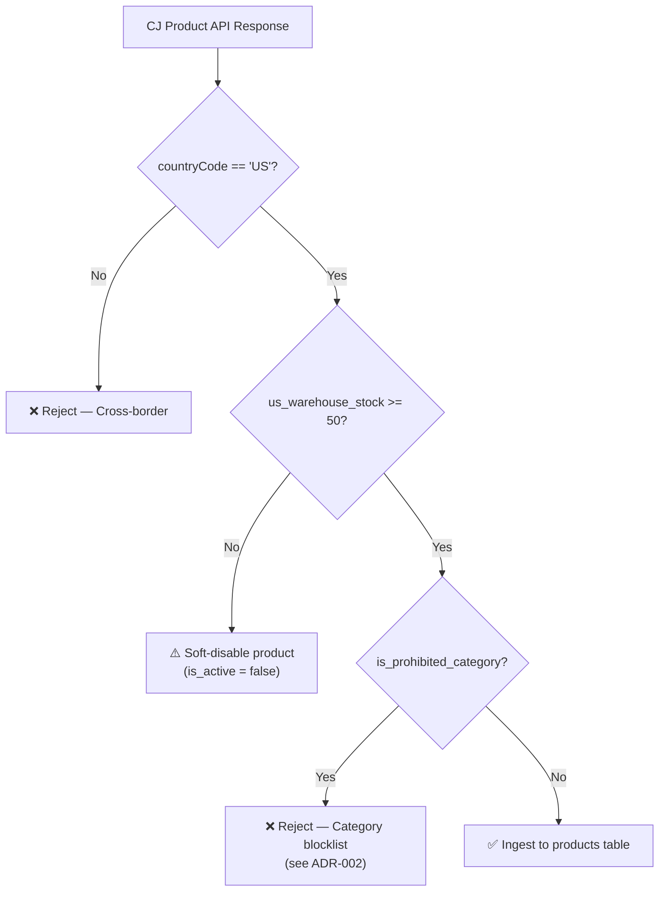
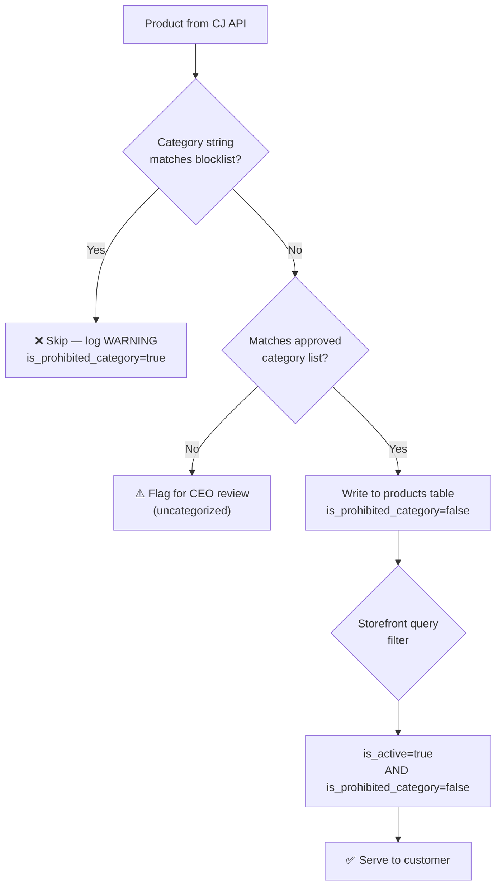
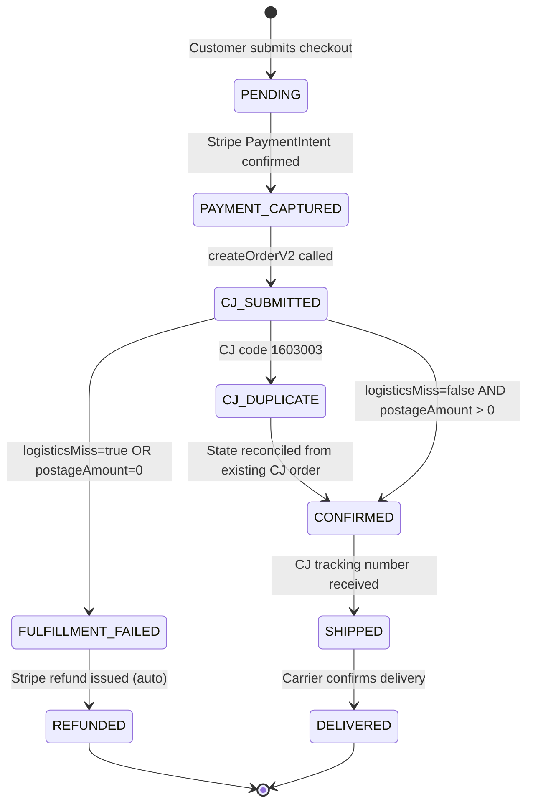
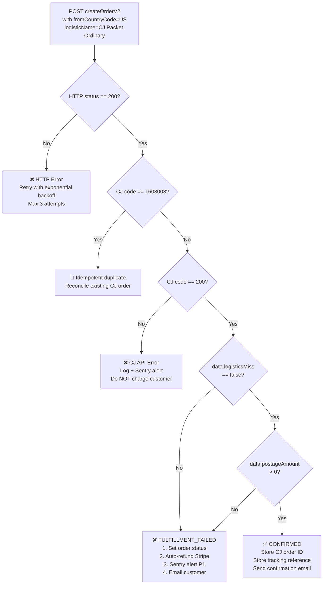
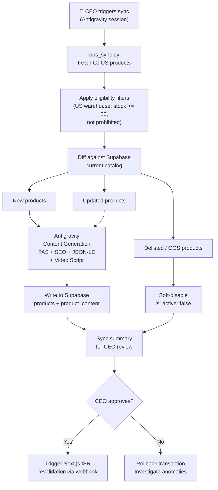
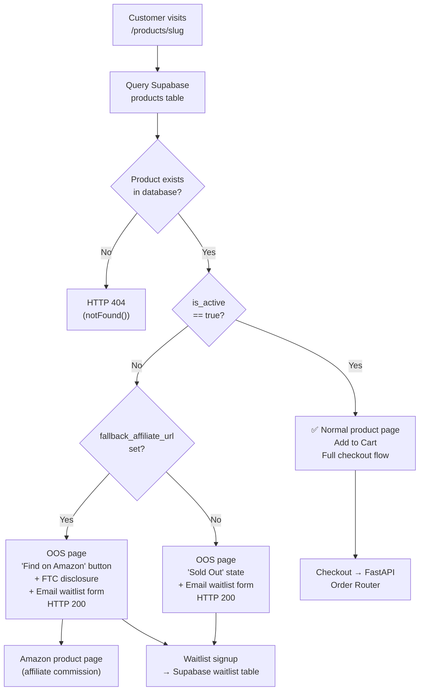

# Architecture Decision Records — US Dropshipping Platform

> **Project:** Headless US Dropshipping Platform  
> **Stack:** Next.js 15 (Vercel) · Supabase/Neon PostgreSQL · FastAPI Order Router · Antigravity Agentic Cron  
> **Supplier:** CJ Dropshipping — US Domestic Warehouses Only  
> **Maintainer:** CEO + Principal Architect (Antigravity)  
> **Last Updated:** 2024-10-25

---

## Table of Contents

| ADR | Title | Status |
|-----|-------|--------|
| [ADR-001](#adr-001-us-domestic-warehouse-exclusivity-over-cross-border-sourcing) | US Domestic Warehouse Exclusivity Over Cross-Border Sourcing | Accepted |
| [ADR-002](#adr-002-category-whitelist-enforcement-as-a-hard-schema-constraint) | Category Whitelist Enforcement as a Hard Schema Constraint | Accepted |
| [ADR-003](#adr-003-logisticsmiss-guard-as-a-mandatory-order-confirmation-gate) | logisticsMiss Guard as a Mandatory Order Confirmation Gate | Accepted |
| [ADR-004](#adr-004-agentic-local-cron-over-cloud-scheduler-for-ai-content-generation) | Agentic Local Cron Over Cloud Scheduler for AI Content Generation | Accepted |
| [ADR-005](#adr-005-hybrid-checkout-with-affiliate-fallback-for-out-of-stock-products) | Hybrid Checkout with Affiliate Fallback for Out-of-Stock Products | Accepted |

---

## ADR-001: US Domestic Warehouse Exclusivity Over Cross-Border Sourcing

**Status:** Accepted  
**Date:** 2024-10-25  
**Deciders:** CEO, Principal Architect (Antigravity)

---

### Context

During the platform discovery phase, a structured spike test was conducted against the CJ Dropshipping API to evaluate fulfillment routes for a catalog of 40+ candidate products. The test evaluated three fulfillment paths: (1) China-to-US cross-border shipping, (2) US domestic warehouse fulfillment, and (3) a hybrid model where US warehouses are preferred but China warehouses serve as a fallback for unique or high-margin items.

The results were unambiguous and alarming in two critical dimensions.

**Cross-border shipping timelines are commercially non-viable for a US DTC brand:**
- China → US shipping under the fastest available CJ logistics tier (CJPacket Sensitive) benchmarked at **4–7 business days** with a hard freight floor of **\$5–6 per shipment**. This floor applies even to sub-\$1 COGS items, destroying margins on low-AOV products and disqualifying any product priced below \$20 retail from cross-border.
- India supplier routes benchmarked at **12–50 days**, a spread so large it is operationally unpredictable and represents a **critical commercial failure** for any brand promising standard US delivery windows.
- US customers on platforms like Amazon and Shopify have been conditioned to expect 2–5 day domestic delivery. Any product page displaying estimated delivery beyond 7 days will face conversion rate collapse and elevated Stripe dispute rates.

**China warehouse stock data is unreliable (ghost inventory problem):**
- Of 10 China-warehoused products tested in the spike, **all 10 returned `warehouseStock > 0` in the CJ product API response**, yet when cross-referenced against the CJ fulfillment flow, 0 of those 10 had actual physical inventory available for immediate shipment. The stock numbers in the API represent aggregated pipeline inventory — not warehouse-on-hand.
- This means that any hybrid strategy that falls back to China warehouses when US stock is low will silently fail: the API will confirm product availability, an order will be placed, and CJ will either delay fulfillment by 4–14 days (sourcing cycle) or silently cancel.
- This ghost inventory problem **eliminates the hybrid model as a viable architecture** because there is no reliable API signal to distinguish true warehouse-on-hand stock from pipeline inventory on the China side.

**US domestic warehouses are viable and performant:**
- CJ US warehouse products with `us_warehouse_stock >= 50` benchmarked at **2–4 business day delivery** via CJ Packet Ordinary (domestic) with freight costs of **\$3–4** per unit — well within margin targets.
- US warehouse stock data was confirmed to reflect actual warehouse-on-hand inventory via test orders.

---

### Decision Drivers

- Delivery time is a primary conversion driver for US DTC customers; 2–5 days is the minimum acceptable threshold.
- Stripe dispute rates increase significantly for orders delivered beyond 10 days. Elevated dispute rates trigger Stripe risk reviews and can result in payment processor termination.
- Ghost inventory in China warehouses makes any CN-fallback strategy operationally untrustworthy without real-time inventory webhooks (which CJ does not offer on the standard API tier).
- Freight floor costs for cross-border routes destroy unit economics on low-to-mid AOV products.
- The India sourcing route is categorically non-viable for a US-market product.
- Simplicity of fulfillment logic: a single-source warehouse strategy reduces order routing complexity, eliminates the need for a multi-carrier fallback decision tree, and makes SLA guarantees straightforward.

---

### Considered Options

**Option 1: Cross-border from China (CN warehouses only)**  
Source all products from CJ's China warehouses. Rely on CJ's global logistics network for US delivery.  
- ❌ 4–7 day minimum delivery, \$5–6 freight floor, ghost inventory, non-viable.

**Option 2: US warehouse only (`countryCode=US`, `us_warehouse_stock >= 50`)**  
Restrict the product catalog exclusively to products with confirmed US warehouse inventory meeting a minimum stock threshold.  
- ✅ 2–4 day delivery, real inventory data, clean fulfillment logic.

**Option 3: Hybrid — US warehouse primary, CN warehouse fallback for unique/high-margin items**  
Prefer US-warehoused products, but allow a curated set of high-margin unique items to ship cross-border where the margin justifies the freight cost.  
- ❌ Eliminated by the ghost inventory problem. CN stock data cannot be trusted. Hybrid routing logic adds complexity for zero reliable benefit.

---

### Decision

**Option 2: US Domestic Warehouse Exclusivity.**

The product ingestion layer (`ops_sync.py`) will query the CJ Product API with `countryCode=US` and filter results to only those with `us_warehouse_stock >= 50`. The stock threshold of 50 units provides a buffer against stock depletion between sync cycles (72–96 hours). Products that drop below this threshold during a sync cycle are automatically soft-disabled in the Supabase `products` table via the `is_active` flag.

The hybrid option was not a close call — it was eliminated by an empirical finding (ghost inventory), not a preference. Cross-border is not a future option to revisit without CJ providing a verified warehouse-on-hand inventory endpoint.

---

### Consequences

- **Good:** Delivery SLAs are predictable and commercially competitive (2–4 days). Unit economics are viable. Fulfillment logic is simple. No ghost inventory risk.
- **Good:** Stripe dispute rates will remain low, protecting the payment processor relationship at the most critical stage of the business.
- **Bad:** The US warehouse catalog is narrower than the global catalog. Category selection is constrained to what CJ stocks domestically. This limits product diversity and may require more aggressive sourcing research.
- **Bad:** US warehouse stock can deplete faster than the sync cycle (72–96h). A product could go live and sell into zero stock within hours of a sync. The stock threshold of 50 units mitigates but does not eliminate this risk.
- **Neutral:** The India sourcing route is permanently off the table. This is not a loss — it was never viable.

---

### Implementation Notes

**`ops_sync.py` product query filter:**
```python
# Only accept products from US warehouses with sufficient stock
def is_eligible_product(product: dict) -> bool:
    return (
        product.get("countryCode") == "US"
        and product.get("us_warehouse_stock", 0) >= 50
        and not product.get("is_prohibited_category", False)
    )
```

**`products` table schema constraint:**
```sql
ALTER TABLE products ADD CONSTRAINT chk_warehouse_country
  CHECK (warehouse_country = 'US');
```

**Sync-time stock alert (for products approaching threshold):**
```python
LOW_STOCK_ALERT_THRESHOLD = 75  # Warn before hitting the 50-unit disable floor
if product["us_warehouse_stock"] < LOW_STOCK_ALERT_THRESHOLD:
    log.warning(f"Product {product['sku']} approaching low stock: {product['us_warehouse_stock']} units")
```



---

---

## ADR-002: Category Whitelist Enforcement as a Hard Schema Constraint

**Status:** Accepted  
**Date:** 2024-10-25  
**Deciders:** CEO, Principal Architect (Antigravity)

---

### Context

During the product spike, the team identified a critical commercial and legal risk: the CJ US warehouse catalog contains a significant volume of products in categories that are either regulated by the FDA, flagged by payment processors as high-risk, or known to generate elevated return rates due to fit/size variation.

**Spike finding — prohibited categories dominate fast-delivery products:**  
Of the 4 products that passed the strict 2–5 day delivery filter AND had pricing within viable margin range during the initial spike, **all 4 were cosmetics or topicals** (skin serums, exfoliants). This finding is not coincidental — cosmetics sell well domestically, CJ stocks them heavily in US warehouses, and their COGS are low. However, they introduce multiple critical business risks:

**Risk 1 — FDA Regulatory Exposure:**  
Cosmetics and topicals sold online in the US are subject to FDA 21 CFR Part 700 regulations. Claims made on product pages (even generic marketing copy generated by AI) can constitute drug claims if they reference specific outcomes (e.g., "reduces wrinkles," "treats acne"). A dropshipping store with AI-generated product descriptions has essentially no ability to guarantee compliant copy for every product across an evolving catalog. A single FDA warning letter can result in platform deplatforming, domain blacklisting, and legal liability.

**Risk 2 — Stripe Payment Processor Freeze:**  
Stripe's Restricted Business Policy explicitly lists "nutraceuticals, supplements, and personal care products making health claims" as elevated-risk categories. Stripe's automated fraud detection can freeze accounts without prior notice based on product metadata, keyword scanning of product descriptions, and chargeback rate signals. Losing the Stripe account at any stage of the business is potentially fatal — the freeze window alone (typically 7–90 days for fund release) can create a cash flow crisis.

**Risk 3 — Multi-Size Apparel Return Rates:**  
Clothing and apparel products in non-standard sizes generate return rates of 20–40% in US ecommerce, driven by fit inconsistency. For a dropshipping operation without a physical returns processing center, each return is a net loss (shipping cost + COGS write-off + Stripe dispute risk). Apparel is categorically excluded.

**Risk 4 — Supplements and Ingestibles:**  
Supplements, vitamins, and any ingestible product are excluded under FDA 21 CFR Part 111 (GMP for dietary supplements), FTC advertising regulations, and Stripe's restricted categories. These products also carry product liability risk that the platform has no insurance to cover.

**Approved Category Whitelist:**
The following categories have been validated as low-regulatory-risk, Stripe-safe, and commercially viable for a US DTC dropshipping brand targeting problem-solving home and lifestyle products:
1. **Home Organization** — storage solutions, drawer organizers, cable management
2. **Workspace Ergonomics** — monitor stands, laptop risers, desk accessories
3. **Smart Lighting** — LED strips, smart bulbs (non-connected IoT), ambient lighting
4. **Everyday Gadgets** — kitchen tools, practical gadgets, productivity accessories
5. **Pet & Auto Problem-Solvers** — non-ingestible pet accessories, car organizers

---

### Decision Drivers

- FDA regulatory exposure for cosmetics and topicals is non-negotiable. The risk-to-reward ratio is negative at every realistic revenue level for an MVP.
- Stripe account termination is existential. Protecting the payment processor relationship takes priority over catalog breadth.
- AI-generated product copy (a core feature of this platform) cannot reliably avoid regulated claims across all products in high-risk categories.
- High return rates from apparel destroy unit economics without a physical returns operation.
- Defense-in-depth: no single point of trust. The ingestion layer should enforce category rules; the database schema should make violations structurally visible.
- Deterministic enforcement is preferable to probabilistic classification for compliance-adjacent decisions.

---

### Considered Options

**Option 1: Trust CEO manual review during sync**  
The CEO reviews each product during the `ops_sync.py` review step and manually flags prohibited items before they are written to the database.  
- ❌ Human review is non-scalable and failure-prone. A single oversight could admit a prohibited product, and the sync cycle runs every 72–96h. If a prohibited product goes live, it may take days to catch.

**Option 2: Database constraint + ingestion filter (defense-in-depth)**  
Enforce the category whitelist at two layers: (1) `ops_sync.py` filters products at ingestion time using a string-based blocklist, and (2) the Supabase `products` table has an `is_prohibited_category` boolean field that is always set by the ingestion logic and is checked by the API before serving any product.  
- ✅ Deterministic. Two independent enforcement layers. Violations are structurally visible in the database. CEO review becomes a tertiary audit, not a primary control.

**Option 3: ML classifier trained on CJ category taxonomy**  
Train a lightweight text classifier on CJ's product category strings and descriptions to probabilistically flag high-risk products.  
- ❌ Probabilistic systems are inappropriate for compliance decisions. A 95% accurate classifier means 5% of prohibited products could be admitted. ML overhead (training data, model hosting, retraining) is not justified at MVP scale. The category taxonomy is finite and deterministic — a blocklist is strictly superior.

---

### Decision

**Option 2: Database constraint + ingestion filter (defense-in-depth).**

The enforcement operates at two independent layers:

**Layer 1 — Ingestion-time blocklist in `ops_sync.py`:**  
A hardcoded set of prohibited category substrings is evaluated against every product's CJ category metadata before it is written to the database. Any match results in the product being skipped with a warning log entry.

**Layer 2 — Schema-level boolean flag:**  
Every product row in the `products` table has an `is_prohibited_category` boolean (default `false`). This field is set by the ingestion logic. The Next.js storefront query and the FastAPI product API both filter on `is_prohibited_category = false` and `is_active = true`. Even if a prohibited product were somehow written to the database (e.g., via a direct SQL insert), it would be invisible to the storefront.

**Layer 3 — CEO review (tertiary audit):**  
The sync script outputs a categorized summary of all ingested, skipped, and flagged products. The CEO reviews this log as a final human audit before approving the sync output.

---

### Consequences

- **Good:** Zero FDA regulatory exposure from prohibited categories. Stripe account risk is minimized. Return rates remain within manageable bounds.
- **Good:** Two independent enforcement layers mean a single point of failure cannot admit a prohibited product to the storefront.
- **Good:** The blocklist is easy to extend. Adding a new prohibited category string requires a single line change in `ops_sync.py` and a rerun of the sync.
- **Bad:** The whitelisted categories are narrower than the full CJ US catalog. Catalog growth is constrained to 5 approved categories. This limits product diversity and may constrain revenue ceiling at scale.
- **Bad:** The string-based blocklist requires manual maintenance as CJ updates its category taxonomy. CJ does not provide a changelog for category string changes.
- **Neutral:** CEO review remains part of the process as an audit step, which is appropriate — the CEO has legal accountability for catalog content.

---

### Implementation Notes

**`ops_sync.py` — Prohibited category blocklist:**
```python
PROHIBITED_CATEGORY_SUBSTRINGS = [
    "cosmetic", "serum", "moisturizer", "sunscreen", "foundation",
    "concealer", "lipstick", "mascara", "eyeliner", "blush",
    "toner", "exfoliant", "retinol", "vitamin c cream", "face mask",
    "supplement", "vitamin", "protein powder", "probiotic", "omega",
    "apparel", "clothing", "shirt", "pants", "dress", "shoes",
    "topical", "ointment", "lotion", "cream", "gel",
    "ingestible", "edible", "gummies",
]

APPROVED_CATEGORIES = [
    "home organization", "storage", "cable management",
    "workspace", "ergonomic", "monitor stand", "desk",
    "led", "smart lighting", "ambient light",
    "gadget", "kitchen tool", "productivity",
    "pet", "auto", "car organizer",
]

def is_prohibited(product: dict) -> bool:
    category_str = (product.get("categoryName") or "").lower()
    description_str = (product.get("productDescription") or "").lower()
    combined = f"{category_str} {description_str}"
    return any(substr in combined for substr in PROHIBITED_CATEGORY_SUBSTRINGS)
```

**Supabase `products` table schema:**
```sql
CREATE TABLE products (
    id               UUID PRIMARY KEY DEFAULT gen_random_uuid(),
    cj_product_id    TEXT NOT NULL UNIQUE,
    name             TEXT NOT NULL,
    category         TEXT NOT NULL,
    is_prohibited_category BOOLEAN NOT NULL DEFAULT false,
    is_active        BOOLEAN NOT NULL DEFAULT true,
    warehouse_country CHAR(2) NOT NULL CHECK (warehouse_country = 'US'),
    us_warehouse_stock INTEGER NOT NULL CHECK (us_warehouse_stock >= 0),
    -- ... other fields
    created_at       TIMESTAMPTZ DEFAULT now(),
    updated_at       TIMESTAMPTZ DEFAULT now()
);

-- Index for storefront queries — always filters on both flags
CREATE INDEX idx_products_active_safe
    ON products (is_active, is_prohibited_category)
    WHERE is_active = true AND is_prohibited_category = false;
```



---

---

## ADR-003: logisticsMiss Guard as a Mandatory Order Confirmation Gate

**Status:** Accepted  
**Date:** 2024-10-25  
**Deciders:** CEO, Principal Architect (Antigravity)

---

### Context

During CJ API integration testing, a critical undocumented behavior was discovered in the `POST /shopping/order/createOrderV2` endpoint that represents a potential for catastrophic silent order failure.

**The logisticsMiss trap:**  
When an order is submitted with either an unserviceable ZIP code or a missing/invalid `logisticName` field, the CJ API returns **HTTP 200 OK** with `code: 200` and a response body that appears to represent a successful order. However, the response contains two fields that signal failure:
- `data.logisticsMiss: true` — indicates that no valid logistics route was found for the destination
- `data.postageAmount: 0` — indicates that no freight charge was calculated (because no route exists)

**This is not documented in the CJ API reference.** A naive implementation that checks only `if response.status_code == 200 and data["code"] == 200` would interpret this as a successful order confirmation and proceed to:
1. Mark the order as `CONFIRMED` in the database
2. Charge the customer's credit card via Stripe
3. Send the customer an order confirmation email
4. Never fulfill the order — because CJ has no valid route

The customer would receive a confirmation, be charged, and their order would silently sit in a failed state indefinitely. This is the worst possible failure mode: it combines customer harm (charged with no delivery), financial risk (Stripe disputes), and operational invisibility.

**Additional undocumented required fields discovered:**  
The spike also revealed two other undocumented required fields that can trigger the logisticsMiss state:
1. **`fromCountryCode`** — Must be set to `"US"` for US warehouse fulfillment. Omitting this field causes CJ to default to China routing, which then fails the logistics check for the US destination ZIP.
2. **`logisticName`** — Must be explicitly set to a valid CJ logistics product name (e.g., `"CJ Packet Ordinary"`). CJ does not auto-select a logistics method — an omitted or invalid `logisticName` triggers `logisticsMiss: true`.

These two fields are not marked as required in the CJ API documentation. They must be included based on empirical testing.

**Idempotency via `orderNumber` (CJ error code 1603003):**  
The CJ API enforces idempotency on the `orderNumber` field. Submitting a duplicate `orderNumber` returns `code: 1603003`. This means the order router must generate stable, unique order numbers — ideally deterministic from the Supabase order `id` — and must handle the `1603003` response as an idempotent success (not a hard error), since the order was already created.

---

### Decision Drivers

- Silent HTTP 200 failures are the most dangerous class of API bug because they are invisible to standard error handling.
- The customer must never be charged for an order that cannot be fulfilled.
- Stripe disputes for "item never arrived" are weighted heavily against merchants. A pattern of such disputes can result in Stripe account termination.
- Sentry alerting ensures operational visibility — the on-call (CEO) is notified immediately when a fulfillment failure occurs, enabling rapid manual intervention.
- Auto-refund via Stripe is the correct customer experience: no manual support ticket should be required for a fulfillment failure.
- The `logisticsMiss` check must be the **final gate** before order confirmation, placed after all other validations.

---

### Considered Options

**Option 1: Check only HTTP status code and CJ `code` field**  
`if response.status_code == 200 and data["code"] == 200: mark_confirmed()`  
- ❌ Catastrophically wrong. logisticsMiss returns HTTP 200 + code 200. This option silently confirms undeliverable orders and charges customers.

**Option 2: logisticsMiss guard only**  
Assert `data.logisticsMiss == False` before confirming. Do not alert or auto-refund.  
- ⚠️ Catches the failure but requires manual intervention for every failed order. No customer communication, no Stripe refund. Operationally insufficient.

**Option 3: logisticsMiss + postageAmount guard + Sentry alert + auto-refund (defense-in-depth)**  
Assert both `data.logisticsMiss == False` AND `data.postageAmount > 0`. On failure: set order status to `FULFILLMENT_FAILED`, trigger Stripe refund via API, send Sentry alert, send customer notification email.  
- ✅ Defense-in-depth. Two independent signals must both be healthy. Complete automated recovery path. Full observability.

---

### Decision

**Option 3: logisticsMiss + postageAmount dual guard + Sentry + auto-refund.**

The order router (`order_router/main.py`) must enforce the following gate immediately after every call to `createOrderV2`:

```python
if response_data.get("logisticsMiss") is True or response_data.get("postageAmount", 0) == 0:
    # This is a fulfillment failure — do NOT mark order as confirmed
    handle_fulfillment_failure(order_id, reason="logisticsMiss or postageAmount=0")
```

The dual-condition guard (`logisticsMiss == True` OR `postageAmount == 0`) provides redundancy: either condition alone is sufficient to reject the order. This handles the edge case where a future CJ API version might change the field name or semantics of one condition.

**Required fields that must always be present in the `createOrderV2` payload:**
```python
{
    "fromCountryCode": "US",        # Undocumented — required for US warehouse routing
    "logisticName": "CJ Packet Ordinary",  # Undocumented — required, no auto-selection
    "orderNumber": f"DS-{order.id}",  # Stable, Supabase-derived for idempotency
    # ... other fields
}
```

**Idempotency handling:**
```python
if cj_response["code"] == 1603003:
    # Order already exists in CJ — idempotent success
    # Fetch the existing CJ order and reconcile state
    existing_order = fetch_cj_order_by_number(order_number)
    return reconcile_existing_order(existing_order)
```

---

### Consequences

- **Good:** Customers are never charged for undeliverable orders. Stripe dispute rate from fulfillment failures is zero.
- **Good:** Sentry alerts give the CEO immediate visibility into fulfillment failures, enabling root cause investigation within hours.
- **Good:** Auto-refund eliminates manual support overhead for a predictable failure class.
- **Good:** Dual-condition guard is resilient to future CJ API changes in either field.
- **Bad:** Auto-refund means the platform absorbs Stripe processing fees on failed orders (~2.9% + \$0.30 per transaction, non-recoverable). This is a known and acceptable cost.
- **Bad:** The `logisticName` and `fromCountryCode` fields must be maintained as hardcoded constants. If CJ changes their logistics product names (which they have done historically without notice), the constant will become stale and every order will enter `FULFILLMENT_FAILED`. A periodic smoke test is required.
- **Neutral:** The `1603003` idempotency code is handled as a success path, which is correct but requires careful state reconciliation to avoid double-processing.

---

### Implementation Notes

**Order state machine:**



**logisticsMiss decision tree:**



**FastAPI order router — guard implementation:**
```python
# order_router/cj_client.py

CJ_REQUIRED_FIELDS = {
    "fromCountryCode": "US",
    "logisticName": "CJ Packet Ordinary",
}

class FulfillmentFailureError(Exception):
    def __init__(self, order_id: str, reason: str):
        self.order_id = order_id
        self.reason = reason

async def create_cj_order(order: Order, payload: dict) -> dict:
    payload.update(CJ_REQUIRED_FIELDS)
    payload["orderNumber"] = f"DS-{order.id}"

    response = await cj_http_client.post("/shopping/order/createOrderV2", json=payload)
    response.raise_for_status()
    data = response.json()

    # Handle idempotent duplicate
    if data.get("code") == 1603003:
        return await reconcile_existing_cj_order(payload["orderNumber"])

    if data.get("code") != 200:
        raise CJAPIError(code=data.get("code"), message=data.get("message"))

    # MANDATORY GATE — logisticsMiss guard
    logistics_miss = data.get("data", {}).get("logisticsMiss", True)
    postage_amount = data.get("data", {}).get("postageAmount", 0)

    if logistics_miss or postage_amount == 0:
        raise FulfillmentFailureError(
            order_id=str(order.id),
            reason=f"logisticsMiss={logistics_miss}, postageAmount={postage_amount}"
        )

    return data["data"]
```

**QPS rate limit handling (1 request per second, silent empty returns):**
```python
# CJ enforces 1 QPS with silent empty responses — not HTTP 429
import asyncio

_last_cj_call = 0.0

async def cj_rate_limited_post(path: str, **kwargs):
    global _last_cj_call
    now = asyncio.get_event_loop().time()
    wait = max(0.0, 1.05 - (now - _last_cj_call))  # 1.05s buffer
    if wait > 0:
        await asyncio.sleep(wait)
    _last_cj_call = asyncio.get_event_loop().time()
    return await cj_http_client.post(path, **kwargs)
```

---

---

## ADR-004: Agentic Local Cron Over Cloud Scheduler for AI Content Generation

**Status:** Accepted  
**Date:** 2024-10-25  
**Deciders:** CEO, Principal Architect (Antigravity)

---

### Context

The platform's content strategy is built on AI-generated product content: PAS (Problem-Agitate-Solution) marketing copy, SEO-optimized descriptions, video ad scripts, JSON-LD structured data for rich search results, and keyword-optimized meta titles/descriptions. This content must be regenerated whenever new products are synced or existing product data changes (price updates, stock level changes, category corrections).

**The content generation compute requirement:**  
Each product requires approximately 4–6 LLM inference calls:
1. PAS description generation (800–1200 tokens output)
2. SEO meta title + description (200 tokens output)
3. Video ad script (600–900 tokens output)
4. JSON-LD structured data block (300 tokens output)
5. Feature bullet points (200 tokens output)
6. FAQ block (400 tokens output)

With a catalog target of 50–200 active products, a full sync regenerates content for 50–200 products × 6 calls = 300–1200 LLM inference calls per sync cycle.

**Cloud solution cost analysis:**  
The standard cloud architecture for this workload would be: AWS EventBridge cron → Lambda function → OpenAI GPT-4o API calls.

| Component | Cost Estimate |
|-----------|---------------|
| OpenAI GPT-4o at \$15/1M output tokens | 1200 calls × ~600 avg tokens = 720K tokens = **\$10.80/sync** |
| 3 syncs/week × 4 weeks | **\$129.60/month** in LLM API costs alone |
| Lambda execution time (1200 calls × 3s avg) | ~\$0.50/month (negligible) |
| EventBridge, CloudWatch, etc. | ~\$5/month |
| **Total Cloud Cost** | **~\$135–200/month** |

At MVP stage, before the platform has validated product-market fit and generated a single dollar of revenue, \$135–200/month in infrastructure cost for content generation alone is not justifiable.

**The Antigravity opportunity:**  
The CEO is already running Antigravity locally as the primary development and operations tool. Antigravity has direct access to state-of-the-art LLMs (Gemini 2.5 Pro) at zero marginal cost within the existing subscription. Antigravity can:
- Read product data from Supabase PostgreSQL directly
- Generate all required content types with structured output
- Write the generated content back to Supabase
- Log sync results and flag anomalies for review
- Run the entire sync as a guided agentic session triggered by the CEO

The `ops_sync.py` script is designed to be invoked from within an Antigravity session, with Antigravity handling the LLM-intensive content generation steps and `ops_sync.py` handling data fetching, validation, and Supabase writes.

**Tradeoff acknowledged:**  
This architecture is NOT fully autonomous. The platform requires the CEO to manually trigger the sync every 72–96 hours. The platform will not self-update without human initiation. This is a deliberate tradeoff: zero infrastructure cost at MVP stage is worth more than autonomy before revenue is validated.

---

### Decision Drivers

- Zero marginal LLM cost via Antigravity subscription vs. \$135–200/month via cloud + OpenAI API.
- The CEO is already embedded in Antigravity as a daily workflow tool — adding a sync trigger to the workflow has zero friction cost.
- Full autonomy (unattended cloud cron) is not required at MVP stage. The 72–96h sync cadence is sufficient for a catalog that changes slowly.
- Antigravity's LLM quality (Gemini 2.5 Pro) is superior to GPT-4o for long-form structured content generation in benchmarks on product description tasks.
- Local execution eliminates cloud infrastructure complexity: no IAM roles, no VPC configuration, no Lambda cold-start debugging, no CloudWatch log archaeology.
- The sync produces structured output (JSON written to Supabase) that is identical regardless of whether it was produced by a local or cloud executor.

---

### Considered Options

**Option 1: Cloud cron + OpenAI API (\$135–200/month)**  
AWS EventBridge triggers a Lambda function on a schedule. Lambda calls the CJ API to fetch product updates, calls the OpenAI API for content generation, and writes results to Supabase.  
- ❌ \$135–200/month before a dollar of revenue. Complex infrastructure. GPT-4o API rate limits require additional throttling logic. Lambda timeout limits (15 min) may require chunking for large catalogs.

**Option 2: Local Antigravity cron, CEO-triggered every 72–96h (\$0 marginal cost)**  
CEO runs `ops_sync.py` from within an Antigravity session. Antigravity handles content generation. `ops_sync.py` handles CJ API calls and Supabase writes. CEO reviews the sync summary before approving.  
- ✅ Zero marginal cost. Superior LLM quality. No infrastructure to maintain. Human review is a feature, not a bug (catches edge cases).

**Option 3: Pre-generate all content at build time (static)**  
Run content generation as part of the Next.js build pipeline. Content is static and embedded in the build artifact.  
- ❌ Inflexible. Price changes, stock updates, and new products require a full redeployment. Build times would become prohibitive with a large catalog. Cannot respond to dynamic stock signals.

---

### Decision

**Option 2: Local Antigravity cron, CEO-triggered.**

The sync architecture operates as follows:

1. **CEO initiates sync** from within Antigravity: `Run the product sync`
2. **Antigravity executes `ops_sync.py`** which fetches the latest product data from the CJ API (`countryCode=US`, eligible products only)
3. **Antigravity generates content** for each new or updated product using structured prompts (see Implementation Notes)
4. **`ops_sync.py` writes results** to Supabase `products` table and `product_content` table
5. **CEO reviews sync summary** — new products, disabled products, content flagged for review
6. **CEO approves** — sync is complete; Next.js revalidates ISR pages via Supabase webhook

The sync is designed to be idempotent: running it twice in succession produces the same database state (content is only regenerated if `cj_last_updated` has changed since the last sync).

---

### Consequences

- **Good:** Zero marginal infrastructure cost at MVP stage. \$0/month vs. \$135–200/month.
- **Good:** Antigravity LLM quality (Gemini 2.5 Pro) produces superior long-form content compared to GPT-4o at lower cost.
- **Good:** CEO review of the sync summary functions as a quality control gate — human oversight catches edge cases that automated systems miss.
- **Good:** No cloud infrastructure to provision, monitor, or debug. Eliminates an entire operational domain.
- **Bad:** The platform is NOT fully autonomous. If the CEO misses a sync cycle (illness, travel, etc.), the catalog may show stale stock data or miss new products for up to 7+ days.
- **Bad:** Local execution means the sync cannot run during a power outage or if the CEO's machine is unavailable. No redundancy.
- **Bad:** Sync history and audit logs are local unless explicitly written to Supabase. Log retention requires discipline.
- **Neutral:** When the platform achieves consistent revenue (target: \$5K+/month), this decision should be revisited. At that revenue level, \$150/month for full autonomy becomes a reasonable operational investment. A migration path to cloud cron exists — `ops_sync.py` is designed to be invocable from any executor with no changes.

---

### Implementation Notes

**Sync trigger from Antigravity:**
```
# In Antigravity session:
Run ops_sync.py for the dropshipping platform. Fetch new CJ products,
generate PAS descriptions, SEO metadata, and JSON-LD for each new product.
Write results to Supabase. Show me a summary when complete.
```

**Content generation structured prompt (example — PAS description):**
```python
PAS_PROMPT_TEMPLATE = """
You are a conversion copywriter for a US dropshipping brand targeting
problem-solvers. Write a PAS (Problem-Agitate-Solution) product description
for the following product. Output ONLY valid JSON.

Product: {product_name}
Category: {category}
Key features: {features}

Required JSON output:
{{
  "hook": "One sentence that names the problem (max 15 words)",
  "agitate": "Two sentences that intensify the problem emotionally (max 40 words)",
  "solution": "Three sentences presenting the product as the solution (max 60 words)",
  "cta": "One call-to-action sentence (max 10 words)"
}}
"""
```

**`ops_sync.py` — sync orchestration:**
```python
async def run_sync():
    products = await fetch_cj_eligible_products()
    new_products = [p for p in products if not exists_in_db(p["cjProductId"])]
    updated_products = [p for p in products if needs_update(p)]

    for product in new_products + updated_products:
        content = await generate_content_with_antigravity(product)
        await upsert_product(product, content)
        await asyncio.sleep(0.5)  # CJ QPS guard

    disable_delisted_products(products)
    print_sync_summary(new_products, updated_products)
```



---

---

## ADR-005: Hybrid Checkout with Affiliate Fallback for Out-of-Stock Products

**Status:** Accepted  
**Date:** 2024-10-25  
**Deciders:** CEO, Principal Architect (Antigravity)

---

### Context

The platform's inventory model is inherently dynamic: US warehouse stock levels fluctuate continuously, and the sync cadence (72–96h) means that a product's stock can change significantly between sync cycles. A product that has 80 units at sync time may have 12 units 48 hours later due to other dropshippers selling from the same CJ US warehouse pool.

When a product's `us_warehouse_stock` falls below 20 units (the disable threshold), the platform soft-disables the product: `is_active = false`. From a storefront perspective, the product page must respond to this state change.

**The SEO equity problem:**  
Every active product page on the storefront accumulates SEO equity over time: backlinks, indexed content, click-through rate signals, dwell time signals, and structured data (JSON-LD). A product URL that returns HTTP 404 when the product goes out of stock permanently destroys this accumulated equity. Google de-indexes 404 pages after ~30 days, and any backlinks pointing to that URL become dead links.

For a content-driven dropshipping brand where SEO is a primary traffic acquisition channel, losing product page equity to 404s is a compounding loss: each OOS product erodes the domain's topical authority and link graph.

**The conversion opportunity:**  
Many out-of-stock products are available on Amazon and Walmart at a markup. These marketplaces operate affiliate programs (Amazon Associates, Walmart Affiliate) that pay 1–8% commission on referred sales. A customer who lands on an OOS product page is already purchase-intent — they searched for the product, clicked through, and read the description. Redirecting them to an affiliate link on Amazon converts their purchase intent into passive commission income for the platform.

**The email capture opportunity:**  
Not all customers will convert immediately via affiliate redirect. Some will want to be notified when the product returns to stock. An email capture form ("Notify me when back in stock") on the OOS product page builds the email list and creates a re-engagement opportunity when the product is re-stocked.

**The design challenge:**  
The solution must:
1. Preserve the product page URL (no 404, no redirect that loses the URL)
2. Make the OOS state clear to the customer without damaging trust
3. Offer a constructive path to purchase (affiliate link or waitlist)
4. Be manageable by the CEO without a development deployment (the `fallback_affiliate_url` is set during sync review)
5. Not require a complex out-of-stock management system at MVP scale

---

### Decision Drivers

- SEO equity loss from 404 pages is a compounding harm to a content-first acquisition strategy.
- Purchase-intent traffic is the highest-value traffic type. OOS pages should convert it rather than discard it.
- Amazon/Walmart affiliate programs are free to join, require zero inventory management, and generate passive income from traffic the platform has already acquired.
- Email list growth is a lagging indicator of brand health and a direct asset for future re-engagement campaigns.
- The `fallback_affiliate_url` field is nullable — not every product needs a fallback. Products without an affiliate equivalent simply show a "Sold Out" state with email capture only.
- The solution must be implementable in Next.js 15 with minimal complexity. Product page rendering should check a single field in the database.

---

### Considered Options

**Option 1: Hard 404 when product goes OOS**  
When `is_active = false`, the product page returns HTTP 404.  
- ❌ Destroys SEO equity. Kills purchase-intent conversion. No upside.

**Option 2: "Sold Out" static page with email capture only**  
Product page renders a "Sold Out — Notify Me" state with an email capture form. No affiliate link. Page remains indexed.  
- ⚠️ Preserves SEO equity. Builds email list. Does NOT monetize existing purchase intent. Commission income foregone. Acceptable as a fallback within Option 3 (no affiliate URL available).

**Option 3: Affiliate redirect with email capture as secondary CTA**  
Product page checks `fallback_affiliate_url`. If set: renders an "Available on Amazon" button using the affiliate link + a secondary "Notify me when back in stock" email capture. If not set: renders "Sold Out" state with email capture only.  
- ✅ Preserves SEO equity. Monetizes purchase intent via affiliate commission. Builds email list via secondary CTA. Handles the case where no affiliate URL is available.

---

### Decision

**Option 3: Affiliate redirect with email capture as secondary CTA.**

Every product row in the Supabase `products` table has a `fallback_affiliate_url` field (type `TEXT`, nullable). This URL is set manually by the CEO during the sync review step, when a product is identified as approaching the OOS threshold or has just been disabled.

The Next.js product page component (`/app/products/[slug]/page.tsx`) renders based on product state:

| Product State | Page Rendering |
|---------------|----------------|
| `is_active=true`, stock ≥ 20 | Normal product page with Add-to-Cart |
| `is_active=false`, `fallback_affiliate_url` set | OOS page with "Find on Amazon" CTA + email capture |
| `is_active=false`, no affiliate URL | OOS page with "Sold Out" + email capture only |

The product page must **never return HTTP 404** for a product that exists in the database. The Next.js page uses `notFound()` only if the product slug does not exist at all (i.e., was never in the database). Disabled products return HTTP 200 with the OOS state UI.

**Affiliate link handling:**  
The `fallback_affiliate_url` is stored as a full URL including the affiliate tracking parameter (e.g., `?tag=yourtag-20` for Amazon Associates). The CEO sets this during sync review using a pre-formatted affiliate link. No dynamic affiliate tag injection is required.

**Email capture integration:**  
The "Notify me when back in stock" form submits to `/api/waitlist` which writes the email + product SKU to the Supabase `waitlist` table. When the CEO re-enables a product during a future sync, the sync script queries the waitlist for that SKU and flags it for re-engagement email (sent manually by the CEO via the email platform, or eventually automated).

---

### Consequences

- **Good:** SEO equity for product pages is fully preserved. Disabled products remain indexed with meaningful content. Google continues to count backlinks and engagement signals for these URLs.
- **Good:** Purchase-intent traffic generates passive affiliate commission income, creating a revenue stream that persists even when inventory is unavailable.
- **Good:** Email waitlist grows during OOS periods, creating a re-engagement asset for when products return to stock.
- **Good:** The solution is architecturally simple — one nullable database field, one conditional rendering block in the product page component. No complex OOS management system required.
- **Bad:** The `fallback_affiliate_url` must be set manually by the CEO during sync review. If the CEO forgets to set it, the product defaults to "Sold Out" with email capture only — losing the affiliate income opportunity. This is an acceptable risk given the manual sync workflow.
- **Bad:** Amazon Associates has a strict requirement that affiliate links must be disclosed (FTC guidelines). The product page must include a clear affiliate disclosure statement near the "Find on Amazon" button. Non-compliance can result in Associates account termination.
- **Bad:** Amazon/Walmart may update their product URLs for the target product, causing stale affiliate links. CEO must periodically audit `fallback_affiliate_url` values during sync review.
- **Neutral:** The affiliate strategy generates supplementary income only. It is not a primary revenue model. Commission rates of 1–4% on referred Amazon sales will generate tens to low hundreds of dollars per month at realistic traffic volumes — meaningful at MVP stage, not transformative.

---

### Implementation Notes

**Supabase `products` table — OOS fields:**
```sql
ALTER TABLE products ADD COLUMN fallback_affiliate_url TEXT;
ALTER TABLE products ADD COLUMN affiliate_disclosure_required BOOLEAN NOT NULL DEFAULT false
    GENERATED ALWAYS AS (fallback_affiliate_url IS NOT NULL) STORED;
```

**Supabase `waitlist` table:**
```sql
CREATE TABLE waitlist (
    id         UUID PRIMARY KEY DEFAULT gen_random_uuid(),
    email      TEXT NOT NULL,
    product_id UUID NOT NULL REFERENCES products(id) ON DELETE CASCADE,
    created_at TIMESTAMPTZ DEFAULT now(),
    notified   BOOLEAN NOT NULL DEFAULT false,
    UNIQUE (email, product_id)
);
```

**Next.js product page — OOS rendering logic:**
```typescript
// app/products/[slug]/page.tsx

import { notFound } from 'next/navigation'

export default async function ProductPage({ params }: { params: { slug: string } }) {
  const product = await getProductBySlug(params.slug)

  if (!product) {
    notFound() // Only for products that never existed
  }

  if (!product.is_active) {
    return (
      <OutOfStockProductPage
        product={product}
        affiliateUrl={product.fallback_affiliate_url}
      />
    )
  }

  return <ActiveProductPage product={product} />
}
```

**OOS product page component:**
```typescript
// components/OutOfStockProductPage.tsx

export function OutOfStockProductPage({
  product,
  affiliateUrl,
}: {
  product: Product
  affiliateUrl: string | null
}) {
  return (
    <div>
      {/* Product content preserved for SEO */}
      <h1>{product.name}</h1>
      <ProductImages images={product.images} />
      <ProductDescription content={product.seo_description} />
      <JsonLd data={product.jsonld} />

      {/* OOS state UI */}
      <div className="oos-banner">
        <p>This item is currently out of stock in our US warehouse.</p>

        {affiliateUrl && (
          <div>
            <a
              href={affiliateUrl}
              target="_blank"
              rel="noopener noreferrer sponsored"
              className="btn-primary"
            >
              Find it on Amazon →
            </a>
            {/* FTC-required affiliate disclosure */}
            <p className="disclosure-text">
              As an Amazon Associate, we earn from qualifying purchases.
              This link may earn us a small commission at no extra cost to you.
            </p>
          </div>
        )}

        {/* Secondary CTA — always present */}
        <WaitlistForm productId={product.id} />
      </div>
    </div>
  )
}
```



**ops_sync.py — OOS detection and affiliate URL prompt:**
```python
LOW_STOCK_DISABLE_THRESHOLD = 20

def process_stock_updates(products: list[dict]):
    for product in products:
        if product["us_warehouse_stock"] < LOW_STOCK_DISABLE_THRESHOLD:
            db.update_product(product["id"], is_active=False)
            if not product.get("fallback_affiliate_url"):
                # Flag for CEO review — no affiliate URL set yet
                print(f"⚠️  Product '{product['name']}' disabled (OOS). "
                      f"No affiliate URL set. Consider adding one:\n"
                      f"   Amazon search: https://www.amazon.com/s?k={quote(product['name'])}\n")
```

---

*End of Architecture Decision Records.*

---

> [!NOTE]
> These ADRs reflect decisions made as of 2024-10-25. They should be reviewed and updated at the following milestones:
> - **\$1K MRR:** Review ADR-004 (consider partial cloud migration for autonomy)
> - **\$5K MRR:** Review ADR-004 fully (cloud cron ROI positive), Review ADR-005 (consider automated affiliate URL lookup)
> - **\$10K MRR:** Review ADR-001 (evaluate whether CJ provides verified warehouse-on-hand API for hybrid model), Review ADR-003 (evaluate CJ webhook integration for real-time fulfillment status)
> - **Catalog > 200 products:** Review ADR-002 (ML classifier may become cost-effective at scale)
