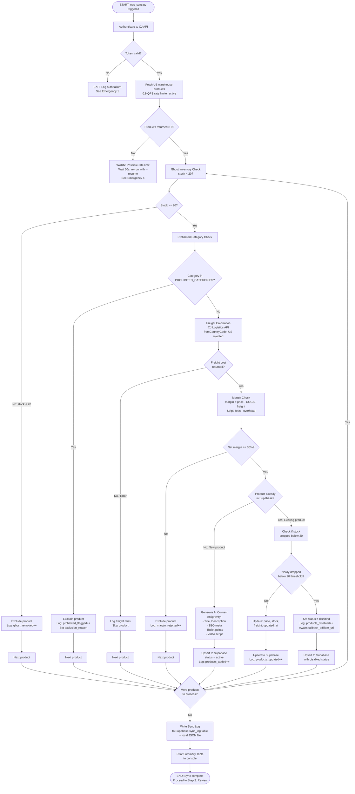

# 05 — CEO Operations Runbook

| Field | Value |
|---|---|
| **Version** | 1.0.0 |
| **Status** | Active |
| **Audience** | CEO / Sole Operator |
| **Last Reviewed** | 2025-01-01 |
| **Review Cadence** | Every 30 days (calendar reminder required) |
| **Next Review Due** | 2025-02-01 |
| **Owner** | CEO |

> [!IMPORTANT]
> This runbook is a living document. After every major incident or platform change, update the relevant section immediately. Do not leave it stale. Set a monthly calendar event titled "Runbook Review" to re-read and verify every section is still accurate.

---

## 1. Overview & Philosophy

### What This Platform Is

This is a **headless, zero-inventory US dropshipping storefront** built on Next.js 15 (Vercel) with a Supabase PostgreSQL backend and a FastAPI order router. Products are sourced exclusively from CJ Dropshipping's US warehouses. Customers see a curated, AI-enriched storefront; orders are routed automatically to CJ for fulfillment.

### What `ops_sync.py` Does

`ops_sync.py` is the single most important operational script. It is an **agentic cron** that performs the following pipeline in sequence every time it runs:

1. **Authenticates** to the CJ Dropshipping API using the stored `CJ_API_KEY`
2. **Fetches** all available products from US warehouse inventory
3. **Filters ghost inventory** — removes any product with stock < 20 units (ghost threshold)
4. **Checks prohibited categories** — flags or excludes any product that matches the prohibited category blocklist (cosmetics, supplements, weapons, adult items, etc.)
5. **Calculates freight** — calls the CJ logistics API to get live US domestic shipping rates
6. **Checks margins** — rejects products where net margin < 30% after COGS + freight + Stripe fees + platform overhead
7. **Generates AI content** via Antigravity — product titles, descriptions, bullet points, SEO meta, video scripts
8. **Upserts to Supabase** — inserts new products and updates existing ones; disables products that no longer meet criteria

### Why It Runs Every 72–96 Hours (Not Continuously)

- CJ inventory fluctuates, but not minute-to-minute. A 72–96 hour cadence captures meaningful stock and price changes without hammering the API.
- AI content generation has a cost per product; running less frequently avoids re-generating content for unchanged products.
- The sync takes 15–30 minutes and requires your attention for the post-sync review. Daily runs would create unsustainable operational load.

### Why CEO-Triggered, Not Fully Autonomous

This pipeline touches live product listings and customer-facing data. An autonomous cron that silently disables 15 products at 3 AM is a liability. The CEO triggers `ops_sync.py` manually so that:
- Every product change is **intentional and observed**
- Anomalies are caught before they go live
- You maintain full situational awareness of catalog health

### The Zero-Cost Principle

Every architectural decision biases toward \$0 infrastructure cost:
- Vercel Hobby tier (free)
- Supabase Free tier (500MB row limit — monitor this)
- CJ Dropshipping (no monthly fee, pays per order)
- Antigravity AI (included in your plan)
- FastAPI runs locally or on a minimal Fly.io free instance

Do not add paid services without a documented ROI threshold. Before spending \$1, ask: does this generate > \$10 in recovered revenue or saved time?

---

## 2. Prerequisites Checklist

Run through this checklist **before** every sync. Do not skip items.

### 2.1 Python Environment

```powershell
# Verify Python version (must be 3.11+)
python --version
# Expected output: Python 3.11.x or 3.12.x

# Activate the virtual environment
# From project root:
.\.venv\Scripts\Activate.ps1

# Verify you are inside the venv (prompt should show (.venv))
# Then verify key packages are installed:
pip show requests supabase anthropic rich
```

If any package is missing:

```powershell
pip install -r requirements.txt
```

### 2.2 `.env` File Verification

```powershell
# From project root, check the file exists and is non-empty
Get-Item .env
Get-Content .env | Select-String "CJ_API_KEY|SUPABASE_URL|SUPABASE_SERVICE_KEY|STRIPE_SECRET_KEY"
```

**All four variables must be present and non-empty.** If any are missing, do not proceed — the sync will fail silently or write corrupt data.

See [Section 8: Environment Variables Reference](#8-environment-variables-reference-table) for the full list of required variables.

### 2.3 CJ API Token Validity

The CJ access token is valid for **180 days**. The current token was last rotated on **2026-10-23** and expires on approximately **2027-04-23**.

```powershell
# Quick check: look at when the token was last written
Get-Item .env | Select-Object LastWriteTime

# Manual expiry check — look for the token rotation date comment in .env:
Get-Content .env | Select-String "TOKEN_ROTATED"
```

> [!WARNING]
> If the token is within 60 days of expiry, rotate it **now** during this sync session. Do not wait for it to expire in production. See [Emergency 1](#emergency-1-cj-api-token-expired) for rotation steps.

**Current expiry:** ~2027-04-23
**60-day rotation trigger date:** ~2027-02-22

### 2.4 Supabase Connection Health

```powershell
# Quick connectivity test using curl (or the Supabase Studio UI)
curl -X GET "$SUPABASE_URL/rest/v1/products?select=id&limit=1" `
  -H "apikey: $SUPABASE_SERVICE_KEY" `
  -H "Authorization: Bearer $SUPABASE_SERVICE_KEY"
```

Expected: HTTP 200 with a JSON array. If you get a 401 or connection refused, check:
1. `SUPABASE_URL` is correctly set (format: `https://<project-ref>.supabase.co`)
2. `SUPABASE_SERVICE_KEY` is the **service role** key (not the anon key)
3. Supabase project is not paused (free tier pauses after 7 days of inactivity — unpause from the dashboard)

### 2.5 Antigravity Running and Authenticated

Antigravity must be running and authenticated for AI content generation to work during the sync.

1. Open Antigravity IDE
2. Verify you are logged in (your account email should be visible in the bottom-left corner)
3. Confirm the Gemini API is accessible by running a quick test prompt in the chat

If Antigravity is not authenticated, the sync will fall back to template-based content (check `ops_sync.py` for `AI_FALLBACK_MODE` flag). Do not run the sync in fallback mode for new products — the content quality will be poor.

### 2.6 Disk Space

The sync writes a local JSON report and may update a local SQLite dev-parity database.

```powershell
# Check free disk space on C: drive
Get-PSDrive C | Select-Object Used, Free
```

You need at least **500MB free**. The sync itself uses < 10MB, but you want headroom for logs, exports, and SQLite writes.

### 2.7 Pre-Sync Checklist Summary

| Item | How to Verify | Pass Condition |
|---|---|---|
| Python 3.11+ | `python --version` | `3.11.x` or higher |
| `.venv` active | Check prompt prefix | Shows `(.venv)` |
| `.env` complete | `Get-Content .env` | All 4+ vars present |
| CJ token valid | Check `.env` comment | > 60 days to expiry |
| Supabase connection | `curl` health check | HTTP 200 |
| Antigravity auth | Check IDE login | Logged in |
| Disk space | `Get-PSDrive C` | > 500MB free |

---

## 3. Step-by-Step: The 72-Hour Sync SOP

### Step 1 — Trigger `ops_sync.py`

#### Command

```powershell
# From project root, with .venv active:
python ops_sync.py
```

To run with verbose output (recommended for monitoring):

```powershell
python ops_sync.py --verbose
```

To resume a previously interrupted sync (skips already-processed products):

```powershell
python ops_sync.py --resume
```

To limit the sync to a specific category for testing:

```powershell
python ops_sync.py --category "Home & Garden"
```

#### Expected Console Output

The sync outputs a live progress display using `rich`. You should see:

```
[ops_sync] 2025-01-01 10:00:00 — Starting sync
[AUTH] Authenticating to CJ API... OK (token valid, 180d)
[FETCH] Fetching US warehouse products...
  Category: Home & Garden       [████████████████████] 47 products
  Category: Kitchen             [████████████████████] 31 products
  Category: Sports & Outdoors   [████████████████████] 22 products
  ...
[FILTER] Ghost inventory check...  43 products removed (stock < 20)
[FILTER] Prohibited categories...   7 products flagged and excluded
[FREIGHT] Calculating shipping rates... (0.9 QPS throttle active)
  [████████░░░░░░░░░░░░] 18/50 products rated
  ...
[MARGIN] Margin check... 12 products below 30% threshold, excluded
[AI] Generating content for 38 products (Antigravity)...
  [████████████████████] 38/38 complete
[UPSERT] Writing to Supabase... 38 products upserted
[DONE] Sync complete in 22m 14s

┌─────────────────────────────────────────────────────┐
│ SYNC SUMMARY                                        │
├───────────────────────┬─────────────────────────────┤
│ Products fetched      │ 157                         │
│ Ghost inventory (rm'd)│ 43                          │
│ Prohibited (flagged)  │ 7                           │
│ Below margin (rm'd)   │ 12                          │
│ Products audited      │ 95                          │
│ Products added (new)  │ 4                           │
│ Products updated      │ 34                          │
│ Products disabled     │ 2                           │
│ Errors                │ 0                           │
│ Duration              │ 22m 14s                     │
└───────────────────────┴─────────────────────────────┘
```

#### Duration Expectations

| Catalog Size | Expected Duration |
|---|---|
| 20–30 products | 10–15 minutes |
| 30–50 products | 15–25 minutes |
| 50–80 products | 25–40 minutes |
| 80+ products | 40–60 minutes |

The AI content generation step is the longest. If Antigravity is slow, the sync will take longer. This is normal.

#### Success vs. Warning Signs

**✅ Success indicators:**
- `Errors: 0` in the summary table
- `Products audited` count is non-zero (at least 20+)
- Duration is within the expected range
- No `[WARN]` lines in the console output

**⚠️ Warning signs that require investigation before proceeding:**
- `Products audited: 0` — sync fetched nothing; likely a rate limit or auth issue
- `Products disabled > 5` in a single run — unusual; may indicate a data quality problem or CJ catalog change
- Any `[ERROR]` lines in the console
- Duration > 60 minutes — something stalled; check network and API rate limits
- Sync exits with a non-zero exit code (`echo $LASTEXITCODE` — should be `0`)

---

### Step 2 — Review the Sync Report

#### Where Reports Are Stored

**1. Supabase `sync_log` table** — every sync run creates a row here:

```sql
SELECT *
FROM sync_log
ORDER BY created_at DESC
LIMIT 5;
```

**2. Local JSON report** — written to `./logs/sync_YYYYMMDD_HHMMSS.json` in the project root.

```powershell
# View the most recent sync log
Get-ChildItem ./logs -Filter "sync_*.json" | Sort-Object LastWriteTime -Descending | Select-Object -First 1 | Get-Content | ConvertFrom-Json
```

#### Key Metrics to Check

| Metric | Normal Range | Investigate If |
|---|---|---|
| `products_audited` | 20–100 | < 10 or 0 |
| `products_disabled` | 0–3 per run | > 5 in one run |
| `products_added` | 0–10 per run | > 20 (unusual spike) |
| `errors` | 0 | Any error > 0 |
| `prohibited_flagged` | 0–5 | > 10 (blocklist may be misconfigured) |
| `ghost_removed` | 0–50% of fetch | > 70% (CJ catalog quality issue) |

#### How to Spot Ghost Inventory Slip-Through

Ghost inventory is product that CJ shows as in-stock but cannot actually ship. The filter removes products with stock < 20 units. However, slip-through can happen if:

1. **CJ reports a round number (e.g., exactly 20)** — this is a common signal of fake inventory. Check any product with exactly 20 units of stock:

```sql
SELECT id, name, sku, stock_quantity, updated_at
FROM products
WHERE stock_quantity = 20
  AND status = 'active'
ORDER BY updated_at DESC;
```

If a product has had exactly 20 units for > 2 sync cycles (i.e., 6+ days), consider raising the ghost threshold to 25 for that product or disabling it.

2. **Order fulfillment fails** — if CJ returns a `logisticsMiss: true` error when a customer orders a product that showed 20+ units of stock, that is a confirmed ghost inventory event. See [Emergency 2](#emergency-2-cj-order-confirmation-failure-logisticsmiss--true).

#### Validating Prohibited Category Exclusions

The prohibited blocklist is defined in `ops_sync.py` (look for `PROHIBITED_CATEGORIES`). After each sync, verify excluded products make sense:

```sql
SELECT id, name, cj_category, exclusion_reason, updated_at
FROM products
WHERE exclusion_reason = 'prohibited_category'
ORDER BY updated_at DESC
LIMIT 20;
```

Review each flagged product. If you see a product that should NOT be prohibited (e.g., a kitchen gadget incorrectly tagged by CJ as "beauty"), you can override:

```sql
UPDATE products
SET exclusion_reason = NULL, status = 'active'
WHERE id = '<product_id>';
```

Then add the specific CJ category to an allowlist override in `ops_sync.py`.

#### Red Flags Requiring Manual Investigation

Stop and investigate before continuing if you observe any of the following:

| Red Flag | Likely Cause | Action |
|---|---|---|
| `products_audited: 0` | Rate limit or auth failure | Re-run with `--verbose`; check `LASTEXITCODE` |
| Entire category missing | CJ catalog restructure | Check CJ Dashboard manually |
| 10+ products disabled in one run | Stock crash or CJ policy change | Review disabled products in Supabase |
| Sync log shows `token_invalid: true` | CJ token expired | See Emergency 1 |
| AI content generation errors for all products | Antigravity auth issue | Re-authenticate Antigravity |
| Freight calculation returns $0.00 for all products | CJ logistics API down | Wait 1 hour; re-run |

---

### Step 3 — Handle Out-of-Stock & Disabled Products

#### 3.1 Find Products Auto-Disabled This Sync

```sql
-- Products disabled in the most recent sync (last 4 hours)
SELECT
  id,
  name,
  sku,
  stock_quantity,
  status,
  disable_reason,
  updated_at
FROM products
WHERE status = 'disabled'
  AND updated_at > NOW() - INTERVAL '4 hours'
ORDER BY updated_at DESC;
```

Save this list. For each disabled product, you must decide: **set a fallback affiliate URL, or leave it blank** (product page will show "currently unavailable" with no link).

#### 3.2 Find a Replacement Amazon Affiliate Link

For each disabled product:

1. Go to [Amazon.com](https://www.amazon.com) and search for the product name
2. Find the best-match listing (preferably Prime, well-reviewed)
3. Copy the product URL
4. Go to [Amazon Associates](https://associates.amazon.com) → **Product Linking** → **Link to Any Page**
5. Paste the Amazon URL, generate the affiliate link
6. Copy the affiliate link (format: `https://amzn.to/XXXXXXX` or `https://www.amazon.com/dp/XXXXXX?tag=yourtag-20`)

#### 3.3 Set the Fallback Affiliate URL in Supabase

```sql
-- Set fallback affiliate URL for a specific disabled product
UPDATE products
SET
  fallback_affiliate_url = 'https://amzn.to/XXXXXXX',
  fallback_affiliate_label = 'View on Amazon',
  updated_at = NOW()
WHERE id = '<product_id>';

-- Verify the update
SELECT id, name, status, fallback_affiliate_url
FROM products
WHERE id = '<product_id>';
```

Do this for every disabled product that has a clear Amazon equivalent.

#### 3.4 Decision Tree: Disable Permanently vs. Re-Enable Later

```
Is the product disabled due to low stock?
│
├── YES: Stock < 20
│     └── Has this product been disabled for > 2 sync cycles (6+ days)?
│           ├── YES → Disable permanently; set affiliate URL; mark as ARCHIVED
│           └── NO  → Keep as disabled; monitor next sync; no action needed
│
├── YES: Margin < 30%
│     └── Is the COGS or freight the driver?
│           ├── COGS too high → Disable permanently; CJ won't lower it
│           └── Freight too high → Check if a different CJ warehouse has better rates
│                                   → If yes: override warehouse in product record; re-test
│                                   → If no: Disable permanently
│
└── YES: Prohibited category
      └── Was this a correct flagging?
            ├── YES → Archive the product; do not set affiliate URL
            └── NO  → Override exclusion (see Section 3, ghost check); re-enable
```

#### 3.5 Archive a Product Permanently

```sql
UPDATE products
SET
  status = 'archived',
  archived_at = NOW(),
  archive_reason = 'permanent_oos'  -- or 'low_margin', 'prohibited', etc.
WHERE id = '<product_id>';
```

Archived products will never be re-enabled by the sync. They are removed from all storefront listings.

---

### Step 4 — Verify Storefront & Push to Production

Vercel automatically deploys from the `main` branch whenever Supabase data changes are reflected via API calls. You do not need to manually trigger a deploy for data changes. However, **always spot-check before considering the sync complete.**

#### 4.1 Spot-Check 3 Random Product Pages

```sql
-- Pick 3 random active products for spot-checking
SELECT id, slug, name
FROM products
WHERE status = 'active'
ORDER BY RANDOM()
LIMIT 3;
```

For each of the 3 slugs returned:

1. Open `https://your-storefront.vercel.app/products/<slug>` in an incognito window
2. Verify the page loads (no 404, no blank screen)
3. Verify the product title matches what is in Supabase
4. Verify the primary product image loads
5. Verify the price is displayed correctly

#### 4.2 Verify Bundle Pricing (1x / 2x / 3x)

On each spot-check product page, verify the quantity selector shows correct prices:

| Bundle | Expected Price | How to Verify |
|---|---|---|
| 1x | Base price | Matches `price` field in Supabase |
| 2x | `price × 2 × bundle_discount_2x` | Typically 5–10% off |
| 3x | `price × 3 × bundle_discount_3x` | Typically 10–15% off |

If bundle prices look wrong (e.g., all showing the same price), check the `bundle_config` JSONB field in the products table:

```sql
SELECT id, name, price, bundle_config
FROM products
WHERE slug = '<slug>';
```

#### 4.3 Check SEO Meta Tags in Page Source

1. On the product page, press `Ctrl+U` (or right-click → View Page Source)
2. Search (`Ctrl+F`) for `<meta name="description"`
3. Verify the description is present and contains product-relevant content (not a generic placeholder)
4. Search for `<title>` — verify it includes the product name
5. Search for `og:image` — verify an image URL is present

If meta tags are missing, the AI content generation may have failed for this product. Check:

```sql
SELECT id, name, seo_title, seo_description, ai_content_generated_at
FROM products
WHERE slug = '<slug>';
```

If `seo_title` or `seo_description` is NULL, manually trigger content generation for this product or regenerate by re-running the sync with `--single-product <product_id>`.

#### 4.4 Check That Disabled Products Redirect Correctly

Pick one product you know is disabled:

```sql
SELECT slug, status, fallback_affiliate_url
FROM products
WHERE status = 'disabled'
LIMIT 1;
```

Visit `https://your-storefront.vercel.app/products/<slug>`:
- **Expected behavior:** Redirects to `fallback_affiliate_url` (Amazon) OR shows an "unavailable" page with an affiliate link button
- **Not acceptable:** HTTP 404 error
- **Not acceptable:** Product page loads as if the product is still available

If you get a 404, check the Next.js routing configuration in `app/products/[slug]/page.tsx` — the page should check product status and call `redirect()` or render the fallback UI.

#### 4.5 Final Sign-Off

Once all 4 spot-check steps pass, the sync is complete.

```
✅ Sync report reviewed
✅ Disabled products handled (affiliate URLs set)
✅ 3 product pages spot-checked
✅ Bundle pricing correct
✅ SEO meta tags present
✅ Disabled product redirects work
```

Vercel auto-deploys from `main`. No manual deployment action is needed for data-only changes. If you made code changes (e.g., to a Next.js component), verify the Vercel deployment dashboard shows a successful build:

**Vercel Dashboard:** `https://vercel.com/dashboard`

---

## 4. Emergency Runbooks

### Emergency 1: CJ API Token Expired

#### Symptoms

- `ops_sync.py` exits immediately with `[AUTH] Token invalid or expired`
- Console shows HTTP 401 or `{"result":false,"code":"1601001","message":"token error"}`
- Sync log shows `auth_success: false`

#### Detection

```powershell
# Quick test to check token validity
$env:CJ_ACCESS_TOKEN = (Get-Content .env | Select-String "CJ_ACCESS_TOKEN" | ForEach-Object { $_.ToString().Split("=")[1] })
curl -X GET "https://developers.cjdropshipping.com/api2.0/v1/product/list?pageNum=1&pageSize=1" `
  -H "CJ-Access-Token: $env:CJ_ACCESS_TOKEN"
```

If the response contains `"code":"1601001"` or `"result":false`, the token is expired.

#### Recovery Steps

**Step 1: Get a new access token**

```powershell
# Replace YOUR_EMAIL and YOUR_PASSWORD with your CJ account credentials
curl -X POST "https://developers.cjdropshipping.com/api2.0/v1/authentication/getAccessToken" `
  -H "Content-Type: application/json" `
  -d '{"email": "YOUR_CJ_EMAIL", "password": "YOUR_CJ_PASSWORD"}'
```

Successful response:

```json
{
  "result": true,
  "code": "200",
  "data": {
    "accessToken": "NEW_TOKEN_HERE",
    "accessTokenExpiryDate": "2027-07-01 00:00:00",
    "refreshToken": "REFRESH_TOKEN_HERE",
    "refreshTokenExpiryDate": "2027-07-15 00:00:00"
  }
}
```

**Step 2: Update `.env` file**

```powershell
# Open .env in your editor
code .env

# Update these two lines:
# CJ_ACCESS_TOKEN=NEW_TOKEN_HERE
# TOKEN_ROTATED=2025-01-01  <-- today's date
```

**Step 3: Update Vercel environment variable**

1. Go to `https://vercel.com/dashboard` → Your Project → **Settings** → **Environment Variables**
2. Find `CJ_ACCESS_TOKEN`
3. Click **Edit** → paste the new token → **Save**
4. Trigger a Vercel redeployment (or it will pick it up on next deploy)

**Step 4: Re-run the sync**

```powershell
python ops_sync.py --verbose
```

**Expected downtime:** < 5 minutes (time to run the curl + update 2 files)

---

### Emergency 2: CJ Order Confirmation Failure (`logisticsMiss = true`)

#### Symptoms

- Sentry alert fires with error type `ORDER_FULFILLMENT_FAILED`
- Order status in Supabase shows `FULFILLMENT_FAILED`
- CJ API response for order creation contains `"logisticsMiss": true`
- Customer has been charged (Stripe payment succeeded)

#### What `logisticsMiss: true` Means

CJ cannot route a shipping carrier to the customer's ZIP code. This is almost always caused by:
1. The customer entered an invalid or undeliverable ZIP code
2. The customer is in a US territory (Puerto Rico, Guam, USVI) where CJ US warehouses don't ship
3. A rare CJ routing gap for a remote rural ZIP code

#### Immediate Actions (Do This First)

> [!CAUTION]
> Do NOT re-submit the order to CJ. The customer has already been charged. Re-submitting without fixing the root cause will result in a second `logisticsMiss` failure and may create a duplicate charge risk.

**Step 1: Pull the order details**

```sql
SELECT
  o.id,
  o.order_number,
  o.status,
  o.cj_order_id,
  o.created_at,
  s.recipient_name,
  s.address_line1,
  s.address_line2,
  s.city,
  s.state,
  s.zip_code,
  s.country
FROM orders o
JOIN order_shipping s ON o.id = s.order_id
WHERE o.status = 'FULFILLMENT_FAILED'
ORDER BY o.created_at DESC
LIMIT 10;
```

**Step 2: Validate the ZIP code**

Check the ZIP code against the USPS ZIP lookup tool: `https://tools.usps.com/zip-code-lookup.htm`

- If **invalid ZIP**: customer made a typo — go to Step 3 (contact customer)
- If **valid ZIP but US territory**: issue a refund — go to Step 4
- If **valid ZIP, continental US**: this is a CJ routing gap — go to Step 5

**Step 3: Contact Customer for Address Correction**

Send this email (replace bracketed fields):

```
Subject: Action Required — We Need to Verify Your Shipping Address

Hi [Customer Name],

Thank you for your order (#[ORDER_NUMBER]).

We encountered an issue confirming delivery to the address on file. 
Could you please reply with your correct shipping address, including 
your ZIP code?

Once confirmed, we'll process your shipment right away.

Sorry for the inconvenience!

[Your Name]
[Store Name]
```

Once the customer replies with a corrected address:

```sql
-- Update the shipping address
UPDATE order_shipping
SET
  zip_code = 'NEW_ZIP',
  address_line1 = 'NEW_ADDRESS',
  city = 'NEW_CITY',
  state = 'NEW_STATE',
  updated_at = NOW()
WHERE order_id = '<order_id>';

-- Reset order status to retry fulfillment
UPDATE orders
SET status = 'PENDING_FULFILLMENT', updated_at = NOW()
WHERE id = '<order_id>';
```

Then re-submit the order through the FastAPI order router.

**Step 4: Issue a Full Refund (Undeliverable Territory)**

1. Go to **Stripe Dashboard** → **Payments** → find the charge by order number
2. Click **Refund** → **Full refund** → **Refund**
3. Note the Stripe refund ID

```sql
-- Record the refund in Supabase
UPDATE orders
SET
  status = 'REFUNDED',
  refund_reason = 'undeliverable_territory',
  stripe_refund_id = 'STRIPE_REFUND_ID_HERE',
  updated_at = NOW()
WHERE id = '<order_id>';
```

Send customer notification:

```
Subject: Your Refund Has Been Issued — Order #[ORDER_NUMBER]

Hi [Customer Name],

Unfortunately, our shipping partner cannot deliver to your location.
We've issued a full refund of $[AMOUNT] to your original payment method.
This may take 3–5 business days to appear.

We're sorry for the inconvenience.

[Your Name]
```

**Step 5: CJ Routing Gap (Valid US ZIP, logisticsMiss)**

This is a CJ infrastructure issue. Steps:

1. Email CJ developer support at `developer@cjdropshipping.com` with the product ID, destination ZIP, and the API response showing `logisticsMiss: true`
2. Issue a full refund to the customer (same as Step 4)
3. Log this ZIP code in a local `routing_gaps.json` file so the FastAPI order router can warn before future orders to this ZIP:

```json
{
  "blocked_zips": ["XXXXX"],
  "reason": "CJ logisticsMiss — reported to CJ support 2025-01-01",
  "reported_at": "2025-01-01"
}
```

**Update order status after resolution:**

```sql
UPDATE orders
SET
  status = 'REFUNDED',
  refund_reason = 'cj_logistics_gap',
  updated_at = NOW()
WHERE id = '<order_id>';
```

---

### Emergency 3: Supabase Free Tier Approaching Row/Storage Limit (500MB)

#### Detection

- Supabase dashboard shows a **storage warning** (yellow or red bar)
- Dashboard URL: `https://supabase.com/dashboard/project/<project-ref>/settings/database`
- You receive a Supabase email warning about approaching limits

#### Immediate Assessment

```sql
-- Check table sizes
SELECT
  schemaname,
  tablename,
  pg_size_pretty(pg_total_relation_size(schemaname || '.' || tablename)) AS total_size,
  pg_total_relation_size(schemaname || '.' || tablename) AS size_bytes
FROM pg_tables
WHERE schemaname = 'public'
ORDER BY size_bytes DESC;
```

The largest tables are likely: `sync_log`, `orders`, `products`, `order_items`.

#### Short-Term: Archive Old Data

**Archive old sync logs (> 30 days):**

```sql
-- Export to CSV first (copy this output and save as sync_log_archive_YYYYMMDD.csv)
SELECT * FROM sync_log WHERE created_at < NOW() - INTERVAL '30 days';

-- Then delete
DELETE FROM sync_log WHERE created_at < NOW() - INTERVAL '30 days';
```

**Archive completed orders (> 90 days):**

```sql
-- Export completed old orders
SELECT * FROM orders
WHERE status IN ('DELIVERED', 'REFUNDED', 'ARCHIVED')
  AND created_at < NOW() - INTERVAL '90 days';

-- Save that CSV, then delete
DELETE FROM orders
WHERE status IN ('DELIVERED', 'REFUNDED', 'ARCHIVED')
  AND created_at < NOW() - INTERVAL '90 days';
```

**Archive orphaned order items:**

```sql
DELETE FROM order_items
WHERE order_id NOT IN (SELECT id FROM orders);
```

After archiving, run `VACUUM ANALYZE;` to reclaim space:

```sql
VACUUM ANALYZE;
```

#### Long-Term: Upgrade or Migrate

| Option | Cost | Effort | Recommendation |
|---|---|---|---|
| Supabase Pro | \$25/mo | 5 min (click upgrade) | Best option if revenue > \$200/mo |
| Neon PostgreSQL free tier | \$0 | 2–4 hours (migration) | Good if you want to stay free |
| Supabase with aggressive archiving | \$0 | Monthly maintenance | Sustainable if orders < 500/mo |

**To upgrade Supabase:** Dashboard → Settings → Billing → Upgrade to Pro

**To migrate to Neon:**
1. `pg_dump` your Supabase database
2. Create a Neon project at `https://neon.tech`
3. `psql` the dump into Neon
4. Update `DATABASE_URL` in `.env` and Vercel environment variables
5. Update the Supabase client initialization in code to use the Neon connection string

---

### Emergency 4: CJ API Rate Limit Hit (Silent Empty Returns)

#### Symptoms

- `ops_sync.py` completes without errors but shows `products_audited: 0` or very low numbers (< 5) for a category that normally has 30+ products
- No error in the console — just an unexpectedly empty result
- The sync completes quickly (< 5 minutes) — a sign it didn't actually fetch anything meaningful

#### Why This Happens

CJ's API does not return a 429 error when rate-limited. Instead, it returns an empty products array `{"data": []}` as if the category genuinely has no products. This is a silent failure mode unique to CJ's API.

The 0.9 QPS rate limiter in `ops_sync.py` should prevent this. If you see it anyway, the rate limiter may have been bypassed (e.g., a previous sync crashed mid-run, and the `--resume` flag caused a burst of requests).

#### Detection

```sql
-- Check the most recent sync log for suspiciously low counts
SELECT
  id,
  created_at,
  products_fetched,
  products_audited,
  products_added,
  products_updated,
  duration_seconds
FROM sync_log
ORDER BY created_at DESC
LIMIT 5;
```

If `products_fetched` is 0 or `products_audited` is 0, and a normal sync shows 50+, this is the silent rate-limit empty return.

#### Immediate Fix

```powershell
# Step 1: Wait 60 seconds to let the rate limit window reset
Start-Sleep -Seconds 60

# Step 2: Re-run with --resume to skip already-processed products
python ops_sync.py --resume --verbose
```

If the second run also returns 0 products, wait 5 minutes (the CJ rate limit window may be 5 minutes):

```powershell
Start-Sleep -Seconds 300
python ops_sync.py --verbose
```

#### Verifying the Rate Limiter Is Active

Open `ops_sync.py` and find the rate limiter configuration:

```python
# Look for something like:
RATE_LIMIT_QPS = 0.9
```

Verify the rate limiter is applied to **every** CJ API call, not just the product list call. The freight calculation and order confirmation endpoints are also subject to rate limits.

#### Long-Term Prevention

- Never run two instances of `ops_sync.py` simultaneously
- Never manually call the CJ API in a loop without rate limiting
- If you write any new CJ API integration code, wrap it in the shared rate limiter utility

---

## 5. Monthly Maintenance Tasks

Run these tasks once per month (first Monday of the month is recommended). Set a recurring calendar reminder.

### 5.1 Review Prohibited Category Blocklist

CJ periodically adds new product categories. Some new categories may fall into prohibited territory (health claims, cosmetics, etc.) without appearing in your existing blocklist.

**Action:**
1. Open `ops_sync.py` → find `PROHIBITED_CATEGORIES` list
2. Go to the CJ Dropshipping dashboard → Product Management → browse categories
3. Compare: are there any new categories not in your blocklist?
4. Specifically watch for: anything with "supplement", "cream", "serum", "pill", "capsule", "weight loss", "muscle gain", "CBD", "hemp"
5. Add any new prohibited categories to `PROHIBITED_CATEGORIES` in `ops_sync.py`

### 5.2 Rotate CJ API Key If < 60 Days to Expiry

Check the `TOKEN_ROTATED` date in `.env`. If the token will expire within 60 days:

1. Follow the token rotation steps in [Emergency 1](#emergency-1-cj-api-token-expired) (it's not an emergency, but the same steps apply)
2. Update the `TOKEN_ROTATED` comment in `.env` with today's date
3. Note the new expiry date (180 days from today)

### 5.3 Review Stripe Dispute Rate

```
Stripe Dashboard → Radar → Disputes
Filter: Last 30 days
```

| Dispute Rate | Action |
|---|---|
| < 0.5% | No action needed |
| 0.5–1.0% | Monitor closely; review returns/refund policy visibility |
| > 1.0% | Investigate immediately; add returns policy to checkout; consider adding order confirmation email with tracking |
| > 2.0% | High risk of Stripe account suspension; contact Stripe support |

Common dispute causes for dropshipping:
- Shipping took longer than expected → Add realistic shipping timelines to product pages
- Customer didn't recognize the charge → Use your store name as the Stripe statement descriptor
- Product not as described → Review AI-generated descriptions for accuracy

### 5.4 Revenue vs. Margin Audit

```sql
-- Top 10 products by revenue (last 30 days)
SELECT
  p.name,
  p.sku,
  COUNT(oi.id) AS units_sold,
  SUM(oi.quantity * oi.unit_price) AS gross_revenue,
  SUM(oi.quantity * (oi.unit_price - p.cogs - p.freight_cost)) AS gross_profit,
  ROUND(
    SUM(oi.quantity * (oi.unit_price - p.cogs - p.freight_cost)) /
    NULLIF(SUM(oi.quantity * oi.unit_price), 0) * 100,
    1
  ) AS margin_pct
FROM order_items oi
JOIN products p ON oi.product_id = p.id
JOIN orders o ON oi.order_id = o.id
WHERE o.created_at > NOW() - INTERVAL '30 days'
  AND o.status NOT IN ('REFUNDED', 'CANCELLED')
GROUP BY p.id, p.name, p.sku
ORDER BY gross_revenue DESC
LIMIT 10;
```

```sql
-- Top 10 products by profit margin (last 30 days)
SELECT
  p.name,
  p.sku,
  COUNT(oi.id) AS units_sold,
  SUM(oi.quantity * oi.unit_price) AS gross_revenue,
  ROUND(
    SUM(oi.quantity * (oi.unit_price - p.cogs - p.freight_cost)) /
    NULLIF(SUM(oi.quantity * oi.unit_price), 0) * 100,
    1
  ) AS margin_pct
FROM order_items oi
JOIN products p ON oi.product_id = p.id
JOIN orders o ON oi.order_id = o.id
WHERE o.created_at > NOW() - INTERVAL '30 days'
  AND o.status NOT IN ('REFUNDED', 'CANCELLED')
GROUP BY p.id, p.name, p.sku
HAVING COUNT(oi.id) >= 2  -- at least 2 orders in period
ORDER BY margin_pct DESC
LIMIT 10;
```

**Decision actions based on this data:**
- Top revenue + high margin → Feature these products prominently (homepage, ads)
- Top revenue + low margin → Raise price or replace with a higher-margin alternative
- Low revenue + high margin → These need more traffic; consider running ads
- Low revenue + low margin → Consider removing from catalog

### 5.5 Review Affiliate Fallback URLs for Dead Links

```sql
SELECT id, name, status, fallback_affiliate_url
FROM products
WHERE fallback_affiliate_url IS NOT NULL
ORDER BY updated_at ASC;
```

For each URL, click the link and verify:
- The Amazon listing is still live (not "Page Not Found")
- The affiliate tag is still in the URL (`?tag=yourtag-20`)
- The product is still available (not "Currently Unavailable" with no other sellers)

Update any dead links:

```sql
UPDATE products
SET fallback_affiliate_url = 'NEW_URL', updated_at = NOW()
WHERE id = '<product_id>';
```

---

## 6. Key SQL Queries Reference

### 6.1 All Active Products With Current Stock

```sql
SELECT
  id,
  name,
  sku,
  status,
  stock_quantity,
  price,
  cogs,
  freight_cost,
  ROUND((price - cogs - freight_cost) / price * 100, 1) AS margin_pct,
  updated_at
FROM products
WHERE status = 'active'
ORDER BY stock_quantity ASC;
```

### 6.2 Products Where Stock Dropped Below 20 This Week

```sql
SELECT
  p.id,
  p.name,
  p.sku,
  p.stock_quantity,
  p.status,
  p.updated_at,
  ph.previous_stock,
  ph.recorded_at AS drop_detected_at
FROM products p
JOIN product_stock_history ph ON p.id = ph.product_id
WHERE ph.new_stock < 20
  AND ph.previous_stock >= 20
  AND ph.recorded_at > NOW() - INTERVAL '7 days'
ORDER BY ph.recorded_at DESC;
```

> [!NOTE]
> This query requires a `product_stock_history` table that logs stock changes on each sync. If this table doesn't exist yet, create it as part of the next `ops_sync.py` enhancement.

### 6.3 Revenue and Profit for Last 30 Days

```sql
SELECT
  DATE_TRUNC('day', o.created_at) AS sale_date,
  COUNT(DISTINCT o.id) AS orders,
  SUM(o.total_amount) AS gross_revenue,
  SUM(o.total_amount - o.cogs_total - o.freight_total) AS gross_profit,
  ROUND(
    SUM(o.total_amount - o.cogs_total - o.freight_total) /
    NULLIF(SUM(o.total_amount), 0) * 100,
    1
  ) AS margin_pct
FROM orders o
WHERE o.created_at > NOW() - INTERVAL '30 days'
  AND o.status NOT IN ('REFUNDED', 'CANCELLED')
GROUP BY DATE_TRUNC('day', o.created_at)
ORDER BY sale_date DESC;
```

### 6.4 Orders Stuck in FULFILLMENT_IN_PROGRESS > 48 Hours

```sql
SELECT
  o.id,
  o.order_number,
  o.cj_order_id,
  o.status,
  o.created_at,
  NOW() - o.created_at AS age,
  s.recipient_name,
  s.zip_code
FROM orders o
JOIN order_shipping s ON o.id = s.order_id
WHERE o.status = 'FULFILLMENT_IN_PROGRESS'
  AND o.created_at < NOW() - INTERVAL '48 hours'
ORDER BY o.created_at ASC;
```

For each order returned, check its status in the CJ Dropshipping dashboard. CJ order IDs are in the `cj_order_id` column. If CJ shows the order as shipped, update your local status:

```sql
UPDATE orders
SET status = 'SHIPPED', tracking_number = 'TRACKING_NUM_FROM_CJ', updated_at = NOW()
WHERE id = '<order_id>';
```

### 6.5 Products Without Video Scripts (Need Content Refresh)

```sql
SELECT
  id,
  name,
  sku,
  status,
  ai_content_generated_at,
  video_script
FROM products
WHERE status = 'active'
  AND (video_script IS NULL OR LENGTH(video_script) < 100)
ORDER BY ai_content_generated_at ASC NULLS FIRST;
```

These products need to be re-processed by the AI content generator. To regenerate content for a specific product:

```powershell
python ops_sync.py --regenerate-content --product-id <product_id>
```

Or add all products with missing video scripts to a regeneration queue and re-run the full sync with `--content-only` flag (if implemented).

---

## 7. Environment Variables Reference Table

> [!IMPORTANT]
> Never commit `.env` to Git. The `.gitignore` must include `.env`. Verify with `git status` before any commit.

| Variable | Purpose | Where to Find the Value | Rotation Frequency |
|---|---|---|---|
| `CJ_API_KEY` | CJ Dropshipping API authentication key (long-lived) | CJ Developer Dashboard → API Keys | Annual or when compromised |
| `CJ_ACCESS_TOKEN` | Short-lived CJ OAuth access token (180 days) | Generated via `getAccessToken` API call | Every 180 days (next: ~2027-04-23) |
| `CJ_REFRESH_TOKEN` | Refresh token for CJ access token renewal | Generated alongside access token | Every 180 days |
| `TOKEN_ROTATED` | Comment field — date of last token rotation | Manual — set by you when rotating | Updated on every rotation |
| `SUPABASE_URL` | Supabase project API URL | Supabase Dashboard → Project Settings → API → URL | Never (permanent per project) |
| `SUPABASE_SERVICE_KEY` | Service-role key (full DB access, bypasses RLS) | Supabase Dashboard → Settings → API → Service Role Key | If compromised |
| `SUPABASE_ANON_KEY` | Public anonymous key (used by Next.js frontend) | Supabase Dashboard → Settings → API → Anon Key | If compromised |
| `DATABASE_URL` | Direct PostgreSQL connection string (for migrations, psql) | Supabase Dashboard → Settings → Database → Connection String | If compromised |
| `STRIPE_SECRET_KEY` | Stripe secret key for payment processing | Stripe Dashboard → Developers → API Keys → Secret Key | Annually or if compromised |
| `STRIPE_PUBLISHABLE_KEY` | Stripe publishable key (used in Next.js frontend) | Stripe Dashboard → API Keys → Publishable Key | Annually or if compromised |
| `STRIPE_WEBHOOK_SECRET` | Stripe webhook signing secret (validates webhook events) | Stripe Dashboard → Webhooks → Endpoint → Signing Secret | If webhook endpoint changes |
| `NEXT_PUBLIC_SUPABASE_URL` | Same as `SUPABASE_URL` but exposed to Next.js client | Same as SUPABASE_URL | Never |
| `NEXT_PUBLIC_SUPABASE_ANON_KEY` | Same as `SUPABASE_ANON_KEY` but exposed to Next.js client | Same as SUPABASE_ANON_KEY | If compromised |
| `SENTRY_DSN` | Sentry error tracking DSN | Sentry Dashboard → Project → Settings → DSN | If project deleted/recreated |
| `AMAZON_AFFILIATE_TAG` | Your Amazon Associates tracking tag | Amazon Associates → Account Settings | Never (or if you change program) |
| `OPENAI_API_KEY` | OpenAI API key (if used as fallback for AI content) | OpenAI Dashboard → API Keys | Annually or if compromised |

### Where to Set These Variables

| Environment | How to Set |
|---|---|
| Local development | `.env` file in project root |
| Vercel (production) | Vercel Dashboard → Project → Settings → Environment Variables |
| FastAPI order router (if deployed) | Fly.io secrets or hosting platform env config |

---

## 8. Mermaid Diagram: Ops Sync Decision Flowchart



---

## 9. Contact & Escalation

Since this is a solo operation, there is no internal escalation chain. This section covers **external escalation paths** and **where to find information when things go wrong.**

### 9.1 Where Error Logs Are

| Log Type | Location | How to Access |
|---|---|---|
| Sync run logs | Supabase `sync_log` table | Supabase Studio → Table Editor → `sync_log` |
| Sync run logs (local) | `./logs/sync_YYYYMMDD_HHMMSS.json` | File system, project root |
| Application errors | Sentry | `https://sentry.io/organizations/<your-org>/issues/` |
| Vercel build logs | Vercel Dashboard | `https://vercel.com/dashboard` → Project → Deployments |
| FastAPI order router logs | Fly.io logs (if deployed) | `fly logs -a <app-name>` |
| CJ API errors | Local console + sync_log | `error_details` field in `sync_log` |

### 9.2 If CJ API Goes Down for > 24 Hours

**Symptoms:** All API calls return 500 errors or connection timeouts for > 24 hours.

**Steps:**
1. Check the CJ Dropshipping developer status page (if available) or their social media for announcements
2. Email CJ developer support: `developer@cjdropshipping.com`
   - Subject: "API Outage — Merchant Account [YOUR_ACCOUNT_ID]"
   - Include: your merchant ID, the error you're seeing, approximate start time
3. While waiting for resolution:
   - **Do not** run `ops_sync.py` — it will fail and may write corrupt data
   - **Do** pause any active ad campaigns to avoid taking orders you can't fulfill
   - **Do** put a sitewide banner: "We're experiencing a brief delay with our supplier — new orders will ship within 48 hours"
   - Add the banner in Next.js: update `app/components/SiteBanner.tsx` (or equivalent)

**CJ Support Response Time:** Typically 24–48 hours for developer issues via email.

### 9.3 External Status Pages

Bookmark these URLs. Check them first when diagnosing any platform issue.

| Service | Status Page | Notes |
|---|---|---|
| **Vercel** | `https://www.vercel-status.com/` | Check if deployments or edge functions are degraded |
| **Supabase** | `https://status.supabase.com/` | Check if database or API is degraded |
| **Stripe** | `https://status.stripe.com/` | Check if payment processing or webhooks are affected |
| **Sentry** | `https://status.sentry.io/` | Check if error tracking is delayed |
| **CJ Dropshipping** | No public status page | Email developer support; check CJ merchant portal |

### 9.4 If Vercel Deployment Fails

1. Go to Vercel Dashboard → Project → Deployments
2. Click the failed deployment → View Build Logs
3. Common causes:
   - Next.js build error (TypeScript type error, missing env var at build time)
   - `NEXT_PUBLIC_*` env var not set in Vercel (these are baked in at build time, not runtime)
4. Fix the error, push to `main`, Vercel will auto-retry

### 9.5 If Supabase Project Is Paused (Free Tier)

Supabase free-tier projects pause after 7 consecutive days of inactivity.

**Detection:** All Supabase API calls return `503 Service Unavailable`.

**Fix:**
1. Go to `https://supabase.com/dashboard/project/<project-ref>`
2. You will see a "Project Paused" banner with a **Restore** button
3. Click **Restore** — takes 30–60 seconds
4. Re-run your health check curl from [Section 2.4](#24-supabase-connection-health)

**Prevention:** Set a weekly "keep-alive" ping. Add this to your routine: every Sunday, open the Supabase dashboard and run any query in the SQL editor. This resets the inactivity timer.

Alternatively, add a simple keep-alive endpoint to the Next.js API routes that pings Supabase on a schedule:

```typescript
// app/api/keepalive/route.ts
import { createClient } from '@supabase/supabase-js'

export async function GET() {
  const supabase = createClient(
    process.env.SUPABASE_URL!,
    process.env.SUPABASE_SERVICE_KEY!
  )
  await supabase.from('products').select('id').limit(1)
  return Response.json({ ok: true, ts: new Date().toISOString() })
}
```

Then use an uptime monitoring service (UptimeRobot free tier) to ping this endpoint every 6 days.

### 9.6 Critical Account Credentials Location

> [!CAUTION]
> Never store passwords or API keys in this document or in any Git-tracked file. This section lists *where to find* credentials, not the credentials themselves.

| Credential | Stored In |
|---|---|
| CJ Dropshipping login | Your password manager |
| Stripe login | Your password manager |
| Supabase login | Your password manager (GitHub OAuth recommended) |
| Vercel login | Your password manager (GitHub OAuth recommended) |
| Amazon Associates login | Your password manager |
| Sentry login | Your password manager |
| Domain registrar login | Your password manager |
| All API keys and tokens | `.env` file (local, never committed) + Vercel environment variables |

**Recommendation:** Use a password manager (1Password, Bitwarden) and store the `.env` file as a secure note as a backup. Never email API keys to yourself.

---

*End of 05_OPS_RUNBOOK.md — Version 1.0.0*
*Next review due: 2025-02-01*
