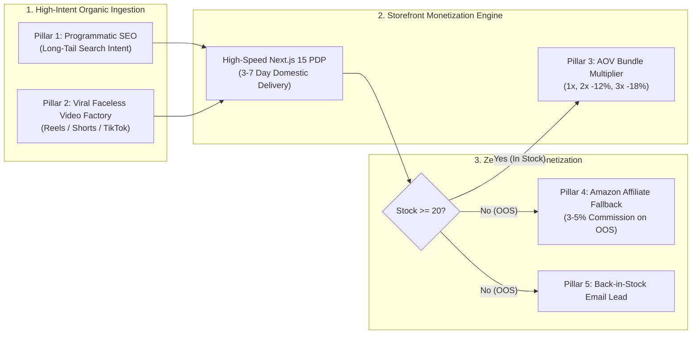
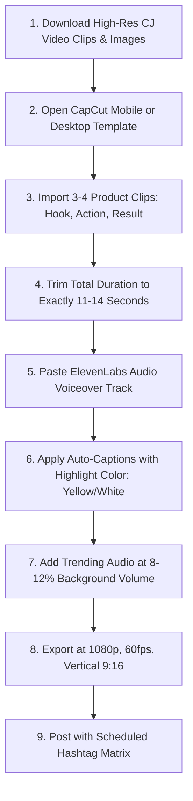
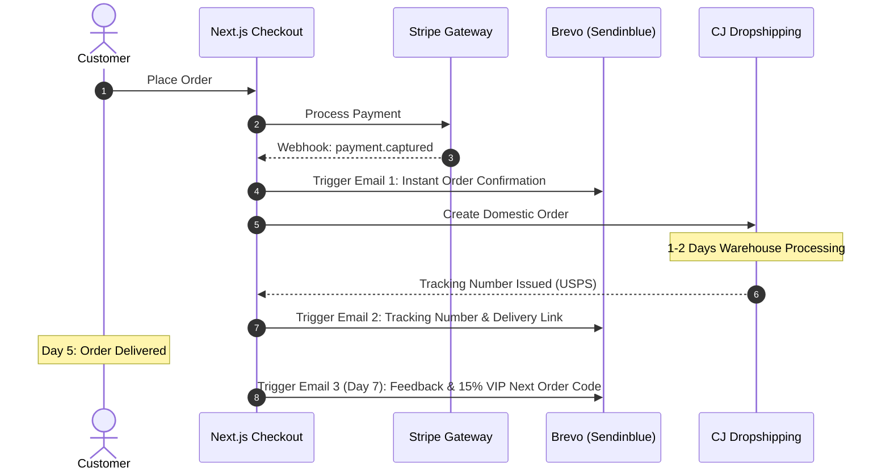

# ZERO-AD-SPEND ORGANIC GROWTH PLAYBOOK
## Programmatic SEO, Viral Video Factory & The AOV Multiplier Engine

**Document Version:** 1.0.0  
**Effective Date:** 2026-10-25  
**Strategy Focus:** 100% Organic, Zero Customer Acquisition Cost (CAC)  
**Target Market:** United States Domestic  
**Execution Runtime:** Antigravity (Local Ops Cron) + Next.js 15 Storefront  
**Operational Time Commitment:** 2–3 Hours / Week  

---

## 1. Executive Summary & Growth Philosophy

### 1.1 The Paid Ad Trap in Dropshipping
Traditional dropshipping operations burn between 40% and 65% of gross top-line revenue on Meta and TikTok ads. In an environment with volatile CPMs ($25–$45 in US e-commerce) and strict ad account bans, paid customer acquisition creates severe fragility:
- Ad fatigue forces continuous creative turnover and ad budget waste.
- One algorithm shift or tracking disruption (iOS 14.5+) turns a profitable store into a net-negative cash drain overnight.
- Return On Ad Spend (ROAS) below $2.2 \times$ mathematically wipes out dropshipping gross margins.

### 1.2 The Autonomous Zero-CAC Alternative
This platform eliminates paid ad spend entirely. Customer acquisition is powered by two compounding organic loops and one monetization safety net:



1. **Programmatic Long-Tail SEO:** Targeting specific problem-oriented search queries (e.g., *"heavy duty under desk cable tray no drill"*) where buyer intent is near 100% and competition is low.
2. **Viral Faceless Short-Form Video Factory:** Producing 10–15 second high-retention video demonstrations generated using AI scripts and voiceovers.
3. **The AOV Bundle Multiplier:** Exploiting \$0 incremental domestic shipping to offer 2-pack and 3-pack volume bundles that increase profit per order by $1.7\times$ to $2.4\times$.
4. **Zero-Bounce Affiliate Fallback:** Monetizing out-of-stock products via Amazon Associates, turning dead inventory into pure passive commission.

---

## 2. Growth Channel Priority Matrix

| Growth Channel | Effort to Launch | Time to First Results | Expected Monthly Visitors (Month 6) | Blended CAC | Priority |
|---|---|---|---|---|---|
| **Viral Short-Form Video** (TikTok/Reels/Shorts) | Low (10 min/video) | 1–3 Weeks | 25,000–50,000 | \$0.00 | **P0 (Immediate)** |
| **AOV Bundle Drawer** (On-Page Upselling) | Zero (Automated) | Day 1 | N/A (Conversion Uplift) | \$0.00 | **P0 (Immediate)** |
| **Programmatic Long-Tail SEO** (JSON-LD + ISR) | Low (Auto-built) | 60–90 Days | 15,000–30,000 | \$0.00 | **P1 (Compounding)** |
| **Amazon Affiliate Fallback** (OOS Traffic) | Zero (Auto-redirect) | Day 1 | 1,000–3,000 | \$0.00 | **P1 (Defense)** |
| **Back-in-Stock Email Capture** (Brevo free tier) | Low (Static form) | 30 Days | 500–1,500 leads | \$0.00 | **P2 (Retention)** |

---

## 3. Pillar 1: Programmatic SEO Engine (Deep Dive)

### 3.1 Long-Tail Keyword Targeting Strategy
Generic head terms (*"desk organizer"*, *"kitchen storage"*) are heavily dominated by Amazon, Wayfair, and Target. We target 4-to-6 word problem-specific long-tail queries:

| Whitelisted Category | Target Long-Tail Keyword Pattern | Search Intent | Est. Monthly Volume | CPC Equivalent |
|---|---|---|---|---|
| **Workspace Ergonomics** | `best cable management tray for standing desk no drill` | Commercial | 1,600 | \$2.40 |
| **Workspace Ergonomics** | `heavy duty clamp on headphone holder with usb charger` | Transactional | 880 | \$1.85 |
| **Home Organization** | `clear stackable acrylic pantry bins with pull handles` | Transactional | 2,400 | \$3.10 |
| **Home Organization** | `under sink 2 tier expandable slide out organizer bathroom` | Commercial | 3,600 | \$2.90 |
| **Smart Ambient Lighting** | `motion sensor magnetic under cabinet lighting rechargeable` | Transactional | 5,400 | \$3.40 |
| **Smart Ambient Lighting** | `ultrawide curved monitor light bar wireless remote control` | Commercial | 1,900 | \$4.10 |
| **Everyday Gadgets** | `electric jar opener for weak hands and seniors` | Transactional | 4,200 | \$3.80 |
| **Everyday Gadgets** | `portable mini thermal label maker bluetooth for home office` | Transactional | 6,100 | \$2.60 |
| **Pet Problem-Solvers** | `washable waterproof back seat pet cover for trucks` | Commercial | 2,900 | \$3.25 |
| **Auto Care & Organization** | `leather car seat gap filler organizer with cup holder` | Transactional | 4,800 | \$2.15 |

### 3.2 AI-Generated SEO Architecture (Schema & Meta)

During every catalog synchronization, Antigravity generates and populates structured JSON-LD into the `product_seo` table:

```json
{
  "@context": "https://schema.org/",
  "@type": "Product",
  "name": "Under Desk No-Drill Steel Cable Management Tray",
  "image": [
    "https://cdn.cjdropshipping.com/products/example-hero-01.jpg",
    "https://cdn.cjdropshipping.com/products/example-detail-02.jpg"
  ],
  "description": "Heavy-duty carbon steel cable management tray designed for sit-stand desks. Clamps securely without drilling holes. Supports up to 22 lbs of power strips and heavy adapters.",
  "sku": "CJST-DESK-TRAY-BLK",
  "brand": {
    "@type": "Brand",
    "name": "WorkSpace Flow"
  },
  "offers": {
    "@type": "Offer",
    "url": "https://yourdomain.com/products/workspace-no-drill-cable-management-tray",
    "priceCurrency": "USD",
    "price": "29.99",
    "priceValidUntil": "2027-12-31",
    "itemCondition": "https://schema.org/NewCondition",
    "availability": "https://schema.org/InStock",
    "shippingDetails": {
      "@type": "OfferShippingDetails",
      "shippingRate": {
        "@type": "MonetaryAmount",
        "value": "0.00",
        "currency": "USD"
      },
      "shippingDestination": {
        "@type": "DefinedRegion",
        "addressCountry": "US"
      },
      "deliveryTime": {
        "@type": "ShippingDeliveryTime",
        "handlingTime": {
          "@type": "QuantitativeValue",
          "minValue": 1,
          "maxValue": 2,
          "unitCode": "DAY"
        },
        "transitTime": {
          "@type": "QuantitativeValue",
          "minValue": 2,
          "maxValue": 5,
          "unitCode": "DAY"
        }
      }
    },
    "hasMerchantReturnPolicy": {
      "@type": "MerchantReturnPolicy",
      "applicableCountry": "US",
      "returnPolicyCategory": "https://schema.org/MerchantReturnFiniteReturnWindow",
      "merchantReturnDays": 30,
      "returnMethod": "https://schema.org/ReturnByMail",
      "returnFees": "https://schema.org/FreeReturn"
    }
  }
}
```

### 3.3 FAQPage Structured Data (Zero-Cost SERP Real Estate)

Google displays expandable FAQ rich snippets for pages with valid `FAQPage` schema, pushing competitors down the page:

```json
{
  "@context": "https://schema.org",
  "@type": "FAQPage",
  "mainEntity": [
    {
      "@type": "Question",
      "name": "How fast does this cable tray ship?",
      "acceptedAnswer": {
        "@type": "Answer",
        "text": "All orders ship directly from our domestic US warehouse in Chino, California via USPS Ground. Typical transit time is 3 to 7 business days with end-to-end tracking."
      }
    },
    {
      "@type": "Question",
      "name": "Does this require drilling holes into my desktop?",
      "acceptedAnswer": {
        "@type": "Answer",
        "text": "No. It uses heavy-duty, silicone-padded C-clamps that securely attach to desktops from 0.4 inches up to 2.4 inches thick without leaving marks or scratches."
      }
    },
    {
      "@type": "Question",
      "name": "Can it hold heavy surge protectors and power bricks?",
      "acceptedAnswer": {
        "@type": "Answer",
        "text": "Yes. Engineered from 2mm cold-rolled carbon steel, the tray supports up to 22 lbs (10 kg), accommodating large surge protectors and heavy charging bricks easily."
      }
    }
  ]
}
```

---

## 4. Pillar 2: Viral Faceless Video Factory (SOP)

### 4.1 The 3-Script Production Formula

For every active product, Antigravity generates three distinct script archetypes tailored for short-form retention algorithms (TikTok, Reels, Shorts).

#### Example Product: Magnetic Rechargeable Under-Cabinet LED Bar
- **Wholesale:** \$8.50 | **Retail (1x):** \$24.99 | **US Domestic Stock:** 420 units | **Shipping:** USPS 3–5 days (\$0.00)

```carousel
### Script 1: The Visual Problem Hook (12 Seconds)
**Objective:** Disrupt passive doomscrolling in the first 1.5 seconds by showing a relatable kitchen frustration.

- **0:00 - 0:02 (Visual Hook):** Fast clip: Hand groping around in a pitch-black pantry or dark kitchen counter, knocking over a spice jar. Large red text overlay: *"Stop cooking in the dark."*
- **0:02 - 0:07 (Demonstration):** Quick click sound effect. Stick magnetic strip under cabinet, snap LED bar in place. Room instantly bathes in warm, high-CRI light.
- **0:07 - 0:10 (Key Benefit):** Show hand passing under; sensor lights up instantly. Text: *"Motion sensor • USB rechargeable • Zero wiring"*.
- **0:10 - 0:12 (CTA):** Show 2-pack bundle packaging on counter. Text: *"US domestic delivery in 3-5 days. Link in bio."*
<!-- slide -->
### Script 2: Before & After Transformation (14 Seconds)
**Objective:** Leverage satisfying aesthetic makeover psychology to generate high saves and shares.

- **0:00 - 0:03 (Before):** Wide shot of dull, flat kitchen at night. Depressing, dark countertops. Lo-fi audio. Text: *"Renting and can't install expensive lighting?"*
- **0:03 - 0:08 (Transformation):** ASMR peel sound: peeling 3M backing tape. ASMR snap sound: magnetic attachment. Triple tap on dimmer switch to show 3 color temperatures.
- **0:08 - 0:12 (After):** Wide shot showing kitchen glowing like a high-end luxury architectural digest spread.
- **0:12 - 0:14 (CTA):** Voiceover: *"Under $25, zero tools, ships from California. Check our bio."*
<!-- slide -->
### Script 3: The Honest "I Tested It" Review (15 Seconds)
**Objective:** Build high trust by addressing objections (battery life, mounting strength) immediately.

- **0:00 - 0:03 (Hook):** Direct product to camera. Text: *"I bought this viral kitchen light so you don't have to."*
- **0:03 - 0:08 (Stress Test):** Firmly tug on the light bar while mounted to show magnetic strength doesn't budge. Plug in USB-C cable to show charging indicator.
- **0:08 - 0:12 (The Verdict):** Show motion sensor activating across 10 feet in the dark. *"Lasts 60 days on motion mode. Total game changer for rentals."*
- **0:12 - 0:15 (CTA):** Screen recording of bundle selector (*"Grab the 2-pack to do both sides of your kitchen"*). Link in bio.
```

### 4.2 ElevenLabs Voiceover Settings
To maintain a high-trust, non-robotic tone:
- **Voice Model:** `Eleven Multilingual v2`
- **Recommended Voice:** *"Adam - Deep, Grounded, Natural Everyday Guy"* or *"Rachel - Calm, Clear, Authentic Lifestyle"*
- **Stability:** `0.55` (prevents monotone delivery while ensuring consistency)
- **Clarity / Similarity Enhancement:** `0.78`
- **Style Exaggeration:** `0.00` (neutral, conversational, not hype-heavy)

### 4.3 10-Minute Video Creation SOP (CapCut Workflow)



### 4.4 Hashtag Matrix Architecture
Never use generic spam tags like `#fyp` or `#viral`. Every post uses a disciplined 8-tag formula:
- **3 Problem/Niche Tags:** `#kitchenorganization #rentalfriendly #smartlighting`
- **3 Product Intent Tags:** `#cabinetlights #homehacks #amazonfinds`
- **2 Broad Category Tags:** `#homedecor #interiorstyling`

---

## 5. Pillar 3: AOV Bundle Multiplier Engine

### 5.1 The Economics of Bundling with \$0 Domestic Freight
In cross-border dropshipping, ordering 2 units doubles your shipping fee ($5.50 \times 2 = $11.00). In contrast, US domestic packages under 1 lb shipped via USPS Ground Advantage feature negligible incremental freight weight tiers.

**Because incremental freight is \$0.00, volume discounts deliver pure profit expansion:**

| Product Title | Wholesale ($C_w$) | Shipping ($C_s$) | 1x Tier (Std) | 1x Profit | 2x Bundle (-12%) | 2x Profit | Profit Lift | 3x Bundle (-18%) | 3x Profit | Profit Lift |
|---|---|---|---|---|---|---|---|---|---|---|
| **No-Drill Cable Tray** | \$9.99 | \$0.00 | \$24.99 | \$12.36 | \$43.98 | \$20.91 | **+1.69x** | \$61.47 | \$29.47 | **+2.38x** |
| **Magnetic LED Light Bar** | \$8.50 | \$0.00 | \$21.24 | \$10.51 | \$37.38 | \$17.77 | **+1.69x** | \$52.25 | \$25.04 | **+2.38x** |
| **Adjustable Laptop Stand** | \$12.40 | \$0.00 | \$30.99 | \$15.34 | \$54.54 | \$25.96 | **+1.69x** | \$76.24 | \$36.57 | **+2.38x** |
| **Car Seat Gap Organizer** | \$8.20 | \$0.00 | \$20.49 | \$10.14 | \$36.06 | \$17.15 | **+1.69x** | \$50.41 | \$24.16 | **+2.38x** |
| **Electric Portable Lint Shaver** | \$9.20 | \$0.00 | \$22.99 | \$11.38 | \$40.46 | \$19.24 | **+1.69x** | \$56.56 | \$27.11 | **+2.38x** |

### 5.2 Storefront Bundle Drawer UX Wireframe

```
+-----------------------------------------------------------+
|  [ ] 1x Single Unit                 $24.99                |
|      Standard Retail Price                                |
+-----------------------------------------------------------+
|  [*] 2x Double Pack (MOST POPULAR)  $43.98  [ SAVE 12% ]  |
|      $21.99 / each - Perfect for dual-desk setups         |
|      *** Free 3-7 Day Domestic Delivery Included ***       |
+-----------------------------------------------------------+
|  [ ] 3x Multi-Room Pack (BEST VALUE) $61.47 [ SAVE 18% ]  |
|      $20.49 / each - Complete Home & Office Solution       |
+-----------------------------------------------------------+
|  [   ADD SELECTED BUNDLE TO CART - SAVE UP TO $13.50   ]  |
+-----------------------------------------------------------+
```

---

## 6. Pillar 4: Zero-Bounce Affiliate Monetization (OOS Fallback)

### 6.1 The SEO Opportunity in Out-of-Stock SKUs
When dropshipping stores experience stockouts, they typically delete the product page or display a dead-end 404 error. This destroys accrued Google PageRank and frustrates visitors arriving from indexed search results.

Instead, when physical US warehouse stock drops below 20 units:
1. Storefront automatically switches the checkout button to an orange Amazon Associates button.
2. The user is redirected to the equivalent product on Amazon with your affiliate tag.
3. You earn a **3% to 4% commission** on the entire Amazon cart session without holding inventory, handling customer service, or paying transaction fees.

### 6.2 Amazon Associates Setup Guide
1. Register for free at `affiliate-program.amazon.com`.
2. Enter your primary storefront URL as the qualifying website.
3. When `ops_sync.py` identifies a low-stock product, it prints an automated search query URL:
   `https://www.amazon.com/s?k={Product_Title_Cleaned}`
4. Copy the ASIN product link with your store tag (e.g., `&tag=yourstore-20`) and paste it into the `fallback_affiliate_url` column in Supabase Studio.

### 6.3 Passive Affiliate Revenue Projections

| Out-of-Stock Monthly Pageviews | Outbound Click Rate (CTR) | Amazon Conversion Rate | Avg Amazon Order Size | Commission Rate | Monthly Passive Income |
|---|---|---|---|---|---|
| **500 visits** | 24% (120 clicks) | 9.5% (11 orders) | \$42.00 | 3.5% | **\$16.17** |
| **2,500 visits** | 26% (650 clicks) | 10.0% (65 orders) | \$48.00 | 3.5% | **\$109.20** |
| **10,000 visits** | 28% (2,800 clicks) | 11.0% (308 orders) | \$52.00 | 3.5% | **\$560.56** |

---

## 7. Pillar 5: Zero-Cost Email Capture & Post-Purchase Retention

### 7.1 Tech Stack Setup (Brevo Free Tier)
- **Account:** Free tier supports up to 300 automated emails/day (9,000/month), zero monthly cost.
- **Integration:** Next.js Server Action pushes subscriber email directly to Brevo API.

### 7.2 Post-Purchase Automated Trigger Flow



---

## 8. 90-Day Execution Roadmap & Growth Milestone Schedule

```mermaid
flowchart LR
    subgraph Month1 ["Month 1: Foundation & Seeding (Days 1-30)"]
        direction TB
        M1_1["Ingest Initial 10 Whitelisted Products"]
        M1_2["Publish 30 Faceless Videos (1/day)"]
        M1_3["Submit XML Sitemap to Google Search Console"]
        M1_4["Verify Stripe / PayPal 1-Click Payments"]
    end

    subgraph Month2 ["Month 2: Channel Traction (Days 31-60)"]
        direction TB
        M2_1["Identify Top 2 Viral Videos (>10k views)"]
        M2_2["Produce 3 Script Iterations per Winner"]
        M2_3["Expand Catalog to 30 Domestic SKUs"]
        M2_4["Review AOV Bundle Conversion Data"]
    end

    subgraph Month3 ["Month 3: Scaling & Compounding (Days 61-90)"]
        direction TB
        M3_1["First Long-Tail SEO Keywords Reach Page 1"]
        M3_2["Automate Affiliate Fallback for OOS SKUs"]
        M3_3["Reach Target: $5,000 Monthly Gross Revenue"]
        M3_4["Maintain 49.5% Net Margin at $0 Fixed Infra Cost"]
    end

    Month1 --> Month2 --> Month3
```



---

## 9. Growth Operations Weekly Checklist (CEO Dashboard)

To ensure this model remains sustainable within a **2 to 3-hour weekly time budget**, the CEO follows this strict calendar:

- [ ] **Monday Morning (20 min):** Trigger `python ops_sync.py` to audit US warehouse stock, prune low-inventory SKUs, and ingest new passing candidates.
- [ ] **Tuesday Evening (30 min):** Pick 2 active products; run ElevenLabs audio generation on their pre-written scripts from `product_video_scripts`.
- [ ] **Wednesday Evening (45 min):** Open CapCut; edit and export 3 short-form videos using CJ video clips and b-roll.
- [ ] **Thursday–Saturday (10 min/day):** Schedule posts to TikTok, Instagram Reels, and YouTube Shorts during peak US hours (6:00 PM – 8:30 PM EST).
- [ ] **Sunday Afternoon (15 min):** Check Supabase orders table, confirm all orders transitioned to `ORDER_CONFIRMED`, and review Google Search Console clicks.

---

## 10. Growth Anti-Patterns & Common Traps

| Anti-Pattern | Why It Kills the Business | Mandatory Enforcement |
|---|---|---|
| **Burning money on Meta/TikTok Ads early** | Dropshipping margins cannot absorb uncalibrated pixel testing costs; cash burn triggers premature shutdown. | **Zero paid ads until 50 organic orders prove product-market fit.** |
| **Adding cosmetics or supplements for fast virality** | High social views, but leads to FDA liability, severe customer complaints, and instant Stripe account closure. | **Zero tolerance: Automated category whitelist drops all topicals.** |
| **Targeting broad head SEO terms** | Competing against \$500M domains on *"ergonomic office chair"* wastes time and yields zero traffic. | **Only target 4+ word specific long-tail problem phrases.** |
| **Neglecting the Bundle Drawer** | Selling single units leaves 40% of potential profit on the table when shipping is free. | **Bundle selector must be expanded by default on mobile PDPs.** |
| **Deleting Out-of-Stock product URLs** | Discarding hard-earned SEO authority and backlinks. | **Never 404: Route OOS products to Amazon affiliate links or waitlists.** |

---

*End of Growth Playbook — Version 1.0.0*
