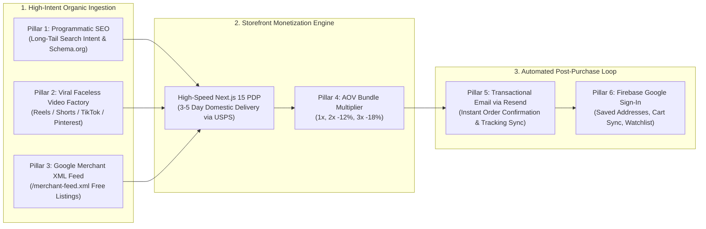

# ZERO-AD-SPEND ORGANIC GROWTH PLAYBOOK (VASTIRE)
## Programmatic SEO, Pinterest Catalog, Viral Video Factory & The AOV Multiplier Engine

**Document Version:** 2.0.0 (Production-Aligned)  
**Effective Date:** 2026-11-14  
**Strategy Focus:** 100% Organic, Zero Customer Acquisition Cost (CAC)  
**Target Market:** United States Domestic — 48 Contiguous States + DC  
**Fulfillment Promise:** 3–5 Business Day Domestic Delivery via USPS Ground Advantage  
**Execution Runtime:** Next.js 15 App Router (Vercel) + Neon PostgreSQL + Resend Email  
**Operational Time Commitment:** 2–3 Hours / Week  

---

## 1. Executive Summary & Growth Philosophy

### 1.1 The Paid Ad Trap in Dropshipping
Traditional dropshipping operations burn between 40% and 65% of gross top-line revenue on Meta and TikTok ads. In an environment with volatile CPMs ($25–$45 in US e-commerce) and strict ad account bans, paid customer acquisition creates severe fragility:
- Ad fatigue forces continuous creative turnover and ad budget waste.
- One algorithm shift or tracking disruption (iOS 14.5+) turns a profitable store into a net-negative cash drain overnight.
- Return On Ad Spend (ROAS) below $2.2 \times$ mathematically wipes out dropshipping gross margins.

### 1.2 The Autonomous Zero-CAC Alternative
Vastire eliminates paid ad spend entirely. Customer acquisition is powered by two compounding organic loops and one monetization safety net:



1. **Programmatic Long-Tail SEO:** Targeting specific problem-oriented search queries (e.g., *"heavy duty under desk cable tray no drill"*) where buyer intent is high and competition is low.
2. **Viral Faceless Short-Form Video Factory & Pinterest Pins:** Producing 10–15 second high-retention video demonstrations generated using AI scripts and automated Pinterest bulk pin feeds (`generate_pinterest_csv.js`).
3. **Google Merchant Center Free Listings:** Automated static XML feed (`/merchant-feed.xml`) keeping Google Shopping listings in sync with live inventory and pricing.
4. **The AOV Bundle Multiplier:** Exploiting \$0 incremental domestic shipping to offer 2-pack and 3-pack volume bundles that increase profit per order by $1.7\times$ to $2.4\times$.
5. **Zero-Touch Post-Purchase Engagement:** Instant transactional confirmations and tracking dispatches powered by Resend (`storefront/src/lib/email.ts`).

---

## 2. Growth Channel Priority Matrix

| Growth Channel | Effort to Launch | Time to First Results | Expected Monthly Visitors (Month 6) | Blended CAC | Priority |
|---|---|---|---|---|---|
| **Google Merchant Free Listings** (`/merchant-feed.xml`) | Zero (Automated XML) | 1–2 Weeks | 10,000–25,000 | \$0.00 | **P0 (Immediate)** |
| **AOV Bundle Selector** (1x, 2x -12%, 3x -18%) | Zero (Built-in) | Day 1 | Conversion Uplift (+35% AOV) | \$0.00 | **P0 (Immediate)** |
| **Pinterest Bulk Pins** (`vastire_pinterest_bulk_pins.csv`) | Low (Script-driven) | 2–4 Weeks | 15,000–35,000 | \$0.00 | **P0 (Immediate)** |
| **Programmatic Long-Tail SEO** (JSON-LD + ISR) | Low (Auto-built) | 60–90 Days | 15,000–30,000 | \$0.00 | **P1 (Compounding)** |
| **Viral Short-Form Video** (TikTok/Reels/Shorts) | Low (10 min/video) | 1–3 Weeks | 25,000–50,000 | \$0.00 | **P1 (High Reach)** |
| **Customer Accounts & Watchlist Sync** (Firebase Auth) | Zero (Automated) | Day 1 | Retention Uplift (+20% LTV) | \$0.00 | **P2 (Retention)** |

---

## 3. Pillar 1: Programmatic SEO & Structured Data

### 3.1 Long-Tail Keyword Targeting Strategy
Generic head terms (*"desk organizer"*, *"kitchen storage"*) are heavily dominated by Amazon, Wayfair, and Target. We target 4-to-6 word problem-specific long-tail queries:

| Approved Category | Target Long-Tail Keyword Pattern | Search Intent | Est. Monthly Volume | CPC Equivalent |
|---|---|---|---|---|
| **Workspace & Tech** | `best cable management tray for standing desk no drill` | Commercial | 1,600 | \$2.40 |
| **Workspace & Tech** | `heavy duty clamp on headphone holder with usb charger` | Transactional | 880 | \$1.85 |
| **Home & Kitchen** | `clear stackable acrylic pantry bins with pull handles` | Transactional | 2,400 | \$3.10 |
| **Home & Kitchen** | `under sink 2 tier expandable slide out organizer bathroom` | Commercial | 3,600 | \$2.90 |
| **Smart Lighting** | `motion sensor magnetic under cabinet lighting rechargeable` | Transactional | 5,400 | \$3.40 |
| **Smart Lighting** | `ultrawide curved monitor light bar wireless remote control` | Commercial | 1,900 | \$4.10 |
| **Outdoor & Patio** | `portable ultra lightweight camping lantern rechargeable` | Transactional | 3,200 | \$2.95 |
| **Everyday Carry & Auto** | `leather car seat gap filler organizer with cup holder` | Transactional | 4,800 | \$2.15 |

### 3.2 Automated JSON-LD Architecture
During catalog rendering, Next.js injects valid Schema.org `Product`, `Offer`, `AggregateRating`, and `FAQPage` JSON-LD blocks:
- `brand` set to `"Vastire"`.
- `shippingDetails` configured to `USPS Ground Advantage (3 to 5 business days)` with `shippingRate: 0.00 USD` for the 48 Contiguous US States.
- `hasMerchantReturnPolicy` configured to a 30-day return policy and pre-fulfillment 30-minute grace window.

---

## 4. Pillar 2: Google Merchant Center & Pinterest Catalog Feeds

### 4.1 Google Merchant Center XML Feed (`/merchant-feed.xml`)
- Served dynamically from [`storefront/src/app/merchant-feed.xml/route.ts`](file:///c:/Users/bodha/OneDrive/Desktop/DropShipping/storefront/src/app/merchant-feed.xml/route.ts).
- Automatically filters out inactive products and any variant with $\le 15$ units of US warehouse stock (`us_warehouse_stock > 15`).
- Generates compliant Google Shopping XML attributes: `<g:id>`, `<g:title>`, `<g:description>`, `<g:link>`, `<g:image_link>`, `<g:availability>`, `<g:price>`, `<g:brand>Vastire</g:brand>`, `<g:condition>new</g:condition>`, and `<g:shipping>`.

### 4.2 Pinterest Bulk Pins CSV Generator (`generate_pinterest_csv.js`)
- Runs from the project root:
  ```powershell
  node generate_pinterest_csv.js
  ```
- Outputs `vastire_pinterest_bulk_pins.csv` containing pre-formatted Title, Description, Destination URL, Image URL, and Category mapping.
- Directly uploadable to the Pinterest Business Bulk Pin Scheduler to distribute 90+ product pins across themed boards in minutes.

---

## 5. Pillar 3: The AOV Bundle Multiplier Engine

### 5.1 The Economics of Free Incremental Freight
Because CJ Dropshipping US domestic warehouses package multi-unit orders together, incremental shipping cost on a 2nd or 3rd unit is often \$0.00 or marginal. Vastire exploits this unit economic asymmetry to pass aggressive discounts to customers while dramatically increasing net profit dollars per transaction:

| Unit Tier | Customer Offer | Multiplier vs. Base | Typical Retail Price | Total COGS (Wholesale + Freight) | PayPal Fee + RTO (11.5%) | Net Profit (\$) | Net Margin (%) |
|---|---|---|---|---|---|---|---|
| **Tier 1 (1x)** | Standard Retail | $1.00\times$ | **\$24.99** | \$11.50 | \$3.36 | **\$10.13** | **40.5%** |
| **Tier 2 (2x)** | **Save 12% Total** | $1.76\times$ | **\$43.99** | \$18.20 | \$5.55 | **\$20.24** | **46.0%** |
| **Tier 3 (3x)** | **Save 18% Total** | $2.46\times$ | **\$61.49** | \$24.80 | \$7.56 | **\$29.13** | **47.4%** |

### 5.2 Storefront UI Implementation
- On every Product Detail Page (`/products/[slug]`), the bundle selector is prominent.
- Selecting Tier 2 ("Buy 2 — Save 12%") updates the price, displays total dollar savings, and pre-selects the bundle for 1-click PayPal checkout.
- Implemented in [`storefront/src/lib/bundlePricing.ts`](file:///c:/Users/bodha/OneDrive/Desktop/DropShipping/storefront/src/lib/bundlePricing.ts).

---

## 6. Pillar 4: Transactional Engagement & Retention

### 6.1 Transactional Email via Resend (`email.ts`)
- Automatically dispatches upon successful PayPal payment capture:
  - Immediate branded order confirmation email with internal order number (`ORD-XXXXX`), itemized receipt, and shipping address.
  - Transparent messaging highlighting the **30-minute pre-fulfillment grace period** and 3–5 day USPS Ground Advantage fulfillment window.
- When carrier tracking numbers are synced via `/api/cron/sync-cj`, shipping confirmation emails provide direct USPS tracking links.

### 6.2 Customer Account & Persistent State
- Customers authenticate via Google Sign-In using Firebase Auth (`firebase.ts`).
- Cart items (`user_carts`) and watchlist items (`user_watchlists`) are automatically synchronized to Neon PostgreSQL across devices.
- Repeat buyers can view their entire order history and tracking statuses directly at `/orders`.

---

## 7. Weekly Growth Operations Checklist

Execute this 2-hour checklist every week:

- [ ] **Monday Morning (20 min):** Verify Vercel Cron status for `/api/cron/sync-cj`; confirm active catalog stock remains compliant ($> 15$ units floor).
- [ ] **Tuesday Evening (30 min):** Pick 2 top-performing products; generate 2 short-form video hooks or product highlights using CJ media assets and ElevenLabs audio.
- [ ] **Wednesday Evening (30 min):** Upload fresh pins to Pinterest Business boards using `generate_pinterest_csv.js`.
- [ ] **Thursday–Saturday (10 min/day):** Post short-form videos to Instagram Reels, TikTok, and YouTube Shorts during peak US hours (6:00 PM – 8:30 PM EST).
- [ ] **Sunday Afternoon (15 min):** Check Google Merchant Center feed diagnostics (`/merchant-feed.xml`) and review weekly net revenue and profit in the Admin Command Center (`/admin/orders`).

---

## 8. Growth Anti-Patterns & Traps to Avoid

| Anti-Pattern | Why It Kills the Business | Mandatory Policy |
|---|---|---|
| **Burning money on Meta/TikTok Ads early** | High CPMs ($30+) destroy bootstrapped margins before organic ranking settles. | **Zero paid ads until 100 organic orders prove unit economics.** |
| **Adding cosmetics, topicals, or apparel** | High return rates (25–35%) and FDA liabilities trigger payment processor holds. | **Strictly adhere to the 5 approved non-perishable verticals.** |
| **Targeting broad 1-word head SEO terms** | Competing against Amazon on *"chair"* yields zero traffic and high bounce. | **Only target 4+ word specific long-tail problem phrases.** |
| **Neglecting the Bundle Drawer** | Selling single units leaves 40% of profit on the table when shipping is free. | **Bundle drawer is enabled and highlighted on all PDPs.** |
| **Promising international delivery** | Cross-border shipping destroys delivery SLAs and creates customer disputes. | **Strictly enforce Contiguous 48 US States fulfillment only.** |

---

*End of Growth Playbook — Version 2.0.0 (Production-Aligned)*
