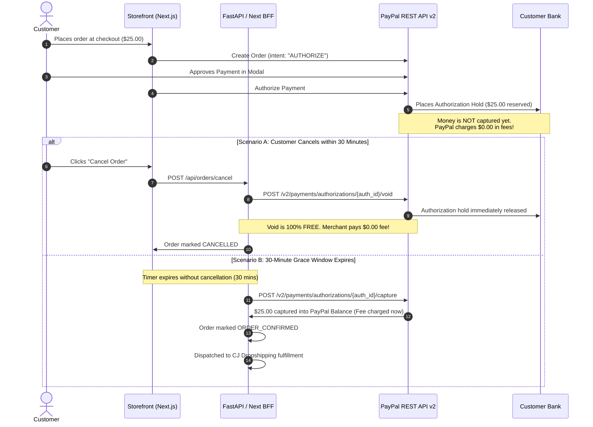

# 07 — Future Architectural Plans & Optimizations

This document records deferred architectural enhancements, payment gateway optimizations, and post-launch feature evolutions. Each plan details the trigger conditions, technical specifications, and migration steps for when business volume warrants implementation.

---

## Plan 1: PayPal Two-Step "Authorize & Capture" (Zero-Fee Grace Cancellations)

### 1. Context & Business Problem
* **Current Implementation:**
  * PayPal checkout uses **Immediate Capture** (`intent: "CAPTURE"`).
  * When a customer places an order, funds are settled immediately, and PayPal deducts its standard processing fee ($3.49\% + \$0.49$).
  * If the customer cancels within the 30-minute grace period, our backend calls PayPal's Refund API (`POST /v2/payments/captures/{capture_id}/refund`) to issue a **100% full refund**.
  * **Fee Consequence:** While the customer gets 100% of their money back, PayPal retains the original processing fee (~$1.20–$1.50 per cancelled order) from the merchant's balance.
* **Trigger Condition to Implement:**
  * Revisit when customer cancellation volume within the 30-minute grace window exceeds **3–5% of monthly transactions**, or when cumulative retained fees justify introducing background capture worker complexity.

---

### 2. Architecture & Technical Mechanism



---

### 3. Key Benefits vs. Operational Tradeoffs

| Factor | Immediate Capture (Current) | Authorize & Capture (Future Plan) |
| :--- | :--- | :--- |
| **Transaction Fee on 30-Min Cancellation** | Lost (~$1.20 to $1.50 retained by PayPal). | **$0.00.** Voiding an authorization incurs zero fees. |
| **Customer Experience** | 100% full refund credited to card/balance. | 100% authorization hold released instantly. |
| **System Complexity** | Low (single-step transaction at checkout). | Moderate (requires automated capture worker or admin trigger after 30 mins). |
| **Hold Expiration Window** | N/A (funds captured upfront). | PayPal guarantees authorizations for **3 days (72 hours)**, expandable up to 29 days. |

---

### 4. Implementation Specification & Required Code Changes

#### A. PayPal Order Creation (`intent: "AUTHORIZE"`)
In `storefront/src/app/api/orders/paypal/create/route.ts` and `src/services/paypal_service.py`:
Change:
```json
{
  "intent": "AUTHORIZE",
  "purchase_units": [...]
}
```

#### B. Storefront Button Handler
In `storefront/src/components/PayPalButton.tsx`:
Replace `actions.order.capture()` with `actions.order.authorize()`.

#### C. Database Schema Migration
Add authorization tracking columns to the `orders` table:
```sql
ALTER TABLE orders ADD COLUMN paypal_authorization_id VARCHAR(128);
ALTER TABLE orders ADD COLUMN authorized_at TIMESTAMP WITH TIME ZONE;
```

#### D. Void Endpoint on Grace Cancellation
In `storefront/src/app/api/orders/cancel/route.ts` and `src/services/paypal_service.py`:
```python
def void_authorization(self, authorization_id: str) -> Dict[str, Any]:
    """Void an authorized payment hold before capture (zero processing fees)."""
    token = self.get_access_token()
    url = f"{self.base_url}/v2/payments/authorizations/{authorization_id}/void"
    req = urllib.request.Request(url, data=b"{}")
    req.add_header("Authorization", f"Bearer {token}")
    req.add_header("Content-Type", "application/json")
    with urllib.request.urlopen(req, timeout=15) as resp:
        return json.loads(resp.read().decode("utf-8")) if resp.status == 200 else {"status": "VOIDED"}
```

#### E. Automated 30-Minute Capture Mechanism
Implement a lightweight scheduled background task (or Celery/FastAPI task / Vercel Cron) that polls for orders where:
$$\text{status} = \text{'AUTHORIZED'} \quad \text{AND} \quad \text{NOW}() - \text{authorized\_at} \ge 30\text{ minutes}$$
When triggered, it calls `POST /v2/payments/authorizations/{authorization_id}/capture`, settles the funds, transitions the order status to `ORDER_CONFIRMED`, and pushes the order to CJ Dropshipping.

---

## Plan 2: Post-Delivery Return & Exchange Architecture (RMA)

### 1. Context & Business Strategy
* **Current Policy:**
  * During the pre-launch and initial order validation phase, **no post-delivery returns or exchanges are offered on the UI**.
  * The only self-serve cancellation allowed is within the **30-minute pre-fulfillment grace period**.
* **Trigger Condition to Implement:**
  * Introduce only after processing 100+ live customer orders, evaluating defect rates from US domestic CJ warehouses, and reviewing customer feedback.

### 2. Proposed Architecture for Post-Delivery RMA:
* **Return Merchandise Authorization (RMA) Workflow:**
  * Customers submit a ticket with photo/video evidence of damaged, defective, or incorrect goods.
  * Integration with domestic return warehouse address or CJ dispute API (`POST /dispute/createDispute`).
  * Automated generation of USPS return shipping labels.
  * Options for Instant Store Credit vs. Original Payment Method Refund.
