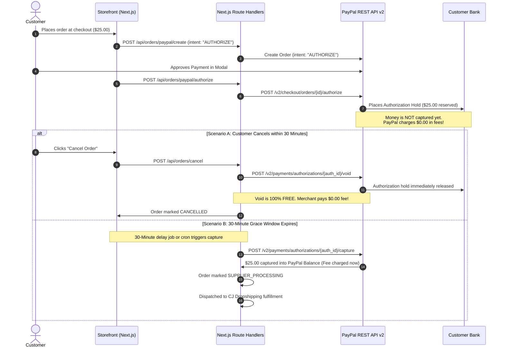

# 07 — Future Architectural Plans & Deferred Optimizations

This document records deferred architectural enhancements, payment gateway optimizations, and post-launch feature evolutions. Each plan details the trigger conditions, technical specifications, and implementation steps for when business volume warrants execution.

---

## Plan 1: PayPal Two-Step "Authorize & Capture" (Zero-Fee Grace Cancellations)

### 1. Context & Business Problem
* **Current Production Implementation:**
  * PayPal checkout uses **Immediate Capture** (`intent: "CAPTURE"`).
  * When a customer places an order, funds are settled immediately, and PayPal deducts its standard processing fee ($3.49\% + \$0.49$).
  * If the customer cancels within the 30-minute grace period, our backend calls PayPal's Refund API (`POST /v2/payments/captures/{capture_id}/refund`) via [`storefront/src/app/api/orders/cancel/route.ts`](file:///c:/Users/bodha/OneDrive/Desktop/DropShipping/storefront/src/app/api/orders/cancel/route.ts) to issue a **100% full refund**.
  * **Fee Consequence:** While the customer gets 100% of their money back, PayPal retains the original processing fee (~$1.20–$1.50 per cancelled order) from the merchant's balance.
* **Trigger Condition to Implement:**
  * Revisit when customer cancellation volume within the 30-minute grace window exceeds **3–5% of monthly transactions**, or when cumulative retained fees justify introducing background capture worker complexity.

---

### 2. Architecture & Technical Mechanism



---

### 3. Key Benefits vs. Operational Tradeoffs

| Factor | Immediate Capture (Current Production) | Authorize & Capture (Future Plan) |
| :--- | :--- | :--- |
| **Transaction Fee on 30-Min Cancellation** | Lost (~$1.20 to $1.50 retained by PayPal). | **$0.00.** Voiding an authorization incurs zero fees. |
| **Customer Experience** | 100% full refund credited to card/balance. | 100% authorization hold released instantly. |
| **System Complexity** | Low (single-step transaction at checkout). | Moderate (requires delayed capture worker via Upstash QStash or Vercel Cron). |
| **Hold Expiration Window** | N/A (funds captured upfront). | PayPal guarantees authorizations for **3 days (72 hours)**, expandable up to 29 days. |

---

### 4. Implementation Specification & Required Code Changes

#### A. PayPal Order Creation (`intent: "AUTHORIZE"`)
In [`storefront/src/app/api/orders/paypal/create/route.ts`](file:///c:/Users/bodha/OneDrive/Desktop/DropShipping/storefront/src/app/api/orders/paypal/create/route.ts):
```typescript
const orderPayload = {
  intent: "AUTHORIZE",
  purchase_units: [
    {
      reference_id: orderNumber,
      custom_id: commitmentHash,
      amount: {
        currency_code: "USD",
        value: totalRetail.toFixed(2),
      },
    },
  ],
};
```

#### B. Storefront Button Handler
In [`storefront/src/components/PayPalButton.tsx`](file:///c:/Users/bodha/OneDrive/Desktop/DropShipping/storefront/src/components/PayPalButton.tsx):
Replace `actions.order.capture()` with `actions.order.authorize()`.

#### C. Database Schema Migration (Neon PostgreSQL)
Add authorization tracking columns to the `orders` table:
```sql
ALTER TABLE orders ADD COLUMN IF NOT EXISTS paypal_authorization_id VARCHAR(128);
ALTER TABLE orders ADD COLUMN IF NOT EXISTS authorized_at TIMESTAMPTZ;
```

#### D. Void Endpoint on Grace Cancellation
In [`storefront/src/lib/paypal.ts`](file:///c:/Users/bodha/OneDrive/Desktop/DropShipping/storefront/src/lib/paypal.ts) and [`storefront/src/app/api/orders/cancel/route.ts`](file:///c:/Users/bodha/OneDrive/Desktop/DropShipping/storefront/src/app/api/orders/cancel/route.ts):
```typescript
export async function voidPayPalAuthorization(params: {
  creds: PayPalCredentials;
  accessToken: string;
  authorizationId: string;
}): Promise<boolean> {
  const res = await fetch(
    `${params.creds.baseUrl}/v2/payments/authorizations/${encodeURIComponent(params.authorizationId)}/void`,
    {
      method: "POST",
      headers: {
        Authorization: `Bearer ${params.accessToken}`,
        "Content-Type": "application/json",
      },
      signal: AbortSignal.timeout(10_000),
    }
  );
  return res.ok || res.status === 204;
}
```

#### E. Automated 30-Minute Capture Mechanism
Use **Upstash QStash** (or a scheduled Vercel Cron worker polling every 5 minutes):
```sql
SELECT id, internal_order_number, paypal_authorization_id, total_retail
FROM orders
WHERE status = 'AUTHORIZED'
  AND authorized_at <= NOW() - INTERVAL '30 minutes';
```
For each matching order, invoke `/v2/payments/authorizations/{id}/capture`, settle the funds, transition to `SUPPLIER_PROCESSING`, and submit the order to CJ Dropshipping.

---

## Plan 2: Post-Delivery Return & Exchange Architecture (RMA)

### 1. Context & Business Strategy
* **Current Production Policy:**
  * During initial launch, **no post-delivery returns or exchanges are offered on the UI**.
  * The only self-serve cancellation allowed is within the **30-minute pre-fulfillment grace period**.
* **Trigger Condition to Implement:**
  * Introduce only after processing 100+ live customer orders, evaluating defect rates from US domestic CJ warehouses, and reviewing customer feedback.

### 2. Proposed Architecture for Post-Delivery RMA:
* **Return Merchandise Authorization (RMA) Workflow:**
  * Customers submit a ticket with photo/video evidence of damaged, defective, or incorrect goods.
  * Integration with domestic return warehouse address or CJ dispute API (`POST /dispute/createDispute`).
  * Automated generation of USPS return shipping labels.
  * Options for Instant Store Credit vs. Original Payment Method Refund.

---

## Plan 3: Multi-Warehouse Expansion (East & West Coast Routing)

### 1. Context & Business Strategy
* **Current Production Implementation:**
  * Orders query CJ US domestic warehouse stock in bulk and route through default USPS US-to-US lines.
* **Future Enhancement:**
  * When CJ exposes discrete warehouse locations (e.g., Chino, CA vs. New Jersey), implement proximity-based routing matching the customer's shipping state prefix with the nearest US warehouse, reducing transit times to 2–3 business days.

---

*End of Future Architectural Plans — Version 2.0.0*
